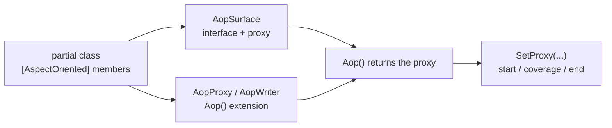

# AOP — Quick Start

The **aop** feature of `VeloxDev.Core` adds aspect-oriented interception to an ordinary `partial` class. Mark a public member with `[AspectOriented]`; at compile time the source generator emits three artifacts: a mirror interface, a sealed proxy class implementing it, and an `Aop()` extension returning one cached proxy per target instance.

The proxy is ordinary C# in your own assembly. There is no `System.Reflection.DispatchProxy`, no `Reflection.Emit`, and no per-call method lookup: a member with no hooks calls the target directly.

Each intercepted member takes one `AspectHooks` set with up to three delegates:

| Stage | When it runs | What its result does |
|---|---|---|
| `start` | before the member | passed to `coverage` as `previous` |
| `coverage` | instead of the member body, when non-null | becomes the member's result |
| `end` | after the member | discarded |

## Sub-pages

| Page | What it covers |
|---|---|
| [Prerequisites](00_prerequisites/index.md) | Supported target frameworks, SDK, language version, required services |
| [Install](01_install/index.md) | `VeloxDev.Core` plus the generator analyzer, in and out of this repository |
| [Define the Aspect Target](02_define-the-aspect-target/index.md) | The `partial` class, member rules, and the generated surface |
| [Install Hooks](03_install-hooks/index.md) | `Aop()`, `SetProxy`, the three stages, and `Aop.GetTarget` |
| [Verify and Complete Code](04_verify-and-complete-code/index.md) | The shipped demos, a complete console program, recorded output, and the Run Declaration |

## Evidence

- Tests: `Src/Core/VeloxDev.Core.Test/AspectOriented/AopProxyTests.cs` and `AopFixture.cs` pin stage order, replacement semantics, exception paths, caching, and collectability.
- Demos: `Examples/AOP/WPF/Demo` and `Examples/AOP/Avalonia/Demo`.
- Runtime: `Src/Core/VeloxDev.Core/AspectOriented/`.
- Generator: `Src/Generators/VeloxDev.Core.Generator/AopSurface.cs`, `AopProxy.cs`, `Writers/AopWriter.cs`.
