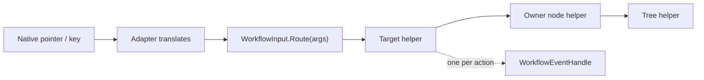

# Canvas Input and Navigation

A VeloxDev workflow is drawn on a canvas, and the canvas is not a platform control: the adapter under it owns the gestures, while Core owns one standard input vocabulary that every platform speaks. This feature is that split — how a native pointer or key becomes a routed, cancellable event, how the built-in gestures pan and zoom, and how a host moves the viewport to a node it names.

## What the feature covers

- **One input route per tree.** `WorkflowInput.For(tree)` is the single object an adapter forwards standard events into and a host subscribes through. It routes a `PointerEventArgs` or `KeyEventArgs` from the target up to the tree.
- **A handle per action.** Every routed event carries a `WorkflowEventHandle`; `PreventDefault` stands the framework's own hand down, `StopPropagation` stops the walk to ancestors.
- **Gestures stay in the adapter.** Panning, Ctrl+wheel zoom, node drag and connection drag are adapter behaviors that issue model commands. Core only routes input and supplies the geometry.
- **Navigation is a capability, not a dependency.** An attached surface registers `IWorkflowSurfaceScroller` and `IWorkflowSurfaceNavigator`; `Locate()` and wheel take-over use them when present and do nothing when not.

## Where each piece lives

| Layer | Types | Responsibility |
|---|---|---|
| Core | `WorkflowInput`, `IInputEvents`, `InputRelay`, `Pointer*EventArgs`, `Key*EventArgs`, `InputKey`, `InputModifiers`, `MouseButton`, `WorkflowEventHandle` | The route, the one handle, the standard argument shape. No gesture. |
| Core | `IWorkflowSurfaceScroller`, `IWorkflowSurfaceNavigator`, `SurfaceScrollerCore`, `WorkflowSurfaceMath`, `WorkflowNavigationEx` | Turning a wheel delta into a scroll, centring a canvas-local point, locating a component. |
| Core | `LinkHitTestEx`, `SlotHitTestEx`, `LinkCurve` | Shared geometric hit tests the adapters call; the link hit test uses the curve the view published. |
| WPF | `WorkflowSurfaceBehavior` | Resolves named parts, routes native input, owns pan / Ctrl+wheel zoom / wheel arbitration, registers the scroller and navigator. |
| WPF | `WorkflowNodeDragBehavior`, `WorkflowSlotConnectionBehavior`, `WorkflowCanvasTransformBehavior` | Per-view drag and connection gestures, plus the render-transform carrier the templates bind to. |

The other six adapters close the same role set with their own property systems. Type names are the same; the property system is not.

## Pages

- [Prerequisites](00_prerequisites/index.md) — supported targets, packages and the runnable demo.
- [Surface setup](01_surface-setup/index.md) — attach the surface behavior and name the parts it needs.
- [Route input](02_route-input/index.md) — subscribe to the route, read the handle, take a wheel over.
- [Navigation](03_navigate/index.md) — pan, Ctrl+wheel zoom, `Locate()`, and the scroller/navigator capabilities.
- [Verification](04_verification/index.md) — run the demo, verify each behaviour, complete code and run declaration.

## The route at a glance

The chain is target first, ancestors next, tree last. A subscriber nearer the target runs before the framework's reaction and can cancel it; the same handle instance reaches every element, so an ancestor can read what the closer subscriber decided.

## Evidence

- Demo: `Examples/Workflow/WPF Trimmed/Demo/Views/Workflow/TreeView.xaml` and `TreeView.xaml.cs`; the full workbench at `Examples/Workflow/WPF/Demo/Views/Workflow/WorkflowView.xaml.cs` adds locate, Shift+wheel and veto examples.
- Tests: `Src/Test/Unit/Core/VeloxDev.Core.Test/WorkflowSystem/WorkflowInputTests.cs`, `WorkflowInputHandleTests.cs`, `SurfacePipelineTests.cs`, `WorkflowNavigationExTests.cs`; `Src/Test/Headless/VeloxDev.WPF.Headless.Tests/Tests/WorkflowSurfaceHeadlessTests.cs`.
