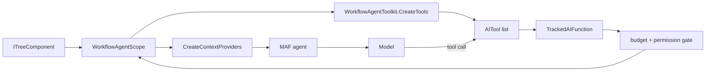

# Workflow Agent Tools

`WorkflowAgentScope` turns a workflow tree into a tool surface that a Microsoft Agent Framework (MAF) agent can call. The tools cover inspection, graph edits, execution, layout, analytics and state, and every call passes through one pipeline that counts it, gates it and reports it.

This quick start builds a scope over the dependency-free `TreeDefaultViewModel`, lists the tools by category, switches one off, and then wires a chat client so a model can call the rest.

## What you will build

- a `WorkflowAgentScope` from `tree.AsAgentScope()`;
- a filtered tool list from `CreateToolkit().CreateTools(WorkflowToolCategory…)`;
- a live conversation in which the model inspects and edits the graph.

## Pages

- [Setup](00_setup/index.md) — prerequisites, the package, and the scope configuration.
- [Usage](01_usage/index.md) — tool categories, the live switch, the chat-client wiring, and the complete program.

## How the pieces fit

The provider returned by `CreateContextProviders()` is the single source of tools. Do not also pass tools through `ChatOptions.Tools`: MAF unions the two lists without deduplicating by name, so a tool offered through both channels reaches the model twice.

## Related

- [Agent Safety and Budgets](../18_agent-safety-budgets/index.md) — the permission gate every tool call passes through.
- [Headless CLI](../23_headless-cli/index.md) — the same toolkit published over MCP without a GUI.
