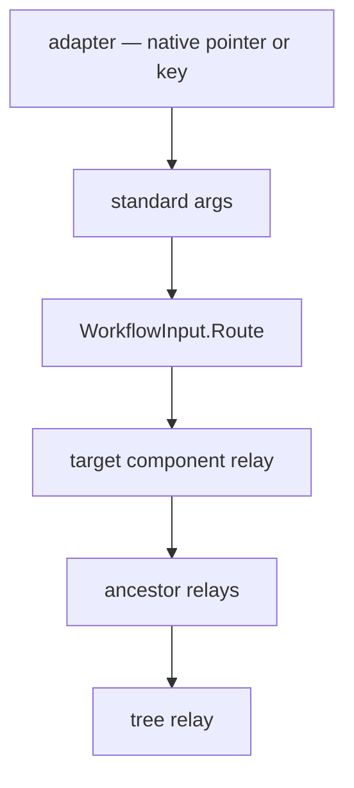

# Workflow System — GUI Input: the routed input surface

One standard pointer-and-keyboard surface, so a host writes an interaction once instead of once per GUI. The adapter decides **what** was hit (its gesture logic already knows) and hands the event to `WorkflowInput`; Core decides **who hears about it** — the target first, then its ancestors, every one of them seeing the same argument instance.

Core performs **no action of its own** on the route. Deleting a link, highlighting it, opening a menu are the host's, written where they can be seen and changed.

Sources: `Src/Core/VeloxDev.Core/WorkflowSystem/GUI/Events/Input/*.cs` (the 15 types), `GUI/Events/WorkflowInput.cs` (the route).



## `WorkflowInput` — the entry

**Signature:** `public sealed class WorkflowInput` (`GUI/Events/WorkflowInput.cs:31`). One instance per tree, created on first use and kept as long as the tree lives.

| Member | Signature | Notes |
|---|---|---|
| `For` | `static WorkflowInput For(IWorkflowTreeViewModel tree)` | The one way to get the tree's instance (`:53`) |
| constructor | `WorkflowInput(IWorkflowTreeViewModel tree)` | `null` throws `ArgumentNullException` (`:46`) |
| `Tree` | `IWorkflowTreeViewModel` | (`:60`) |
| `Route` | `void Route(PointerEventArgs e)` / `void Route(KeyEventArgs e)` | Expands the target's ancestor chain and dispatches down it (`:250,264`) |
| `PointerTarget` | `IWorkflowViewModel?` | Which component the pointer is on — the route's only persistent state (`:66`) |
| `HoveredLink` | `IWorkflowLinkViewModel?` | `PointerTarget as IWorkflowLinkViewModel` (`:69`) |
| `ConnectionSender` | `IWorkflowSlotViewModel?` | The port the drag started from (`:72`) |
| `PreviewReceiver` | `IWorkflowSlotViewModel?` | The candidate port under the pointer (`:75`) |
| `PreviewState` | `ConnectionPreviewState` | The current stage of the connection drag (`:78`) |
| `PreviewCheck` | `ConnectionCheck?` | The check for the candidate; `null` when there is no candidate. An invalid candidate still carries a check, so a view can explain the red band (`:84`) |
| `HitRadius` | `double` | Hit-test radius for curves; defaults to `LinkHitTestEx.DefaultHitRadius` (`:213`) |
| `IsSuspended` | `bool` | Set while a host menu is open; pointer tracking stops (`:220`) |
| `Scroller` | `IWorkflowSurfaceScroller?` | Written by an adapter while attached; how a subscriber scrolls after taking a wheel over (`:238`) |
| `Navigator` | `IWorkflowSurfaceNavigator?` | Written by an adapter while attached; how the surface centers a world point. `WorkflowNavigationEx`'s `node/slot/link.Locate()` calls it (`:249`) |

**Route order.** The target is dispatched first, then each ancestor up to the tree. Every element on the way sees the same argument instance — so one action has one `WorkflowEventHandle`, and an ancestor can read what a handler closer to the target decided.

**Locating an element.** `Navigator` is the absolute counterpart of `Scroller`: instead of a wheel delta it takes a world point and puts it at the viewport center. `WorkflowNavigationEx` turns a component into that point, so a host does not need the platform's scroll API:

```csharp
using VeloxDev.WorkflowSystem.StandardEx;

node.Locate();   // the node's rectangle center
slot.Locate();   // its parent node's rectangle center
link.Locate();   // the midpoint of its two endpoint nodes' centers
```

All three read model data only — a slot's measured anchor and a link's published curve are deliberately ignored — so an off-screen, unmeasured or not-yet-drawn element still reaches the center. It pans only, preserving the zoom, and returns `false` without changing anything when no surface is attached. A target outside the current extent grows the canvas (the adapter decides; WinForms' pan engine simply accepts the signed target).

## `IInputEvents` / `InputRelay`

**Signature:** `public interface IInputEvents { InputRelay Input { get; } }` (`Input/IInputEvents.cs`). The four helpers (`TreeHelper<T>`, `NodeHelper<T>`, `SlotHelper<T>`, `LinkHelper<T>`) implement it, so a host subscribes like this:

```csharp
((IInputEvents)link.GetHelper()).Input.PointerEntered += OnLinkEntered;
```

The capability is deliberately **not** a member of `IWorkflow…ViewModelHelper`: adding members there would break every existing implementer, and a helper with no interest in input should not have to answer for it.

| `InputRelay` event | Argument |
|---|---|
| `PointerEntered` / `PointerExited` / `PointerMoved` / `PointerPressed` / `PointerReleased` | `PointerEnteredEventArgs` and its siblings |
| `PointerWheelChanged` | `PointerWheelEventArgs` |
| `KeyDown` / `KeyUp` | `KeyDownEventArgs` / `KeyUpEventArgs` |

The `sender` is the relay, which is how a subscriber tells which element of the route it is hearing from.

## Connection drag preview

The route also owns the **connection drag**: `ConnectionSender`, `PreviewReceiver`, `PreviewState` and `PreviewCheck`. An adapter reports the candidate with `StandardSetPreviewReceiver` (usually `SlotHitTestEx.HitTest(tree, x, y)` while the rubber band covers the surface); Core computes the verdict, marks `SlotState.PreviewReceiver`, and calls `IConnectionPreviewLink.SetPreview` on the tree's `VirtualLink`.

| Event | Payload | When |
|---|---|---|
| `PreviewChanged` | `ConnectionPreviewEventArgs(Sender, Receiver, State, Check)` | Whenever the sender, the candidate or the stage changes — including the end of the drag (`None`). A link view paints the rubber band per stage; it does not decide the connection. |
| `PreviewValidating` | `ConnectionPreviewValidatingEventArgs(Sender, Receiver, Check)` | Once for each **new** candidate the framework would accept, before it is marked valid. `Reject(message)` turns the candidate red with `ConnectionRejectReason.RejectedByHost` for this preview only. Not raised for candidates the framework already refused, and not re-raised while the pointer stays on the same candidate unless `StandardRefreshConnectionPreview` is called. |

| Stage | Meaning |
|---|---|
| `None` | No drag is in progress. |
| `Started` | The sender is fixed; the pointer is not over a candidate. |
| `ValidTarget` | The pointer is over a slot the framework would accept. |
| `InvalidTarget` | The pointer is over a slot, but the connection would be refused (or the host rejected it for this preview). |

**The preview is not the verdict.** `PreviewValidating` can only tighten a framework pass into a red candidate; it can never turn a refusal green. The release-time `IWorkflowTreeEvents.Connecting` veto and `ValidateConnection` remain the final decision.

```csharp
// Source: Src/Core/VeloxDev.Core.Test/WorkflowSystem/WorkflowConnectionPreviewTests.cs
input.PreviewValidating += (_, e) =>
{
    if (!allow) e.Reject("still checking");
};

tree.GetHelper().SendConnection(sender);
tree.StandardSetPreviewReceiver(receiver);   // raises PreviewValidating once
tree.StandardSetPreviewReceiver(receiver);   // same candidate: no second call
allow = true;
tree.StandardRefreshConnectionPreview();      // forces the check again
```

### `SlotHitTestEx`

`public static class SlotHitTestEx` (`GUI/Interaction/SlotHitTestEx.cs`) finds the nearest **measured** slot anchor within a radius: `HitTest(tree, x, y, radius = DefaultHitRadius)` with `DefaultHitRadius = 12`. A slot whose anchor is still `double.NaN` is skipped; overlapping slots resolve to the nearest anchor. This exists because the rubber band is drawn over the whole surface, so the platform view under the pointer is often the surface itself and cannot answer "which slot".

```csharp
// Source: Src/Adapters/VeloxDev.WPF/Attached/Workflow/WorkflowSurfaceBehavior.cs:755
viewModel.StandardSetPreviewReceiver(
    SlotHitTestEx.HitTest(viewModel, pointer.Horizontal, pointer.Vertical));
```

## The fifteen types

| Group | Types |
|---|---|
| Capability / relay | `IInputEvents`, `InputRelay` |
| Pointer | `PointerEventArgs` + `PointerEntered` / `PointerExited` / `PointerMoved` / `PointerPressed` / `PointerReleased` / `PointerWheel` args |
| Keyboard | `KeyEventArgs`, `KeyDownEventArgs`, `KeyUpEventArgs`, `InputKey` |
| Value types | `MouseButton`, `InputModifiers` |

### `PointerEventArgs` (abstract)

| Member | Type | Notes |
|---|---|---|
| `Position` | `Anchor` | Surface coordinates; its `Layer` is the **source view's** layer — a pointer has no layer of its own |
| `Modifiers` | `InputModifiers` | |
| `Source` | `object?` | The view the input came from; what used to be the event's `sender` |
| `Target` | `IWorkflowViewModel?` | What the adapter resolved the pointer onto; `null` over empty canvas. **Every** element on the route sees this same value — an ancestor sees the original target, not itself |
| `Handle` | `WorkflowEventHandle` | |

Subclasses add: `PointerPressedEventArgs` and `PointerReleasedEventArgs` → `Button` (`MouseButton`), `ClickCount` (`int`); `PointerWheelEventArgs` → `DeltaX`, `DeltaY` (`double`). `PointerEntered` / `Exited` / `Moved` add nothing.

### `KeyEventArgs` (abstract)

| Member | Type | Notes |
|---|---|---|
| `Key` | `InputKey` | `Unknown` when this enum does not name the key |
| `RawKeyCode` | `int` | The platform's own code — **not comparable across adapters** |
| `Modifiers` | `InputModifiers` | Precise even when `Key` is `Unknown`, so Ctrl + an unmapped key stays distinguishable |
| `IsRepeat` | `bool` | The platform reports an auto-repeat rather than a fresh press |
| `Source` / `Target` / `Handle` | | `Target` is whatever the adapter decided the key applies to — for `Delete`, the component the pointer is on |

A down and an up are **two separate events**, not two phases of one.

### `MouseButton` / `InputModifiers` / `InputKey`

| Type | Members |
|---|---|
| `MouseButton` | `None`, `Left`, `Right`, `Middle`, `XButton1`, `XButton2`. The wheel is deliberately **not** a button — it has its own event |
| `InputModifiers` | `[Flags]`: `None`, `Alt`, `Control`, `Shift`, `Meta` |
| `InputKey` | A curated subset (~66 members) mirroring `Avalonia.Input.Key` — editing and navigation keys, the function row, letters and digits. Anything else is `Unknown`, and `RawKeyCode` still carries the platform's code |

## The handle

`WorkflowEventHandle` is shared by the whole route — one per action:

| Flag | Effect |
|---|---|
| `PreventDefault` | The framework's own reaction does not happen. For `Delete` that means *this one press does not delete*. |
| `StopPropagation` | The event stops here; no ancestor hears it. |

Neither flag set behaves exactly as if they did not exist.

## The alias discipline (platform layer)

In `Src/Adapters/`, `Src/Templates/` and `Examples/`, these fifteen names are **always written through an alias**, never bare:

```csharp
using Wf = VeloxDev.WorkflowSystem;          // Core side   → Wf.PointerPressedEventArgs
using PlatformInput = <platform input ns>;   // platform    → PlatformInput.PointerEventArgs
```

**Why:** an adapter's namespace is `VeloxDev.WorkflowSystem.AttachedBehaviors` — a *child* of Core's namespace. C# resolves a name by walking outward from the innermost namespace and only then trying `using`s, so a same-named type declared in the **outer** namespace silently wins. There is no CS0104 ambiguity error; the failure surfaces far away as `CS1061` ("does not contain `GetPosition`"), `CS0019` ("operator `!=` cannot be applied to `MouseButton` and `MouseButton`") or `CS0115` ("no suitable method found to override"). The prefix-less rename produced **134 errors in 11 files** on the first full build, none of them pointing at the cause.

Both aliases are declared in every file that touches one of the fifteen — **even when an alias goes unused there**. The test is not "does this name collide here" but "this layer leaves no bare name, so a reader need not resolve the rules first".

Names outside the fifteen (`WorkflowInput`, `WorkflowEventHandle`, `Anchor`, the `IWorkflow…ViewModel` family, and the per-component event families `IWorkflowNodeEvents` / `IWorkflowSlotEvents` / `IWorkflowTreeEvents`) stay **bare**.
