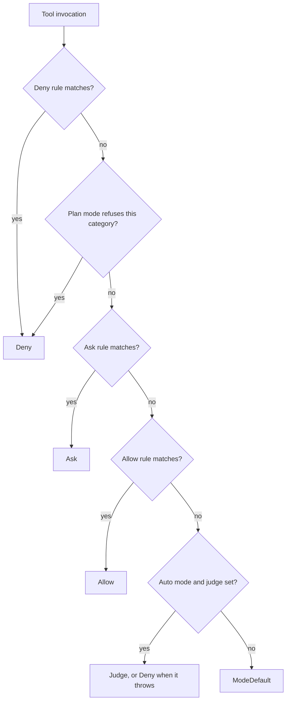

# Agent Safety and Budgets

`VeloxDev.AI.Safety` decides, per tool call, whether the agent may run it, and how much it may spend. The decision is a named **mode** plus a list of **rules**, enforced at the call site — switching the mode governs the very next call. The same scope enforces the call-count and token budgets.

`AgentActionCategory` classifies what a call *does* at call time. It is deliberately separate from `WorkflowToolCategory`, which only decides what is sent to the model. A tool can be visible and still be refused.

## Namespaces

| Namespace | Types |
|---|---|
| `VeloxDev.AI.Safety` | `AgentPermissionMode`, `AgentActionCategory`, `PermissionDecision`, `AgentPermissionRule`, `ToolInvocation`, `AgentPermissionPolicy` |
| `VeloxDev.AI.Workflow` | safety and budget members of `WorkflowAgentScope`, `WorkflowAgentScope.SelectionResult` |
| `VeloxDev.AI` | `AgentToolCallEventArgs`, `IAgentToolCallNotifier`, `AgentSelectionEventArgs`, `AgentConfirmationEventArgs` |

## Pages

- [Permission model](00_permission-model/index.md) — modes, categories, rules, invocations and the policy's evaluation order.
- [Scope safety](01_scope-safety/index.md) — the scope's permission, opt-in and interaction-handler members.
- [Budgets and dirty marking](02_budgets/index.md) — call, token and result-size caps.
- [Interaction events](03_interaction-events/index.md) — the event-args types a host handler receives and a caller observes.

## Evaluation order

## Related

- [Workflow Agent Tools](../17_workflow-agent-tools/index.md) — the tools these rules govern.
- [MCP Integration](../20_mcp-integration/index.md) — the `Curate` calls modes treat most carefully.
- [Sub-Agents](../21_sub-agents/index.md) — the ledger a child's allowance draws on.
