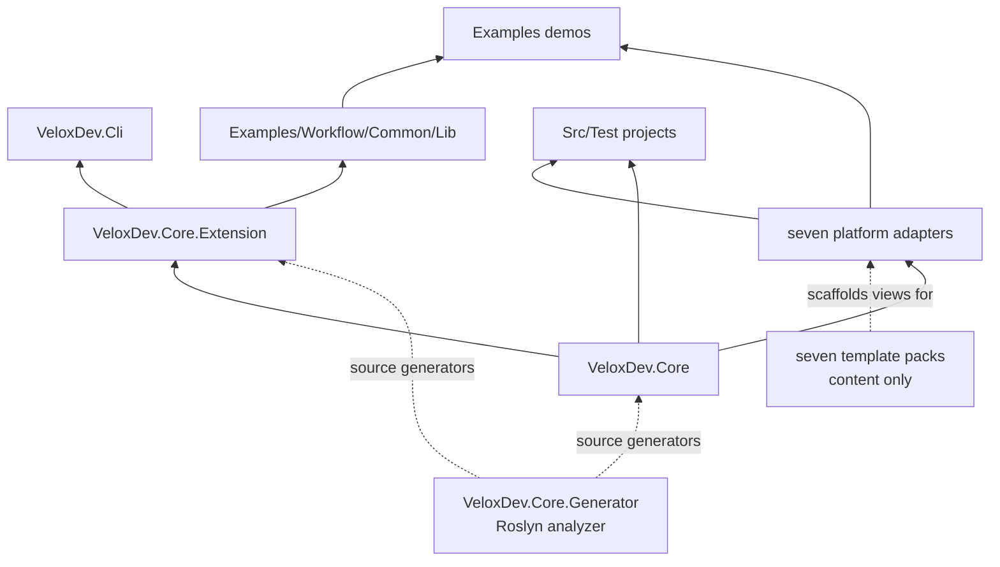

# File structure

VeloxDev is a multi-project .NET solution. The product and its verification live under `Src/`, the runnable demos under `Examples/`, and the documentation source is a git submodule at `Wiki/`. The layout is deliberately not a feature map: the graph model, its compiler and its runtime all live in `VeloxDev.Core`, while the same canvas capability is reimplemented in seven adapter projects and exercised by seven example projects.

## Layout

```text
VeloxDev/
├── Src/
│   ├── Core/
│   │   ├── VeloxDev.Core/              model, canvas mechanics, compiler, runtime, core services
│   │   └── VeloxDev.Core.Extension/    agent tools, safety, skills, MCP, sub-agents
│   ├── Generators/
│   │   └── VeloxDev.Core.Generator/    ten Roslyn incremental generators
│   ├── Adapters/                       Avalonia, Jalium, MAUI, Razor, WinForms, WinUI, WPF
│   ├── Cli/
│   │   └── VeloxDev.Cli/               headless host and stdio MCP server
│   ├── Templates/                      one item-template pack per adapter, seven in total
│   └── Test/
│       ├── Unit/                       MSTest suites and CLI fixtures
│       ├── Headless/                   windowless adapter conformance suites
│       ├── Benchmarks/                 BenchmarkDotNet and headed view-pipeline hosts
│       ├── AutoTest/                   real-window acceptance harness
│       ├── Harness/                    one-shot UI and browser probes
│       └── Compatibility/              WinForms .NET Framework 4.8 smoke project
├── Examples/
│   ├── Workflow/                       demos per GUI, minimal mirrors, shared Lib
│   ├── MVVM/                           shared Lib plus WPF and Avalonia demos
│   ├── Transition/                     one demo per GUI
│   ├── Theme/                          WPF and Avalonia demos plus minimal mirrors
│   ├── AOP/                            WPF and Avalonia demos
│   └── Tickable/                       WPF demo
├── Easel/                              git submodule; WinForms animation dependency
├── Wiki/                               git submodule; documentation source
├── Assets/                             logo, promo media, VeloxDev.Core.agentcontext.xml
├── memory/                             module memory and specifications
├── skills/                             repository-level Claude skills
└── VeloxDev.slnx
```

Build output (`bin/`, `obj/`) and the empty, untracked `Src/Verification/` tree are not solution content. `Src/Test/AutoTest` is intentionally absent from `VeloxDev.slnx`, so a root-level `dotnet test` never opens a window; `Src/Test/Harness` holds PowerShell probes, not projects.

## Project map

### Solution membership

The solution groups projects by working area rather than by feature.

| Solution folder | Projects |
| --- | --- |
| `/Core/` | `VeloxDev.Core`, `VeloxDev.Core.Extension` |
| `/Generators/` | `VeloxDev.Core.Generator` |
| `/Adapters/` | `VeloxDev.Avalonia`, `VeloxDev.Jalium`, `VeloxDev.MAUI`, `VeloxDev.Razor`, `VeloxDev.WinForms`, `VeloxDev.WinUI`, `VeloxDev.WPF` |
| `/Cli/` | `VeloxDev.Cli` |
| `/Templates/` | the seven `VeloxDev.*.Templates` packs, each under `Src/Templates/<name>/working/` |
| `/Test/Unit/Core/` | `VeloxDev.Core.Test`, `VeloxDev.Core.Extension.Test` |
| `/Test/Unit/Cli/` | `VeloxDev.Cli.Test`, plus the `Test.Copy` and `Test.Plugin` fixtures |
| `/Test/Headless/` | `VeloxDev.AdapterTestKit`, then the WPF, Avalonia, WinForms, Razor and Jalium suites |
| `/Test/Benchmarks/` | seven benchmark hosts |
| `/Test/Compatibility/` | `VeloxDev.WinForms.Net48.Smoke` |
| `/Examples/...` | every demo project, listed below |

The adapter folder is the clearest statement of the one-project-per-GUI rule:

```xml
<Folder Name="/Adapters/">
    <Project Path="Src/Adapters/VeloxDev.Avalonia/VeloxDev.Avalonia.csproj" />
    <Project Path="Src/Adapters/VeloxDev.Jalium/VeloxDev.Jalium.csproj" />
    <Project Path="Src/Adapters/VeloxDev.MAUI/VeloxDev.MAUI.csproj" />
    <Project Path="Src/Adapters/VeloxDev.Razor/VeloxDev.Razor.csproj" Id="7fd995c3-8c46-486c-b8b2-e2bcac557da7" />
    <Project Path="Src/Adapters/VeloxDev.WinForms/VeloxDev.WinForms.csproj" />
    <Project Path="Src/Adapters/VeloxDev.WinUI/VeloxDev.WinUI.csproj" />
    <Project Path="Src/Adapters/VeloxDev.WPF/VeloxDev.WPF.csproj" />
</Folder>
```

> Source: `VeloxDev.slnx:8-16`

### Product projects

| Project | Source folder | Kind | Targets |
| --- | --- | --- | --- |
| `VeloxDev.Core` | `Src/Core/VeloxDev.Core/` | class library | `netstandard2.0`, `netframework4.6.1`, `net5.0`, `netcoreapp3.0`, `net8.0` |
| `VeloxDev.Core.Generator` | `Src/Generators/VeloxDev.Core.Generator/` | Roslyn analyzer | `netstandard2.0` |
| `VeloxDev.Core.Extension` | `Src/Core/VeloxDev.Core.Extension/` | class library | `netstandard2.0`, `net8.0` |
| `VeloxDev.WPF` | `Src/Adapters/VeloxDev.WPF/` | class library | `netframework4.6.1`, `net5.0-windows`, `netcoreapp3.0`, `net8.0-windows` |
| `VeloxDev.Avalonia` | `Src/Adapters/VeloxDev.Avalonia/` | class library | `netstandard2.0`, `net6.0`, `net8.0` |
| `VeloxDev.WinUI` | `Src/Adapters/VeloxDev.WinUI/` | class library | `net8.0-windows10.0.19041.0`, `net10.0-windows10.0.19041.0` |
| `VeloxDev.MAUI` | `Src/Adapters/VeloxDev.MAUI/` | class library | `net10.0`, `net10.0-windows10.0.19041.0` |
| `VeloxDev.WinForms` | `Src/Adapters/VeloxDev.WinForms/` | class library | `netframework4.6.1`, `net5.0-windows`, `netcoreapp3.0`, `net8.0-windows` |
| `VeloxDev.Razor` | `Src/Adapters/VeloxDev.Razor/` | class library | `net6.0`, `net8.0` |
| `VeloxDev.Jalium` | `Src/Adapters/VeloxDev.Jalium/` | class library | `net10.0` |
| `VeloxDev.Cli` | `Src/Cli/VeloxDev.Cli/` | console tool | `net8.0` |
| seven `VeloxDev.*.Templates` packs | `Src/Templates/<name>/working/` | template pack | `netstandard2.0` |

`VeloxDev.Core` declares `IsAotCompatible` on `net8.0` only (`Src/Core/VeloxDev.Core/VeloxDev.Core.csproj:15`); the declaration is per-target, not a promise that every adapter's own platform types survive trimming.

### Example projects

Every demo is a normal project in the solution; nothing under `Examples/` is generated.

| Example tree | Projects | References |
| --- | --- | --- |
| `Examples/Workflow/Common/Lib/` | `Lib.csproj` | `VeloxDev.Core`, `VeloxDev.Core.Extension` |
| `Examples/Workflow/{WPF,Avalonia,WinUI,MAUI,WinForms,Jalium}/Demo/` | one `Demo.csproj` per GUI | that GUI's adapter plus the shared `Lib` |
| `Examples/Workflow/Blazor/Demo/` | `Demo/Demo.csproj` (server) and `Demo.Client/Demo.Client.csproj` | server project references the Razor adapter plus `Lib` |
| `Examples/Workflow/Avalonia Trimmed/Demo/` | `Demo`, `Demo.Desktop`, `Demo.Browser`, `Demo.Android`, `Demo.iOS` | Avalonia head projects around the shared `Demo` |
| the other `* Trimmed` trees | one `Demo.csproj` each | minimal call-sequence demos, not trimming or AOT publish tests |
| `Examples/MVVM/Common/Lib/`, `WPF/`, `Avalonia/` | `Lib.csproj` and two `Demo.csproj` | Core plus the MVVM generator |
| `Examples/Transition/{7 GUIs}/Demo/` | one `Demo.csproj` per GUI (Blazor has two) | that GUI's adapter |
| `Examples/Theme/{WPF,Avalonia}{, Trimmed}/Demo/` | one `Demo.csproj` each | WPF or Avalonia adapter |
| `Examples/AOP/{WPF,Avalonia}/Demo/` | one `Demo.csproj` each | Core plus the AOP generator |
| `Examples/Tickable/WPF/Demo/` | `Demo.csproj` | Core plus the tick generator |

### Verification projects

| Tree | Projects | What it checks |
| --- | --- | --- |
| `Src/Test/Unit/Core/` | `VeloxDev.Core.Test` (net10.0), `VeloxDev.Core.Extension.Test` (net10.0) | model, compiler, runtime, layout, MVVM, transition, themes, AOP, tick, serialization, agent and CLI-adjacent behaviour |
| `Src/Test/Unit/Cli/` | `VeloxDev.Cli.Test` (net10.0) plus the `Test.Copy` and `Test.Plugin` fixtures (netstandard2.0) | option parsing, MCP protocol, archives, sessions, plugin loading, run logs |
| `Src/Test/Headless/` | `VeloxDev.AdapterTestKit` (netstandard2.0) and five suites | the adapter contract without a window: WPF, Avalonia, WinForms, Razor and Jalium |
| `Src/Test/Benchmarks/` | seven hosts | serialization versus System.Text.Json and Newtonsoft; headed view-pipeline hosts for WPF, Avalonia, WinForms, Jalium, WinUI, MAUI and Razor |
| `Src/Test/AutoTest/` | `VeloxDev.AT` (net10.0-windows), `VeloxDev.SamplerTest` | end-to-end acceptance through real windows; excluded from the solution |
| `Src/Test/Compatibility/` | `VeloxDev.WinForms.Net48.Smoke` (net48) | the WinForms adapter on .NET Framework 4.8 |
| `Src/Test/Harness/` | PowerShell scripts only | one-shot UI and CDP browser probes, plus template-output checks |

## Reference graph



The graph is enforced by project files, not convention. `VeloxDev.Core` has no product reference at all — the generator is attached as an analyzer, and only in a Debug build is it a project reference:

```xml
<ItemGroup>
    <ProjectReference Include="../../Generators/VeloxDev.Core.Generator/VeloxDev.Core.Generator.csproj"
                      OutputItemType="Analyzer"
                      ReferenceOutputAssembly="false"
                      Condition="'$(Configuration)' == 'Debug'" />
    <PackageReference Include="VeloxDev.Core.Generator" Version="12.3.0"
                      Condition="'$(Configuration)' != 'Debug'" />
</ItemGroup>
```

> Source: `Src/Core/VeloxDev.Core/VeloxDev.Core.csproj:50-57`

The same pair appears wherever generated attributes are consumed: `VeloxDev.Core.Extension` repeats it (`Src/Core/VeloxDev.Core.Extension/VeloxDev.Core.Extension.csproj:29-32`), and the unit-test project attaches the analyzer the same way. Every adapter references `VeloxDev.Core` and no other VeloxDev project (`Src/Adapters/VeloxDev.WPF/VeloxDev.WPF.csproj:28-29`); WinForms additionally references the Easel submodule for its animation primitive. `VeloxDev.Cli` has a single project reference, `VeloxDev.Core.Extension` (`Src/Cli/VeloxDev.Cli/VeloxDev.Cli.csproj:48`). The template packs contain `content/` assets and no project reference, so they cannot introduce a compile dependency on any adapter.

The functional view — which feature each assembly owns, and where a host enters the stack — is on [Functional structure](../01_functional-structure/index.md).
