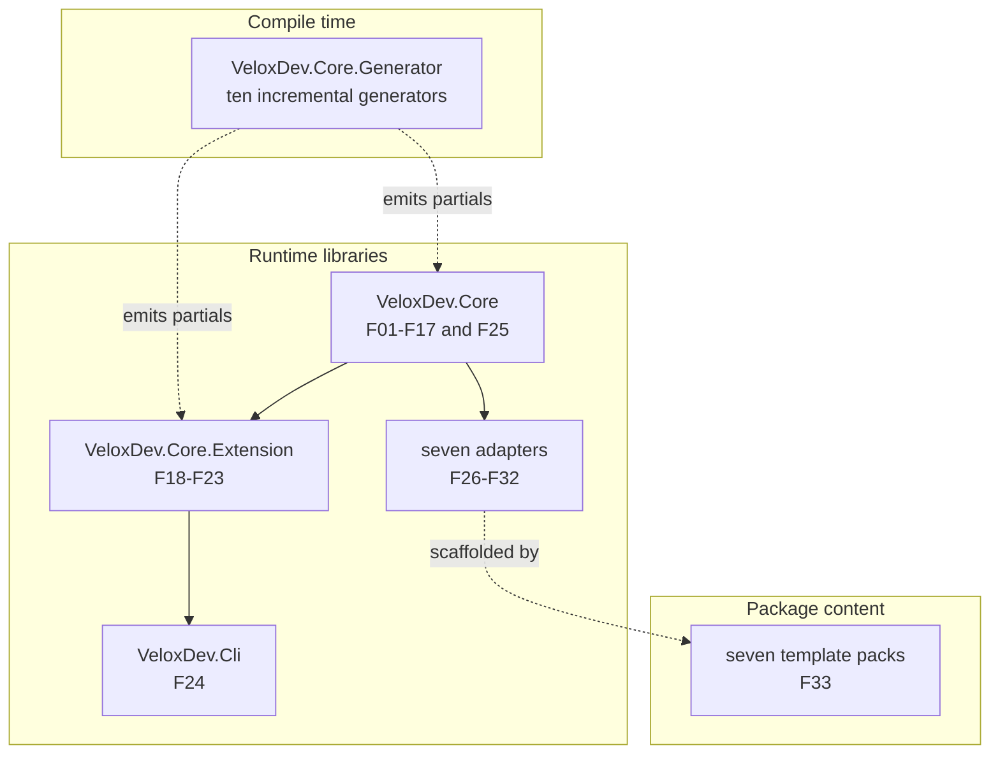

# Functional structure

VeloxDev exposes 33 features. The feature is the unit of documentation; the owning assembly is where the capability's contract lives. Several features are deliberately split: Core owns the contract and the platform-neutral engine, each adapter owns one GUI implementation of that contract, and the Roslyn generator writes the plumbing a component class would otherwise repeat.

## Assembly layers



| Layer | Assemblies | What it contributes |
| --- | --- | --- |
| Model and engine | `VeloxDev.Core` | the graph, its commands, canvas input contracts, layout, compiler, runtime, view hosting, minimap contract, and the six supporting services |
| Agent | `VeloxDev.Core.Extension` | the tool surface over the graph, permission gate, context, skills, MCP, sub-agents, dashboard and transcript |
| Platform | seven adapters | the attached behaviors, view pools, platform samplers and theme converters for one GUI each |
| Headless host | `VeloxDev.Cli` | a stdio MCP server and a one-shot runner over the same Extension toolkit |
| Compile time | `VeloxDev.Core.Generator` | ten incremental generators that emit the members marked by the library's attributes |
| Package content | seven template packs | `dotnet new` item templates that scaffold the seven view roles per GUI |

## Feature-to-project mapping

The owning project is the assembly that owns the capability. Where a capability is split, Core is named as the owner of the contract and the adapters appear under dependencies.

| ID | Feature | Owning project | Depends on |
| --- | --- | --- | --- |
| F01 | Workflow Graph Model | `VeloxDev.Core` | — |
| F02 | Workflow Editing and History | `VeloxDev.Core` | F01 |
| F03 | Connection Rules and Preview | `VeloxDev.Core` | F01 |
| F04 | Dynamic Slot Enumeration | `VeloxDev.Core` | F01, F02 |
| F05 | Workflow Compiler | `VeloxDev.Core` | F01, F03 |
| F06 | Workflow Runtime | `VeloxDev.Core` | F05 |
| F07 | Workflow Auto-Layout | `VeloxDev.Core` | F01, F03 |
| F08 | Canvas Input and Navigation | `VeloxDev.Core` + adapters | F01, F03 |
| F09 | View Hosting and Virtualization | `VeloxDev.Core` + adapters | F01, F08 |
| F10 | Minimap | `VeloxDev.Core` + adapters | F01, F08, F09 |
| F11 | Grid Decorators and Rulers | `VeloxDev.Core` + adapters | F01, F08 |
| F12 | MVVM ViewModel Generation | `VeloxDev.Core` + Generator | — |
| F13 | Transition Animation | `VeloxDev.Core` + adapters | — |
| F14 | Runtime Themes | `VeloxDev.Core` + Generator + adapters | F13 |
| F15 | Aspect-Oriented Programming | `VeloxDev.Core` + Generator | — |
| F16 | Tick Loop | `VeloxDev.Core` + Generator | — |
| F17 | Closed-World Serialization | `VeloxDev.Core` + Generator | — |
| F18 | Workflow Agent Tools | `VeloxDev.Core.Extension` | Core |
| F19 | Agent Safety and Budgets | `VeloxDev.Core.Extension` | F18 |
| F20 | Agent Context and Skills | `VeloxDev.Core.Extension` | F18 |
| F21 | MCP Integration | `VeloxDev.Core.Extension` | F18, F19 |
| F22 | Sub-Agents | `VeloxDev.Core.Extension` | F18, F19 |
| F23 | Agent Dashboard and Transcript | `VeloxDev.Core.Extension` | F18, F19 |
| F24 | Headless CLI | `VeloxDev.Cli` | Core.Extension |
| F25 | Platform Adapter Contract | `VeloxDev.Core` | F01, F08-F11 |
| F26 | WPF Adapter | `VeloxDev.WPF` | Core, F25 |
| F27 | Avalonia Adapter | `VeloxDev.Avalonia` | Core, F25 |
| F28 | WinUI Adapter | `VeloxDev.WinUI` | Core, F25 |
| F29 | MAUI Adapter | `VeloxDev.MAUI` | Core, F25 |
| F30 | WinForms Adapter | `VeloxDev.WinForms` | Core, F25, Easel |
| F31 | Razor / Blazor Adapter | `VeloxDev.Razor` | Core, F25 |
| F32 | Jalium Adapter | `VeloxDev.Jalium` | Core, F25 |
| F33 | Workflow Item Templates | the seven `VeloxDev.*.Templates` packs | F25, each adapter |

By owning assembly: Core owns 18 features (F01-F17 plus F25), Extension owns 6 (F18-F23), the CLI owns 1 (F24), the seven adapters own one each (F26-F32), and one feature is distributed across the seven template packs (F33).

## Responsibilities and entry points

### Module boundaries

| Module | Namespace | Responsibility | Project |
| --- | --- | --- | --- |
| Workflow system | `VeloxDev.WorkflowSystem` | four component contracts, editing commands, connection rules and preview, slot providers, input routing, geometry, layout, compiler, runtime, view hosting, minimap pipeline | Core |
| MVVM | `VeloxDev.MVVM` | property and command attributes, command pipeline, collection tracking | Core + Generator |
| Transition | `VeloxDev.TransitionSystem` | typed transition chain, easing catalogue, samplers, scheduler and interpreter | Core; the typed `Transition<T>` specialization lives in each adapter |
| Themes | `VeloxDev.DynamicTheme` | theme registration, palette cache, animated or instant switching | Core + Generator; value converters in adapters |
| AOP | `VeloxDev.AspectOriented` | aspect attribute, per-instance proxy cache, hook surface | Core + Generator |
| Tick | `VeloxDev.TimeLine`, `VeloxDev.Timing` | channels, five lifecycle hooks, frame pump, time samplers | Core + Generator |
| Serialization | `VeloxDev.Serialization` | closed-world writer/reader registry and archive attributes | Core + Generator |
| AI metadata | `VeloxDev.AI` | context attributes, context readers, slot-selector metadata | Core |
| Agent | `VeloxDev.AI.Workflow`, `.Safety`, `.Skills`, `.MCP`, `.SubAgents`, `.Dashboard`, `.Pipelines`, `VeloxDev.AI` | tool scopes, permission gate, skill sources, MCP servers, sub-agent tree, dashboard view models, event pipelines, transcript, media | Extension |
| Platform adapters | `VeloxDev.WorkflowSystem`, `VeloxDev.TransitionSystem`, `VeloxDev.DynamicTheme` | attached behaviors, view pools, platform samplers, theme converters | one per GUI |
| CLI | `VeloxDev.Cli` | option parsing, archive and session host, isolated worker, MCP host, run log | Cli |
| Generator | `VeloxDev.Generators` | ten incremental generators and their writers | Generator |
| Templates | — | item-template content only | seven packs |

Core's smaller support namespaces have a single job each: `VeloxDev.WeakTypes` holds weak caches, delegates and queues; `VeloxDev.Threading` holds the dispatcher abstraction; `VeloxDev.Lifetime` holds the application-state contract.

### Entry points

Each area of the stack has one type a host meets first. The entry points below are the declaration sites, not wrappers.

| Entry | Declared at | Opens |
| --- | --- | --- |
| `[WorkflowBuilder.Node<T>]` | `Src/Core/VeloxDev.Core/WorkflowSystem/Templates/WorkflowBuilder.cs:27-33` | generated component lifecycle for a node |
| generated `InitializeWorkflow` | `Src/Generators/VeloxDev.Core.Generator/Writers/WorkflowWriter.cs:510-525` | helper creation, slots, collections |
| `ITreeComponent` commands | `Src/Core/VeloxDev.Core/Interfaces/WorkflowSystem/Components/ITreeComponent.cs:27` | create, connect, undo and redo |
| `WorkflowInput.For` | `Src/Core/VeloxDev.Core/WorkflowSystem/GUI/Events/WorkflowInput.cs:53` | the per-tree pointer and key route |
| `CompilerViewModel.CompileAsync` | `Src/Core/VeloxDev.Core/WorkflowSystem/CompilerEx/Compile/CompilerViewModel.cs:38` | a `CompiledGraph` |
| `RuntimeEngine.RunAsync` | `Src/Core/VeloxDev.Core/WorkflowSystem/CompilerEx/Runtime/RuntimeEngine.cs:56` | execution, with optional checkpoint resume |
| `WorkflowLayoutEx.Arrange` | `Src/Core/VeloxDev.Core/WorkflowSystem/Layout/WorkflowLayoutEx.cs:20` | the helper's layout solver |
| `ViewPool<THost,TView,TItem,TPriorityCore>` | `Src/Core/VeloxDev.Core/WorkflowSystem/ViewHosting/ViewPool.cs:463` | one view per visible item |
| `MinimapPipelineCore<...>` | `Src/Core/VeloxDev.Core/WorkflowSystem/Minimap/MinimapPipelineCore.cs:61` | thumbnail and viewport frame |
| `[VeloxProperty]` | `Src/Core/VeloxDev.Core/MVVM/VeloxPropertyAttribute.cs:26` | generated observable property |
| `TransitionCore` / `Transition<T>` | `Src/Core/VeloxDev.Core/TransitionSystem/Effects/Transition.cs:10`; `Src/Adapters/VeloxDev.WPF/TransitionSystem/Transition.cs:15` | a transition segment or chain |
| `ThemeManager.Transition<T>` | `Src/Core/VeloxDev.Core/DynamicTheme/ThemeManager.cs:155` | an animated theme switch |
| `[AspectOriented]` | `Src/Core/VeloxDev.Core/AspectOriented/AspectOrientedAttribute.cs:9` | a generated aspect proxy |
| `TickManager.Start` | `Src/Core/VeloxDev.Core/TimeLine/TickManager.cs:1063` | a frame channel |
| `VeloxJsonSerializer.Serialize` | `Src/Core/VeloxDev.Core/Serialization/VeloxJsonSerializer.cs:56` | a closed-world document |
| `WorkflowAgentScope.ProvideTools` | `Src/Core/VeloxDev.Core.Extension/Agent/Workflow/WorkflowAgentScope.cs:1586` | the workflow tool set |
| `McpScope.LoadAsync` | `Src/Core/VeloxDev.Core.Extension/Agent/MCP/McpScope.cs:778` | external MCP tools |
| `CliOptions.Parse` | `Src/Cli/VeloxDev.Cli/CliOptions.cs:95` | the `mcp` or `run` verb |

The component declaration and the generated lifecycle are the pair that everything else assumes:

```csharp
[AttributeUsage(AttributeTargets.Class, AllowMultiple = false, Inherited = false)]
public sealed class NodeAttribute<T>(int workSemaphore = 1) : Attribute
    where T : INodeHelper, new()
{
    /// <summary>The concurrent capacity of the node's receive task.</summary>
    public int Semaphore { get; } = workSemaphore;
}
```

> Source: `Src/Core/VeloxDev.Core/WorkflowSystem/Templates/WorkflowBuilder.cs:27-33`

The engine entry points take a component and a role, or a compiled graph and a context:

```csharp
public async Task<IReadOnlyList<CompiledGraph>> CompileAsync<T>(
    T component, CompileRole role, CancellationToken ct = default)
    where T : IWorkflowComponent
```

> Source: `Src/Core/VeloxDev.Core/WorkflowSystem/CompilerEx/Compile/CompilerViewModel.cs:38-40`

### Boundary rules

- **Core stays UI-free.** `WorkflowSystem/GUI` defines input contracts, geometry and math (`WorkflowInput`, `SurfaceScrollerCore`, `WorkflowSurfaceMath`); window, control and dispatcher types appear only in an adapter.
- **Contracts travel, implementations do not.** F25 names the seven surface roles; each adapter implements the same role names over its own property system under `WorkflowSystem/AttachedBehaviors/`. A host written against Core runs on any adapter.
- **Extension is additive and one-directional.** `VeloxDev.Core.Extension` references Core (`Src/Core/VeloxDev.Core.Extension/VeloxDev.Core.Extension.csproj:24-25`); no Core project references Extension and no adapter references it either.
- **The generator is compile-time only.** It emits partials into the consuming assembly (`VeloxDev.Core.Generator` is attached as an analyzer, never a runtime library), so generated members carry no extra runtime dependency.
- **Templates hold content, not code.** A template pack ships `content/` and a manifest; it has no project reference, so it can neither call into an adapter nor pin a version.

The file-level view of the same graph — which folders hold these projects and how they reference each other — is on [File structure](../00_file-structure/index.md).
