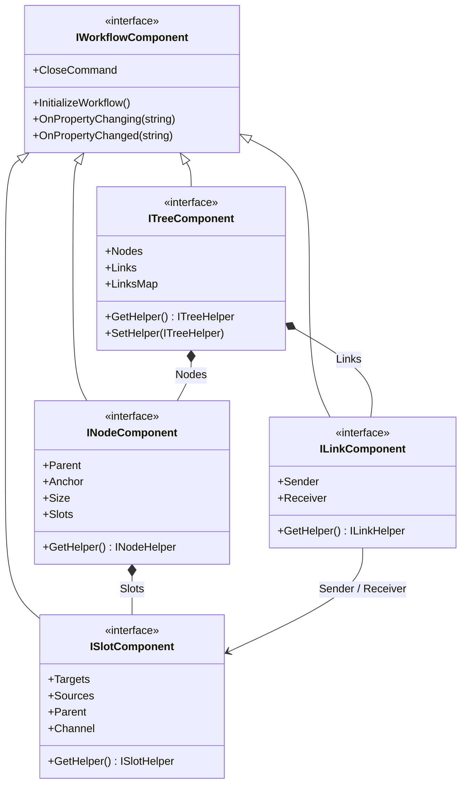
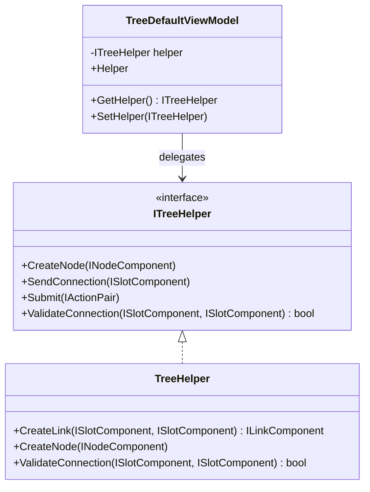
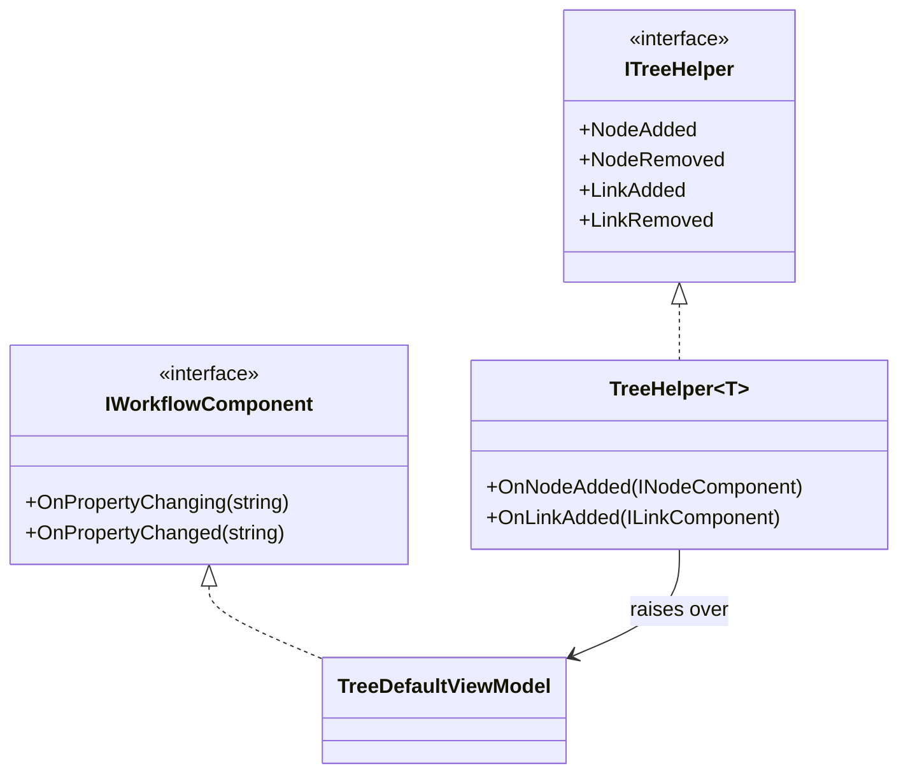

# Design patterns in the workflow graph model

The graph model is a four-role composite whose behaviour is separated from its data. Each role is an interface, a sealed default view model, and a helper; a source generator writes the plumbing in between. This page examines the three patterns that carry that design — Composite, Bridge (implemented as a runtime Strategy), and Template Method — and the Observer contract that keeps the parts synchronized.

## Composite: one tree owns nodes, slots and links

A `ITreeComponent` holds `Nodes` and `Links`; each `INodeComponent` holds `Slots`; each `ILinkComponent` names a sender and a receiver slot. Every role implements the same root contract, `IWorkflowComponent`, so code that walks the graph never needs a special case per level.



The ownership is literal in the contracts: `ITreeComponent.Nodes` and `Links` are `ObservableCollection` properties, `INodeComponent.Slots` is one too, and `ISlotComponent.Targets`/`Sources` mirror the links from each end.

Source: `Src/Core/VeloxDev.Core/Interfaces/WorkflowSystem/Components/ITreeComponent.cs` lines 17-23; `.../INodeComponent.cs` line 28; `.../ISlotComponent.cs` lines 11-14; `.../ILinkComponent.cs` lines 10-13.

| Role | Contract | Default implementation | Default helper |
| --- | --- | --- | --- |
| Tree | `ITreeComponent` | `TreeDefaultViewModel` | `TreeHelper` |
| Node | `INodeComponent` | `NodeDefaultViewModel` | `NodeHelper` |
| Slot | `ISlotComponent` | `SlotDefaultViewModel` | `SlotHelper` |
| Link | `ILinkComponent` | `LinkDefaultViewModel` | `LinkHelper` |

The composite is also what makes the standard extension methods possible: `WorkflowTreeEx.StandardCloseAsync` walks nodes, then their slots, then links, using only `IWorkflowComponent` members.

Source: `Src/Core/VeloxDev.Core/WorkflowSystem/StandardEx/WorkflowTreeEx.cs` lines 62-78.

## Bridge: the component carries data, the helper carries behaviour

Every component exposes `GetHelper()` and `SetHelper(...)`. The component is a data carrier with observable properties; the helper holds the algorithms — create, move, connect, delete, validate. Because the helper is typed by interface and installed at runtime, the same separation reads as a Bridge structurally and as a Strategy operationally: a host can replace the shipped helper without subclassing the view model.



`TreeDefaultViewModel` stores the helper in a private field and exposes it through a notifying property; its constructor calls `InitializeWorkflow()`, which installs the helper.

Source: `Src/Core/VeloxDev.Core/WorkflowSystem/Templates/ViewModels/TreeDefaultViewModel.cs` lines 9-28.

The generic helper binds the behaviour to a concrete component type. `TreeHelper<T>` implements `ITreeHelper`, `ITreeEvents`, `IInputEvents` and `IWorkflowLayoutHost`, so one object is both the behaviour seam and the event surface.

Source: `Src/Core/VeloxDev.Core/WorkflowSystem/Templates/Helpers/TreeHelper.cs` line 34.

## Template Method: the generator writes the skeleton, overrides fill the steps

The `[WorkflowBuilder.*]` attributes name the helper type a component uses. The generator then emits `InitializeWorkflow`, `GetHelper`, `SetHelper`, the collections and the command properties; the helper base class leaves the interesting steps virtual.

```csharp
public override ILinkComponent CreateLink(ISlotComponent sender, ISlotComponent receiver)
{
    return new LinkViewModel() { Sender = sender, Receiver = receiver };
}
```

Source: `Examples/Workflow/Common/Lib/ViewModels/Workflow/Helper/AgentHelper.cs` lines 394-397. The tree that installs this helper declares `[WorkflowBuilder.Tree<AgentHelper>]` at `Examples/Workflow/Common/Lib/ViewModels/Workflow/TreeViewModel.cs` line 16.

The generated `InitializeWorkflow` calls a virtual `InitializeWorkflowCore`, installs the helper, and wires the standard commands. `CreateNode` and `Receive` are generated overrides that forward to the helper.

Source: `Src/Generators/VeloxDev.Core.Generator/Writers/WorkflowWriter.cs` lines 505-528 (lifecycle), lines 555-558 (`CreateNode`), line 841 (`ReceiveAsync`).

The virtual steps in the shipped helper are the template hooks: `CreateLink` decides the concrete link type, `CreateNode` delegates to the standard create operation, and `ValidateConnection` defaults to `true` so a host overrides only when it has a rule.

Source: `Src/Core/VeloxDev.Core/WorkflowSystem/Templates/Helpers/TreeHelper.cs` lines 227-238 and 378-381.

## Observer: notifications are the coordination layer

The root contract inherits both `INotifyPropertyChanging` and `INotifyPropertyChanged`, and the helpers add lifecycle events (`NodeAdded`, `NodeRemoved`, `LinkAdded`, `LinkRemoved`). Generated `[VeloxProperty]` setters raise the two property notifications; the helpers' protected `On...` methods raise the event channel.



Standard operations use a per-tree cache keyed by `ConditionalWeakTable`, which keeps the undo stacks and event caches attached to the component without adding fields to the public interface.

Source: `Src/Core/VeloxDev.Core/WorkflowSystem/StandardEx/WorkflowTreeEx.cs` line 11.

## Pattern summary

| Pattern | Participants | Why it is there |
| --- | --- | --- |
| Composite | `ITreeComponent`, `INodeComponent`, `ISlotComponent`, `ILinkComponent` | One uniform walk over a heterogeneous graph |
| Bridge / Strategy | `*DefaultViewModel` ↔ `*Helper` | Data model independent of behaviour; helper replaceable per instance |
| Template Method | `InitializeWorkflow*`, `CreateLink`, `ValidateConnection` | Generated skeleton with virtual steps |
| Observer | `INotifyPropertyChanged`, helper events | Views and standard operations react without polling |

The next feature builds history on top of these observers; see [Workflow editing and history](../01_workflow-editing-history/index.md).
