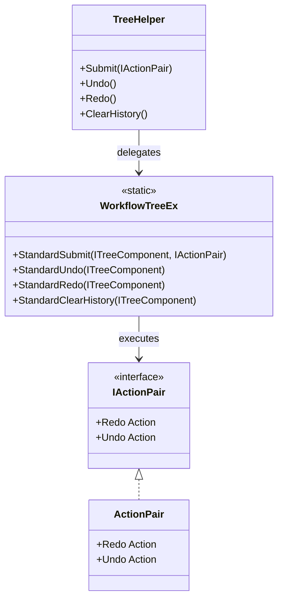
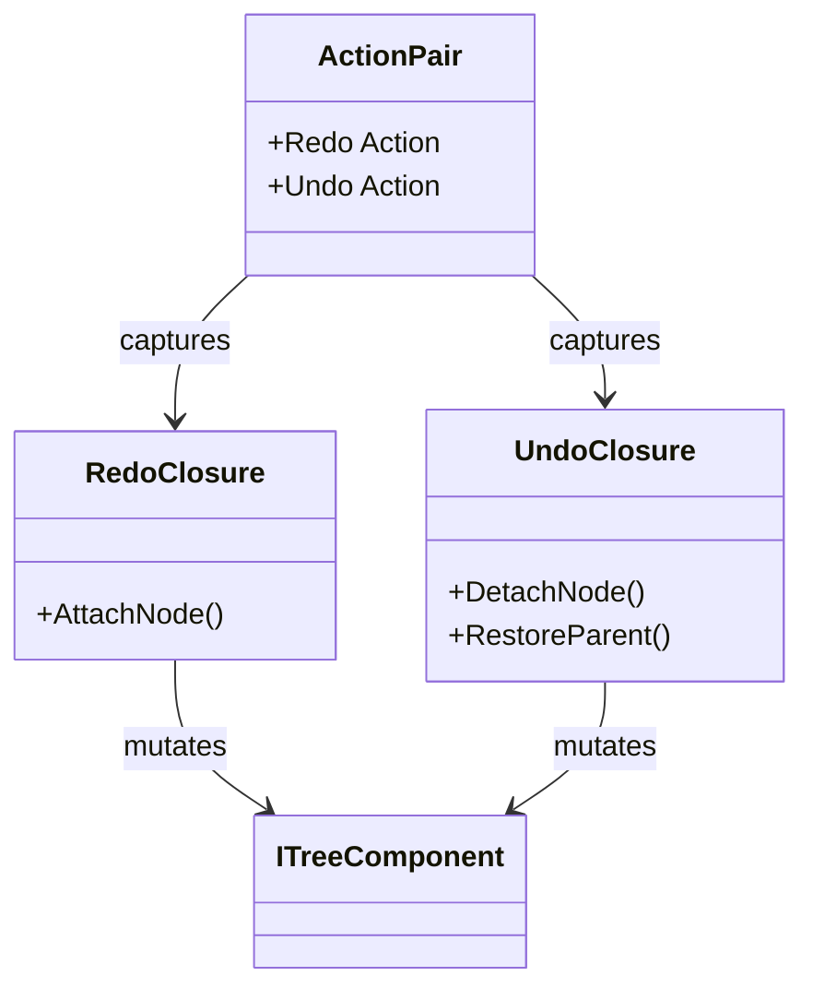
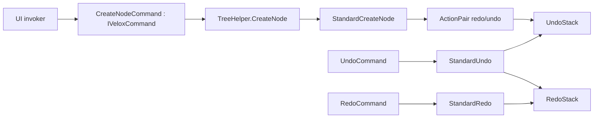

# Design patterns in workflow editing and history

Every mutation that should be undoable is expressed as a redo action and an undo action. The standard operations execute the redo immediately and push the pair onto a history; undo and redo replay the appropriate half. The result is a Command pattern whose commands double as their own Memento, kept in a Caretaker that lives beside the tree rather than on it.

## Command: an action is a pair of delegates

`IActionPair` is deliberately minimal — one `Redo` delegate and one `Undo` delegate, both parameterless `Action` values. A command that needs state closes over it, so the pair is self-contained and no command base class is required.

```csharp
public interface IActionPair
{
    public Action Redo { get; }
    public Action Undo { get; }
}

public readonly struct ActionPair(Action redo, Action undo) : IActionPair
{
    public Action Redo { get; } = redo;
    public Action Undo { get; } = undo;
}
```

Source: `Src/Core/VeloxDev.Core/Interfaces/WorkflowSystem/Commands/IActionPair.cs` lines 4-11; `Src/Core/VeloxDev.Core/WorkflowSystem/ActionPair.cs` lines 6-12.



The helper exposes the same four operations and forwards them to the static standard implementation, so a host can call either the helper or the extension method.

Source: `Src/Core/VeloxDev.Core/WorkflowSystem/Templates/Helpers/TreeHelper.cs` lines 398-411.

## Memento: the command captures the two states

The framework does not serialize a graph snapshot for undo. Instead each standard mutation builds a pair whose closures capture the before and after state it needs. Creating a node, for example, captures the old parent and the new parent; redo attaches the node to the new tree, undo removes it and restores the old parent.

```csharp
component.StandardSubmit(new ActionPair(
    () => CreateNodeRedo(component, node, newParent),
    () => CreateNodeUndo(component, node, oldParent)));
```

Source: `Src/Core/VeloxDev.Core/WorkflowSystem/StandardEx/WorkflowTreeEx.cs` lines 38-40, with the two closures at lines 395-405.

This is the Memento pattern in its lightest form: the originator's state is encoded in the command's captured variables, and the Caretaker only stores the pair. It avoids a general graph snapshot and keeps undo proportional to the operation, not to the tree size.



## Caretaker: two stacks owned by the tree's cache

`StandardSubmit` runs the redo half, then pushes the pair onto `UndoStack`. `StandardUndo` pops from `UndoStack`, runs the undo half, and pushes the pair onto `RedoStack`. `StandardRedo` does the mirror operation. Both stacks are `ConcurrentStack<IActionPair>` held in a per-tree cache created by a `ConditionalWeakTable`, so the history follows the tree's lifetime without becoming part of its public state.

```csharp
var cache = GetCache(component);
if (cache.UndoStack.TryPop(out var pair))
{
    pair.Undo.Invoke();
    cache.RedoStack.Push(pair);
}
```

Source: `Src/Core/VeloxDev.Core/WorkflowSystem/StandardEx/WorkflowTreeEx.cs` lines 352-383; the stack declarations are at lines 684-685.

Two consequences are visible in the code:

- A new submission does **not** clear the redo stack. The standard operations clear history explicitly through `StandardClearHistory`; the class comment for that method is the only clearing policy in Core.
- Exceptions thrown by a redo or undo delegate are caught and written to `Debug`, so a failed replay does not corrupt the stack state. The operation is not rolled back past the point of failure.

Source: `Src/Core/VeloxDev.Core/WorkflowSystem/StandardEx/WorkflowTreeEx.cs` lines 334-391.

## Invoker: generated commands are the user-facing edge

The tree interface exposes the editing operations as `IVeloxCommand` properties — `CreateNodeCommand`, `SendConnectionCommand`, `ReceiveConnectionCommand`, `SubmitCommand`, `UndoCommand`, `RedoCommand`. The generator emits their implementations, and each generated command forwards to the helper. That makes the Command pattern two-layered: a `VeloxCommand` is the UI-level invoker, and the `IActionPair` is the undoable unit it submits.

Source: `Src/Core/VeloxDev.Core/Interfaces/WorkflowSystem/Components/ITreeComponent.cs` lines 27-55; generated forwarding at `Src/Core/VeloxDev.Core/WorkflowSystem/Templates/ViewModels/TreeDefaultViewModel.cs` lines 36-80.



## Pattern summary

| Pattern | Role in the feature | Evidence |
| --- | --- | --- |
| Command | `IActionPair` / `ActionPair`; generated `IVeloxCommand` properties | `IActionPair.cs`, `TreeDefaultViewModel.cs` |
| Memento | Closures capture before/after state | `WorkflowTreeEx.cs` lines 38-40, 395-405 |
| Caretaker | Per-tree `UndoStack` / `RedoStack` | `WorkflowTreeEx.cs` lines 684-685 |
| Invoker / Facade | `TreeHelper` forwarding to `WorkflowTreeEx` | `TreeHelper.cs` lines 398-411 |

The edit operations depend on the connection rules described next; a completed connection is itself submitted as an action pair. See [Connection rules and preview](../02_connection-rules-preview/index.md).
