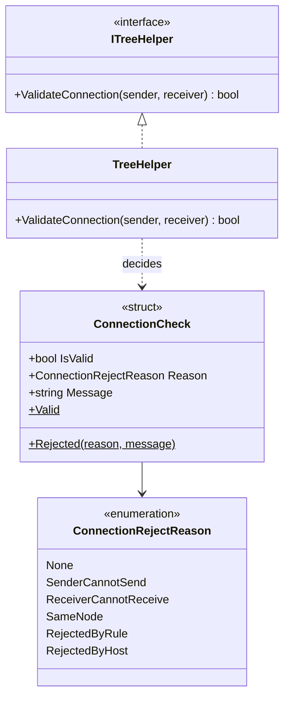
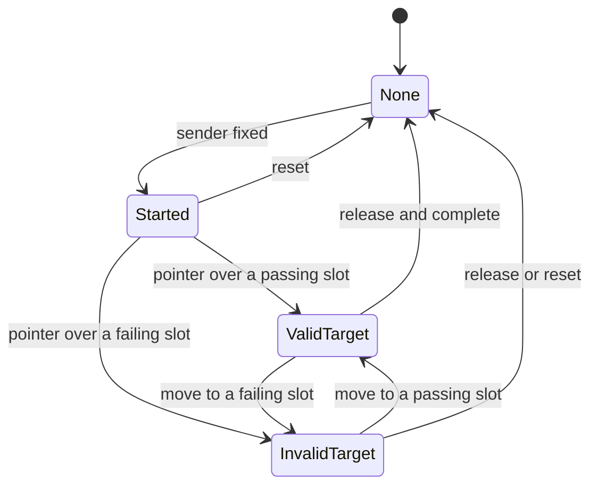

# Design patterns in connection rules and preview

A connection is checked before the pointer is released and checked again from the same rule set while the rubber band moves. The implementation separates three concerns: an ordered chain of framework rules, a host-supplied strategy for domain rules, and a small state machine that describes the drag's stage. Observers see the state change without polling.

## Chain of Responsibility: the framework rules run in a fixed order

`StandardCheckConnection` and the completion path both delegate to `EvaluateConnection`. The checks are ordered and each one can end the evaluation with a specific reason: sender capability, receiver capability, same-node rejection, then the host rule. The chain is explicit control flow rather than a list of handler objects, but it carries the chain's property — a request stops at the first handler that rejects it.

```csharp
if (checkSender && !sender.StandardCanBeSender())
    return ConnectionCheck.Rejected(ConnectionRejectReason.SenderCannotSend);

if (!receiver.StandardCanBeReceiver())
    return ConnectionCheck.Rejected(ConnectionRejectReason.ReceiverCannotReceive);

if (ReferenceEquals(sender.Parent, receiver.Parent))
    return ConnectionCheck.Rejected(ConnectionRejectReason.SameNode);

return component.GetHelper().ValidateConnection(sender, receiver)
    ? ConnectionCheck.Valid
    : ConnectionCheck.Rejected(ConnectionRejectReason.RejectedByRule);
```

Source: `Src/Core/VeloxDev.Core/WorkflowSystem/StandardEx/WorkflowTreeEx.cs` lines 216-234.

The `checkSender` flag is what keeps the chain from diverging between preview and completion: at drag start the sender was already checked, so completion skips that first link and does not re-evaluate a condition the preview already consumed.

Source: `Src/Core/VeloxDev.Core/WorkflowSystem/StandardEx/WorkflowTreeEx.cs` lines 202-220.

## Strategy: the domain rule is a virtual method

The last link of the chain is the host's `ValidateConnection`. `TreeHelper<T>` declares it `virtual` and returns `true`, making the default a permissive strategy; a host subclasses the helper and overrides it.

```csharp
public virtual bool ValidateConnection(
    ISlotComponent sender,
    ISlotComponent receiver)
    => true;
```

Source: `Src/Core/VeloxDev.Core/WorkflowSystem/Templates/Helpers/TreeHelper.cs` lines 378-381.

`ConnectionCheck` is the result value object. It is a readonly struct with `Valid` and `Rejected(reason, message)`, which keeps the decision comparable and lets the preview cache the same value later.



Source: `Src/Core/VeloxDev.Core/Interfaces/WorkflowSystem/Connections/ConnectionCheck.cs` lines 4-68.

## State: the drag stage and the slot flags

Two enums describe connection state.

- `SlotChannel` is a flags enum that describes capacity in each direction (`OneTarget`, `OneSource`, `MultipleTargets`, `MultipleSources`).
- `SlotState` is a flags enum for the live state (`StandBy`, `PreviewSender`, `PreviewReceiver`, `Sender`, `Receiver`).
- `ConnectionPreviewState` tracks the drag: `None`, `Started`, `ValidTarget`, `InvalidTarget`.

Source: `Src/Core/VeloxDev.Core/Interfaces/WorkflowSystem/Enums/SlotChannel.cs` lines 4-35; `Src/Core/VeloxDev.Core/Interfaces/WorkflowSystem/Connections/IConnectionPreviewLink.cs` lines 4-17.

The preview state is an optional capability on the virtual link, not on `ILinkComponent`. `IConnectionPreviewLink` extends the link contract with `Preview` and `SetPreview`; `LinkDefaultViewModel` implements it, and a custom virtual link may opt in.

Source: `Src/Core/VeloxDev.Core/Interfaces/WorkflowSystem/Connections/IConnectionPreviewLink.cs` lines 35-43.



## Observer: preview events are advisory

`WorkflowInput` owns the drag state and exposes `PreviewChanged` and `PreviewValidating`. A subscriber to `PreviewValidating` may tighten a passing verdict, but the code explicitly refuses to let it relax one: the framework check runs first, and the host hook is only asked when the check already passed.

```csharp
if (slot is not null && check.IsValid)
{
    check = input.RaisePreviewValidating(sender, slot, check);
}
input.SetConnectionPreview(slot, check);
```

Source: `Src/Core/VeloxDev.Core/WorkflowSystem/StandardEx/WorkflowTreeEx.cs` lines 261-267; the event declaration is at `Src/Core/VeloxDev.Core/WorkflowSystem/GUI/Events/WorkflowInput.cs` line 102.

The per-attempt veto is a separate observer: `ITreeEvents.Connecting` fires only on release, and may depend on state a preview should not consume. `ConnectionCheck` deliberately excludes it, which is why `RejectedByHost` exists as its own reason rather than reusing `RejectedByRule`.

Source: `Src/Core/VeloxDev.Core/Interfaces/WorkflowSystem/Connections/ConnectionCheck.cs` lines 29-40.

## Pattern summary

| Pattern | Participants | Design consequence |
| --- | --- | --- |
| Chain of Responsibility | `EvaluateConnection` and its ordered checks | One rejection reason, no duplicated rule ordering |
| Strategy | `ITreeHelper.ValidateConnection` override | Domain rule without forking the framework |
| State | `ConnectionPreviewState`, `SlotState`, `SlotChannel` | Views render from a value, not from events |
| Observer | `PreviewChanged`, `PreviewValidating`, `Connecting` | Host can veto without owning the drag |

The slot's enumerated ports are built on top of these states; see [Dynamic slot enumeration](../03_dynamic-slot-enumeration/index.md).
