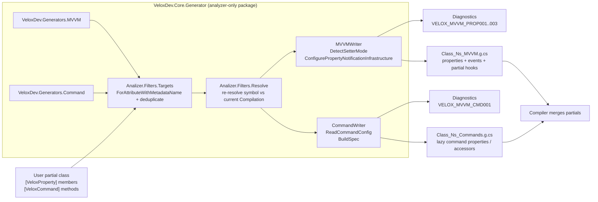

# Design Patterns — MVVM

The `mvvm` feature is a **generator + command runtime** pair. The runtime lives under `Src/Core/VeloxDev.Core/MVVM/**` and `Src/Core/VeloxDev.Core/Interfaces/MVVM/**`, namespace `VeloxDev.MVVM`. The Roslyn source generator under `Src/Generators/VeloxDev.Core.Generator/**` (classes `VeloxDev.Generators.MVVM` and `VeloxDev.Generators.Command`, shipped as the analyzer-only package `VeloxDev.Core.Generator`) turns `[VeloxProperty]` members and `[VeloxCommand]` methods into observable properties and lazy command properties.

## Model class diagram

```mermaid
classDiagram
    direction LR
    class VeloxPropertyAttribute {
        <<attribute>>
    }
    class VeloxCommandAttribute {
        <<attribute, sealed>>
        +Name string
        +CanValidate bool
        +Semaphore int
    }
    class ICommand {
        <<interface>>
        +Execute(object?) void
        +CanExecute(object?) bool
        +CanExecuteChanged EventHandler
    }
    class IVeloxCommand {
        <<interface>>
        +Created/Enqueued/Dequeued/Started/Completed/Failed/Canceled/Exited CommandEventHandler
        +Lock/Unlock/Notify/Clear/Interrupt/Continue/ChangeSemaphore() void
        +ExecuteAsync(object?) Task
    }
    class IVeloxCommandCompletion {
        <<interface>>
        +ExecuteAndWaitAsync(object?, CancellationToken) Task~CommandCompletion~
    }
    class IVeloxCommandResult {
        <<interface>>
        +ExecuteAsync(object?, CancellationToken) Task~object~
        +Execute(object?, out object?) void
    }
    class IVeloxCommandStatus {
        <<interface>>
        +IsBusy bool
        +ActiveCount int
        +PendingCount int
    }
    class IVeloxCommand~TParam,TResult~ {
        <<interface>>
        +CanExecute(TParam) bool
        +Execute(TParam) void
        +ExecuteAsync(TParam, CancellationToken) Task~TResult~
        +Execute(TParam, out TResult) void
    }
    class IVeloxCommandEvents~TParam,TResult~ {
        <<interface>>
        +Created/Failed/Exited/... CommandEventHandler~TParam,TResult~
    }
    class CommandPipeline~TParam,TResult~ {
        <<abstract>>
        +EventContext SynchronizationContext?
        +IsBusy bool
        +ActiveCount int
        +PendingCount int
        +HandlerException Action~Exception~$
        +Dispose() void
        #CanExecuteCore(TParam) bool
        #ExecuteAsyncCore(TParam) Task
        #ExecuteAndWaitTypedAsync(TParam, CancellationToken) Task~TResult~
        -SemaphoreSlim _stateLock
        -Queue _pendingQueue
        -HashSet _active
    }
    class VeloxCommand {
        +VeloxCommand(Func~object?,CancellationToken,Task~, Predicate, int)
        +CreateTaskWithResult(...) VeloxCommand$
        +CreateTaskOnlyWithParameter(...) VeloxCommand$
    }
    class VeloxCommand~TParam,TResult~ {
        <<sealed>>
        +VeloxCommand(Func~TParam,CancellationToken,Task~TResult~~, Predicate~TParam~, int)
    }
    class VeloxCommandExtensions {
        <<static>>
        +ExecuteAndWaitAsync(this IVeloxCommand, object?, CancellationToken)
        +IsBusy/ActiveCount/PendingCount(this IVeloxCommand)
    }
    class CommandEventType {
        <<enum>>
        None Created Enqueued Dequeued Started Completed Failed Canceled Exited
    }
    class CommandEventArgs {
        +Parameter object?
        +EventType CommandEventType
        +Exception Exception?
        +With(type, ex) CommandEventArgs
    }
    class CommandEventArgs~TParam,TResult~ {
        <<sealed>>
        +TypedParameter TParam
        +TypedResult TResult
    }
    class CommandOutcome {
        <<enum>>
        Completed Failed Canceled Refused
    }
    class CommandCompletion {
        <<readonly struct>>
        +Outcome CommandOutcome
        +Exception Exception?
        +Result object?
        +GetResultOrThrow() object?
    }
    class ObservableCollectionTracker {
        <<static>>
        +EnsureSubscribed(collection, handler)
        +Unsubscribe(collection, handler)
    }
    class ObservableViewModelBase {
        <<abstract>>
        +PropertyChanging/PropertyChanged events
        +OnPropertyChanging(string) void
        +OnPropertyChanged(string) void
        +OnCollectionChangedT(...) void
    }
    class UserVM {
        <<partial>>
        +[VeloxProperty] _index, _items, ...
        +[VeloxCommand] Plus, Minus, ...
        +partial OnIndexChanged(old, new)
        +partial CanExecuteMinusCommand(object?)
    }
    class GeneratedVM {
        <<partial MVVM.g.cs + Commands.g.cs>>
        +Index/Items/... properties
        +PlusCommand/MinusCommand/... commands
        +partial OnXxxChanged / OnItemAddedToItems / ...
    }

    ICommand <|-- IVeloxCommand
    IVeloxCommand <|-- IVeloxCommand~TParam,TResult~
    IVeloxCommand <|.. CommandPipeline~TParam,TResult~
    IVeloxCommandCompletion <|.. CommandPipeline~TParam,TResult~
    IVeloxCommandResult <|.. CommandPipeline~TParam,TResult~
    IVeloxCommandStatus <|.. CommandPipeline~TParam,TResult~
    IVeloxCommandEvents~TParam,TResult~ <|.. CommandPipeline~TParam,TResult~
    CommandPipeline~TParam,TResult~ <|-- VeloxCommand
    CommandPipeline~TParam,TResult~ <|-- VeloxCommand~TParam,TResult~
    CommandPipeline~TParam,TResult~ ..> CommandEventType
    CommandPipeline~TParam,TResult~ ..> CommandEventArgs : creates and projects
    CommandPipeline~TParam,TResult~ ..> CommandCompletion : completes the sink with
    CommandEventHandler ..> CommandEventArgs : payload
    VeloxCommandExtensions ..> IVeloxCommandCompletion : casts to
    VeloxCommandExtensions ..> IVeloxCommandStatus : casts to
    GeneratedVM ..> IVeloxCommand : lazy command property
    GeneratedVM ..> ObservableCollectionTracker : EnsureSubscribed
    UserVM ..> GeneratedVM : same partial type
    ObservableViewModelBase <|-- UserVM
```



> Source: `Src/Core/VeloxDev.Core/MVVM/CommandPipeline{TParam,TResult}.cs`, `MVVM/{VeloxCommand.cs, VeloxCommand{TParam,TResult}.cs, CommandArities.cs, CommandEventArgs.cs, CommandCompletion.cs, ObservableCollectionTracker.cs}`, `Interfaces/MVVM/*.cs`.

## Source-generation pipeline

Both generators are `IIncrementalGenerator`s that share one syntax provider (`Src/Generators/VeloxDev.Core.Generator/Base/Analizer.cs`):

- `TriggerAttributes` lists the attributes that can pull a class into a writer, including `VeloxDev.MVVM.VeloxPropertyAttribute` and `VeloxDev.MVVM.VeloxCommandAttribute`;
- `GeneratorTarget` holds the partial declaration plus a type key, deliberately **without** an `ISymbol`;
- `Targets` registers one `ForAttributeWithMetadataName` provider per trigger and deduplicates by type key;
- `Resolve` re-resolves each target against the current compilation.



Each writer implements `ICodeWriter` (`Initialize`, `CanWrite`, `Write`, `GetFileName`) via `Writers/WriterBase.cs`, and emits one `.g.cs` file per class only when it `CanWrite()`.

## Pattern map

| # | Pattern | Participants | Where |
| --- | --- | --- | --- |
| 1 | Source generation | `VeloxDev.Generators.MVVM`, `VeloxDev.Generators.Command`, `Analizer.Filters`, `MVVMWriter`, `CommandWriter` | `Src/Generators/VeloxDev.Core.Generator/**` |
| 2 | Command | `IVeloxCommand : ICommand`, `CommandPipeline`, `VeloxCommand`, the arity family | `Interfaces/MVVM/*.cs`, `MVVM/*.cs` |
| 3 | Observer (INPC + lifecycle events) | generated properties, 8 command events | `Writers/MVVMWriter.cs`, `CommandPipeline{TParam,TResult}.cs` |
| 4 | Template Method (partial hooks) | `OnXxxChanging` / `OnXxxChanged`, collection partials, `CanExecuteXxxCommand` | `Base/Analizer.cs`, `Writers/CommandWriter.cs` |
| 5 | Adapter (host-framework coexistence) | `MVVMWriter.DetectSetterMode` | `Writers/MVVMWriter.cs` |
| 6 | Weak-reference registry | `ObservableCollectionTracker` + `ConditionalWeakTable` | `MVVM/ObservableCollectionTracker.cs` |
| 7 | Interface segregation + opt-in extension | `IVeloxCommandCompletion`, `IVeloxCommandResult`, `IVeloxCommandStatus`, `VeloxCommandExtensions` | `Interfaces/MVVM/*.cs`, `VeloxCommandExtensions.cs` |
| 8 | Promise / awaitable result | `ExecuteAndWaitAsync`, `CommandCompletion`, the internal sink | `CommandPipeline{TParam,TResult}.cs`, `CommandEventArgs.cs` |
| 9 | Sentinel with no event counterpart | `CommandOutcome.Refused` | `CommandCompletion.cs` |

## Patterns identified

### 1. Source generation (Roslyn incremental generators)

`Targets` uses `ForAttributeWithMetadataName` and deduplicates by type key. `Resolve` re-resolves symbols against the current compilation, because a symbol captured inside a cached transform would go stale after an edit elsewhere.

`MVVMWriter` reads `[VeloxProperty]` **fields** (`ReadMVVMConfig`) and **partial properties** (`ReadAutoProperties`), resolving backing storage and reporting conflicts (`VELOX_MVVM_PROP001`–`003`). `CommandWriter.ReadCommandConfig` resolves `name` / `canValidate` / `semaphore` and `BuildSpec` selects the construction by return type and leading parameters — untyped, typed, or the arity family.

The default setter shape is produced by `MVVMPropertyFactory.GetSetterBodyLines`:

```csharp
// Source: Src/Generators/VeloxDev.Core.Generator/Base/Analizer.cs
if(equalityComparison) return;
var old = this._count;
OnPropertyChanging(nameof(Count));
OnCountChanging(old, value);
this._count = value;
OnCountChanged(old, value);
OnPropertyChanged(nameof(Count));
```

Floating-point types compare bit patterns, so `-0.0` and `NaN` are not collapsed by `Object.Equals`.

`ConfigurePropertyNotificationInfrastructure` walks the class and its bases: if no `PropertyChanging` / `PropertyChanged` event and no `OnPropertyChanging` / `OnPropertyChanged(string)` exists anywhere in the hierarchy, it generates them and adds the two interfaces. If a base already provides them, the setters call the inherited methods.

### 2. Command pattern

`IVeloxCommand : ICommand` extends `ICommand` with async execution, lifecycle events and concurrency control. `CommandPipeline<TParam, TResult>` is the single engine: `_stateLock` (a `SemaphoreSlim(1,1)`) guards `_pendingQueue` and `_active`, and `_maxConcurrency` caps parallel runs. `CanExecute` combines the user predicate with the force lock.

The invariant the design turns on: **no user code may run while `_stateLock` is held**, because that lock is not reentrant. Every event is raised after a `Release()`.

`ExecuteCore` either adds to `_active` and starts, enqueues and raises `Enqueued`, or — when force-locked — cancels the item's source, raises `Canceled`, and completes the sink with `CommandOutcome.Refused`.

### 3. Observer pattern

`CommandPipeline` exposes eight lifecycle events plus `CanExecuteChanged`, and explicitly implements the typed `IVeloxCommandEvents<TParam, TResult>`. `ExecuteCoreAsync` raises `Started` before invoking the body, then `Completed` / `Canceled` / `Failed`, and `Exited` is raised from `OnExecutionCompletedAsync`. Generated observable properties follow the classic `INotifyPropertyChanging` / `INotifyPropertyChanged` contract; collection properties additionally subscribe to `CollectionChanged` through `ObservableCollectionTracker`.

A subscriber that throws is isolated rather than allowed to disturb the pipeline:

```csharp
// Source: Src/Core/VeloxDev.Core/MVVM/CommandPipeline{TParam,TResult}.cs
private void Invoke(CommandEventHandler handler, CommandEventArgs args)
{
    try
    {
        handler(args);
    }
    catch (Exception ex)
    {
        ReportHandlerException(ex);
    }
}
```

### 4. Template Method pattern

The generator emits `partial void` declarations and calls them at fixed points of the generated skeleton. For each property it emits `OnXxxChanging(oldValue, newValue)` before the assignment and `OnXxxChanged(oldValue, newValue)` after. Collection properties add `OnItemAddedToXxx` / `OnItemRemovedFromXxx` / `OnItemMovedInXxx` / `OnItemsResetInXxx`, dispatched from the generated `OnXxxCollectionChanged` switch. Command executability uses the same trick: `canValidate: true` generates a `partial bool CanExecuteXxxCommand(...)` that the user must implement.

### 5. Adapter pattern

Rather than forcing a base class, the generator adapts to the notification infrastructure the annotated type already inherits. `DetectSetterMode` recognizes CommunityToolkit.Mvvm, Prism, ReactiveUI and Caliburn.Micro and switches the generated setter to the host's own notifier. `ConfigurePropertyNotificationInfrastructure` likewise reuses existing base-class methods or generates the events only when nothing supplies them.

### 6. Weak-reference registry

`ObservableCollectionTracker` keeps `CollectionChanged` subscriptions alive even when the backing field is assigned directly with `= []`. A `ConditionalWeakTable<object, Entry>` keys tracking entries by collection identity, so an entry is collected with its collection. `Entry` dedupes handlers by `(Method, Target)`:

```csharp
// Source: Src/Core/VeloxDev.Core/MVVM/ObservableCollectionTracker.cs
public bool Equals(Delegate? x, Delegate? y)
{
    if (ReferenceEquals(x, y)) return true;
    if (x is null || y is null) return false;
    return x.Method == y.Method && ReferenceEquals(x.Target, y.Target);
}
```

Without it, every getter access would re-subscribe the fresh delegate a method group produces.

### 7. Interface segregation with opt-in extension

The capabilities added after `IVeloxCommand` shipped — an awaitable result, a boxed result channel, a busy read model, typed events — live on their own interfaces so no existing hand-written implementer breaks. `VeloxCommandExtensions` reaches them from the `IVeloxCommand` type that generated properties are declared with, and fails loudly rather than guessing:

```csharp
// Source: Src/Core/VeloxDev.Core/MVVM/VeloxCommandExtensions.cs
return command as IVeloxCommandStatus
    ?? throw new NotSupportedException(Unsupported(nameof(IVeloxCommandStatus)));
```

### 8. Promise / awaitable result

`ExecuteAndWaitAsync` hands each execution a `TaskCompletionSource<CommandCompletion>` sink on the item's internal `Completion` slot. The outcome is computed inside `ExecuteCoreAsync`, not inferred from events, so a `Failed` result does not depend on anyone having subscribed to `Failed`. `Complete` finishes the sink exactly once from the `finally` every execution passes through.

`CommandEventArgs.With` deliberately does **not** carry the sink, so a projection cannot complete someone else's wait.

### 9. A sentinel that deliberately has no event counterpart

`CommandOutcome.Refused` is the one outcome the event model cannot express:

```csharp
// Source: Src/Core/VeloxDev.Core/MVVM/CommandCompletion.cs
/// The call never ran because the command was locked. This one has no matching
/// CommandEventType member: a refused call raises CommandEventType.Canceled and
/// never reaches CommandEventType.Exited.
Refused,
```

The event stream is a broadcast; a broadcast cannot answer a per-caller question. That is why the awaitable API exists.
