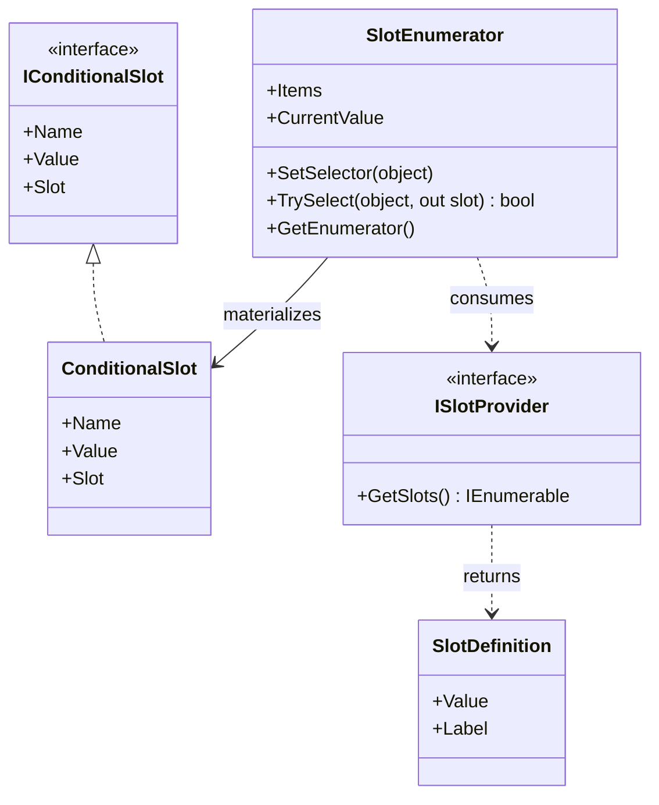
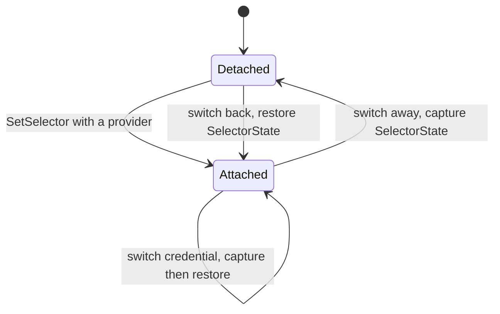

# Design patterns in dynamic slot enumeration

A node can expose a set of ports that depends on a selector — an enum, a boolean, or an instance that describes its own slots. `SlotEnumerator<TSlot>` owns the current selector, materializes one `ConditionalSlot<TSlot>` per selector value, and switches the live connection set when the selector changes. Four patterns carry the implementation: Iterator for the port surface, Builder/Factory for materialization, State with a Memento for switching, and Adapter for the type-erased view.

## Iterator: the enumerator is the port collection

`SlotEnumerator<TSlot>` implements `IEnumerable<TSlot>` and exposes an indexer that returns the slot behind each entry. Consumers iterate ports without knowing how they were built.

```csharp
public partial class SlotEnumerator<TSlot> :
    IConditionalSlotProvider<TSlot>,
    IConditionalSlotProvider,
    System.ComponentModel.INotifyPropertyChanged
{
    public TSlot this[int index] { get { FlushDeferredRemovals(); return Items[index].Slot; } }
    public IEnumerator<TSlot> GetEnumerator() { /* ... */ }
}
```

Source: `Src/Core/VeloxDev.Core/WorkflowSystem/SelectorEx/SlotEnumerator.cs` lines 12-16 and 826-832.

The deferred-removal flush in the indexer matters: the collection can lag behind the selector while a UI control repopulates, and reading through the indexer repairs that before returning a slot.

## Builder and Factory: selector values become slots

A custom provider implements `ISlotProvider.GetSlots()`, returning `SlotDefinition` entries. The enumerator consumes those definitions and builds a `ConditionalSlot<TSlot>` per entry. The definition is a simple value (routing key plus label); the factory work — constructing the slot and wiring it to the node — stays in the enumerator.

```csharp
public interface ISlotProvider
{
    IEnumerable<SlotDefinition> GetSlots();
}

public sealed class SlotDefinition(object value, string label = "")
{
    public object Value { get; } = value;
    public string Label { get; } = label;
}
```

Source: `Src/Core/VeloxDev.Core/Interfaces/WorkflowSystem/Providers/ISlotProvider.cs` lines 16-22; `Src/Core/VeloxDev.Core/WorkflowSystem/SelectorEx/SlotDefinition.cs` lines 6-12.



`SetSelector` accepts either a well-known selector type or an `ISlotProvider` instance, so the same entry point covers enum-driven and data-driven ports.

Source: `Src/Core/VeloxDev.Core/Interfaces/WorkflowSystem/Providers/IConditionalSlotProvider.cs` lines 29-61; implementation at `Src/Core/VeloxDev.Core/WorkflowSystem/SelectorEx/SlotEnumerator.cs` lines 285-424.

## State and Memento: switching remembers each credential

Each selector value is a credential: switching away from it captures the live connection state, and switching back restores it. `SelectorState` is the Memento — the selector type, the items, and the links that were attached. `CaptureState`, `ApplyDetachedState` and `ApplyAttachedState` are the State transitions that detach the old set and attach the new one.

```csharp
private sealed class SelectorState(
    string typeName,
    Type? type,
    IReadOnlyList<ConditionalSlot<TSlot>> items,
    IReadOnlyList<ILinkComponent> links)
{
    public string TypeName { get; } = typeName;
    public Type? Type { get; } = type;
    public IReadOnlyList<ConditionalSlot<TSlot>> Items { get; } = items;
    public IReadOnlyList<ILinkComponent> Links { get; } = links;
}
```

Source: `Src/Core/VeloxDev.Core/WorkflowSystem/SelectorEx/SlotEnumerator.cs` lines 662-672; capture at line 513, apply at lines 525 and 542.



The per-credential memory is why the class keeps a private dictionary of `SelectorState` values keyed by selector type; an enum or provider that returns does not lose its prior wiring.

Source: `Src/Core/VeloxDev.Core/WorkflowSystem/SelectorEx/SlotEnumerator.cs` lines 376-424.

## Adapter: one type-erased view for type-agnostic callers

The generic interface names `TSlot`, which a caller holding only an object cannot close. `IConditionalSlotProvider` is the adapter: it exposes `Parent`, `SelectorTypeName`, `SelectorType`, `CurrentValue`, `Slots` and `TrySelect` with the type argument erased. `SlotEnumerator<TSlot>` implements it explicitly, so existing generic callers are unaffected.

Source: `Src/Core/VeloxDev.Core/Interfaces/WorkflowSystem/Providers/IConditionalSlotProvider.cs` lines 63-107.

A second adapter sits on the node side. `IConditionalSlotProviders` lets a node publish the enumerators it installed, in install order, without exposing the named properties that hold them. `NodeHelper<T>` implements that interface for free.

Source: `Src/Core/VeloxDev.Core/Interfaces/WorkflowSystem/Providers/IConditionalSlotProviders.cs` lines 135-146.

## Pattern summary

| Pattern | Participants | Design consequence |
| --- | --- | --- |
| Iterator | `SlotEnumerator<TSlot>` | Ports are a sequence, not reflection over properties |
| Builder / Factory | `ISlotProvider`, `SlotDefinition`, `ConditionalSlot<TSlot>` | Selector values become wired slots in one place |
| State / Memento | `SelectorState`, capture/apply methods | Each credential keeps its own connections |
| Adapter | `IConditionalSlotProvider`, `IConditionalSlotProviders` | Type-agnostic consumers and node-side discovery |

The declared ports feed compile-time routing and joins; see [Workflow compiler](../04_workflow-compiler/index.md).
