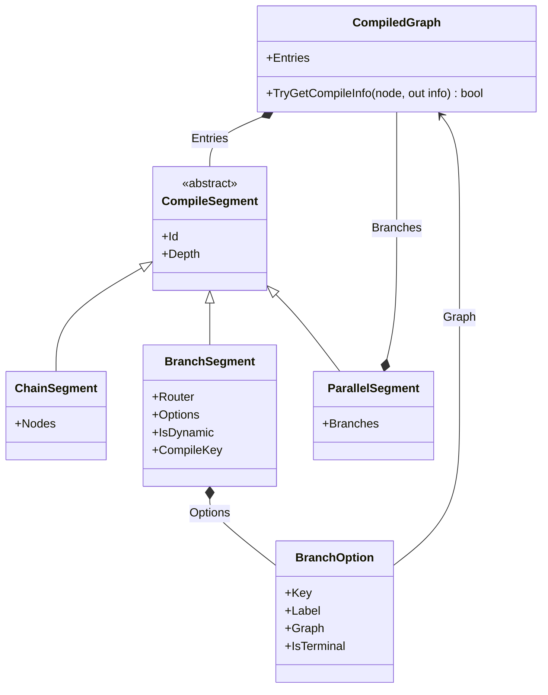
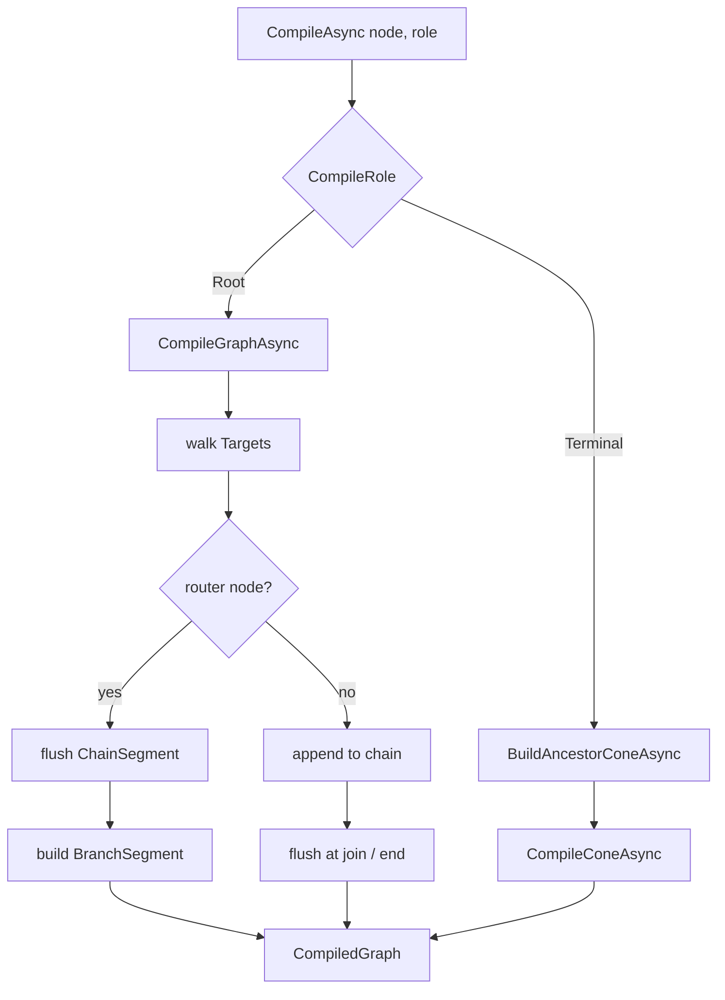
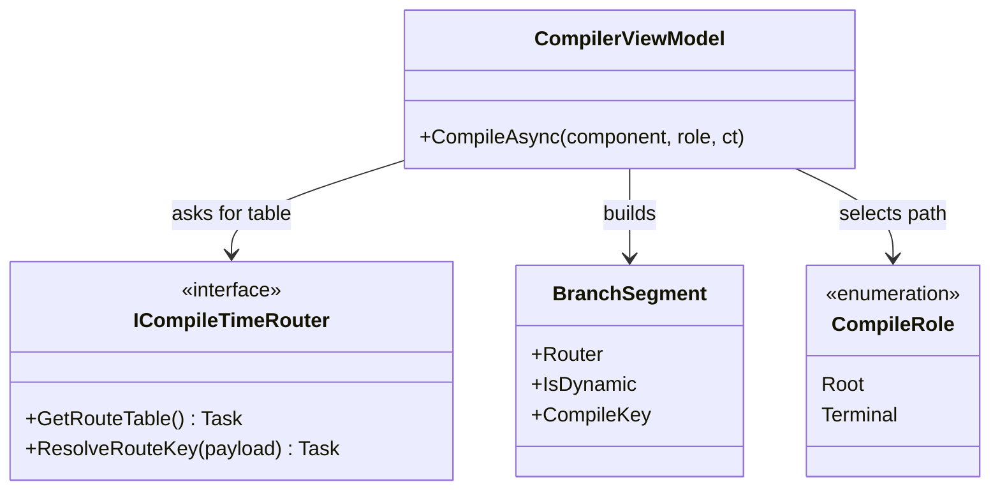

# Design patterns in the workflow compiler

The compiler turns a live, mutable graph into an immutable execution model. It walks the graph once, decides branch structure through a router contract, and emits nested segments. The design is a Builder that produces a Composite, with a Strategy seam for routing and a small Interpreter-friendly model that the runtime consumes.

## Composite: the compiled graph is a tree of segments

`CompiledGraph` holds an ordered collection of `CompileSegment`. `CompileSegment` is abstract; its three concrete forms are `ChainSegment` (a linear run of nodes), `BranchSegment` (one router plus options), and `ParallelSegment` (a fan-out group). A branch option holds a child `CompiledGraph`, and a parallel segment holds child graphs too, so the output nests to arbitrary depth.



Source: `Src/Core/VeloxDev.Core/WorkflowSystem/CompilerEx/Compile/Model/CompiledGraph.cs` lines 19-27; `.../CompileSegment.cs` lines 10-14; `.../ChainSegment.cs` lines 25-28; `.../BranchSegment.cs` lines 43-63; `.../ParallelSegment.cs` lines 75-79; `.../BranchOption.cs` lines 91-109.

The graph also owns the compile identity of every node. `CompileBindings` maps a node to a `NodeCompileInfo`, and the runtime reads that identity back from the graph instead of asking the node. That is what lets a node which does not implement `ICompileTimeAware` still take part in joins and redirects.

Source: `Src/Core/VeloxDev.Core/WorkflowSystem/CompilerEx/Compile/Model/CompiledGraph.cs` lines 14-27.

## Builder: one linear pass assembles the product

`CompileAsync` is the single entry point. It selects a construction path by `CompileRole`, calls `CompileGraphAsync`, and stores the result. The builder state (`CompileState`) carries the visit set, the counter used for orders, the optional cone restriction, and the join-input map.

```csharp
CompiledGraph graph = role switch
{
    CompileRole.Root => await CompileGraphAsync(node, new CompileState(), ct).ConfigureAwait(false),
    CompileRole.Terminal => await CompileConeAsync(
        node, await BuildAncestorConeAsync(node, ct).ConfigureAwait(false), ct).ConfigureAwait(false),
    _ => throw new ArgumentOutOfRangeException(nameof(role), role, null),
};
```

Source: `Src/Core/VeloxDev.Core/WorkflowSystem/CompilerEx/Compile/CompilerViewModel.cs` lines 38-59; builder state at lines 475-495.

The walk accumulates a chain in a list and flushes it into a `ChainSegment` whenever a router, a join boundary or the end of the subtree interrupts linear flow. The flush is what keeps the product structural rather than a flat node list.

Source: `Src/Core/VeloxDev.Core/WorkflowSystem/CompilerEx/Compile/CompilerViewModel.cs` lines 45-140 and 258-268.



## Strategy: routing is a node-supplied contract

Branch shape is not hard-coded in the compiler. A node that implements `ICompileTimeRouter` supplies two operations: `GetRouteTable()` returns key-to-targets at compile time, and `ResolveRouteKey(payload)` returns the key at runtime. The compiler asks for the table and translates it into branch options; the runtime later asks for the key.

```csharp
public interface ICompileTimeRouter
{
    Task<IReadOnlyDictionary<object, IReadOnlyList<INodeComponent>>> GetRouteTable();
    Task<object?> ResolveRouteKey(object? payload);
}
```

Source: `Src/Core/VeloxDev.Core/WorkflowSystem/CompilerEx/Compile/Contracts/ICompileTimeRouter.cs` lines 14-21.

`RouterCompileMode` documents the two strategies a router may implement: `Static` returns only the selected branch at compile time, `Dynamic` returns every branch and leaves the choice to the runtime. The compiler does not enforce the mode; it observes whether `ResolveRouteKey(null)` returns a key (static) or `null` (dynamic), and records `IsDynamic` on the segment.

Source: `Src/Core/VeloxDev.Core/WorkflowSystem/CompilerEx/Compile/Contracts/RouterCompileMode.cs` lines 33-40; the decision at `CompilerViewModel.cs` lines 71-72.



## Interpreter-facing model: data, not behaviour

The compiled model carries almost no behaviour. Segments expose properties; `BranchSegment` and `BranchOption` normalize their keys only when restored from a document (`[OnDeserialized]`). The execution decisions live in the runtime, which switches on the segment type. Keeping the product inert is what makes it serializable and safe to share across a fan-out.

Source: `Src/Core/VeloxDev.Core/WorkflowSystem/CompilerEx/Compile/Model/BranchSegment.cs` lines 56-63; `.../BranchOption.cs` lines 98-109.

## Pattern summary

| Pattern | Participants | Design consequence |
| --- | --- | --- |
| Composite | `CompiledGraph`, `CompileSegment`, `BranchOption` | Nested execution model with uniform traversal |
| Builder | `CompilerViewModel`, `CompileState` | One pass, immutable product |
| Strategy | `ICompileTimeRouter`, `CompileRole` | Node-owned routing, two compile directions |
| Interpreter (model side) | Segment types | Runtime owns behaviour; product is serializable |

The runtime that interprets this model is analyzed next; see [Workflow runtime](../05_workflow-runtime/index.md).
