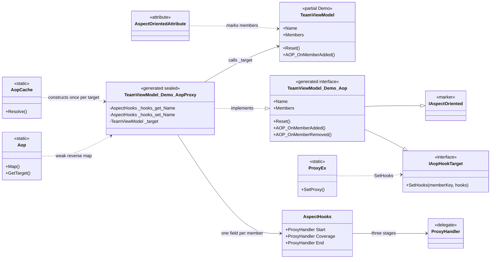

# Design Patterns — AOP

The AOP feature is split across two layers, and the split is the design:

- **Compile time** — `AopSurface` emits a mirror interface and a `sealed` proxy class into the consumer's assembly; `AopProxy` emits the cached `Aop()` extension.
- **Run time** — `ProxyEx.SetProxy` writes one `AspectHooks` field on the proxy; the proxy's member bodies run `start` → body or `coverage` → `end`.

There is no `DispatchProxy` and no `Reflection.Emit`: the "dynamic" proxy is ordinary generated C#, which is why the type is identical under trimming and NativeAOT.

## Class diagram



> Types are those of the WPF demo (`Examples/AOP/WPF/Demo`), where `Demo.TeamViewModel` is the target. The interface and proxy names come from `Base/AopNames.cs`.

## 1. Proxy — generated static proxy

The classic proxy pattern, moved to compile time. The generated class forwards every mirrored member to `_target`:

```csharp
// Emitted by AopSurface.WriteProxy; this is the shape from AopFixture's generated file
public int Add(int a, int b)
{
    var h = _hooks_Add;
    if (h is null)
    {
        return _target.Add(a, b);

    }
    // hook pipeline ...
}
```

Contrast with the old runtime design, which created a `DispatchProxy` through `Reflection.Emit` and dispatched by `MethodInfo`. The test `TheProxyIsGeneratedIntoTheConsumersOwnAssembly` pins the difference:

```csharp
Assert.AreSame(
    typeof(AopFixture).Assembly,
    proxy.GetType().Assembly,
    "the proxy must be emitted at compile time, not created by Reflection.Emit at runtime");
```

## 2. Chain of Responsibility / Interceptor — the three stages

Each `AspectHooks` is a fixed three-link chain. The stage contract (`AspectHooks.cs`) is explicit about what survives:

- `Start` runs first; its return becomes the next stage's `previous`.
- `Coverage`, when non-null, **replaces** the member body; otherwise the body runs.
- `End` observes the final result; its own return is discarded.

The proxy wiring (`AopSurface.WriteProxy`, method branch):

```csharp
var args = new object?[] { a, b };
var r0 = h.Start?.Invoke(args, null);
object? r1;
if (h.Coverage is null)
{
    r1 = _target.Add(a, b);
}
else
{
    r1 = h.Coverage.Invoke(args, r0);
}

h.End?.Invoke(args, r1);
return (int)r1!;
```

The set is installed whole by `IAopHookTarget.SetHooks`, so the chain cannot be half-replaced — a deliberate invariant documented on `AspectHooks`.

## 3. Factory + Flyweight — `AopCache.Resolve`

The generated extension is the factory, and the cache is the flyweight identity map:

```csharp
// Emitted by AopWriter.WriteExtension for AopFixture
public static global::VeloxDev.AopInterfaces.AopFixture_VeloxDev_Core_Test_AspectOriented_Aop Aop(this global::VeloxDev.Core.Test.AspectOriented.AopFixture instance)
    => global::VeloxDev.AspectOriented.AopCache.Resolve<
        global::VeloxDev.Core.Test.AspectOriented.AopFixture,
        global::VeloxDev.AopInterfaces.AopFixture_VeloxDev_Core_Test_AspectOriented_Aop>(
        instance,
        static x =>
        {
            var p = new global::VeloxDev.AopInterfaces.AopFixture_VeloxDev_Core_Test_AspectOriented_AopProxy(x);
            global::VeloxDev.AspectOriented.Aop.Map(p, x);
            return p;
        });
```

`AopCache.Entry<TClass, TInterface>` gives each `(target type, interface)` pair its own `ConditionalWeakTable`, so the flyweight store needs no generated cache code. `AopProxyTests.OneProxyPerInstance_AndADifferentOnePerTarget` pins the one-proxy-per-instance rule.

## 4. Registry — weak reverse mapping

`Aop` is a registry in the weak sense: it maps proxy → target for `GetTarget`, but the key is weak, so the registry never roots a proxy.

```csharp
// Src/Core/VeloxDev.Core/AspectOriented/Aop.cs
public static void Map(object proxy, object target)
    => _proxyToTarget.Add(proxy, target);

public static TTarget? GetTarget<TTarget>(IAspectOriented proxy) where TTarget : class
    => _proxyToTarget.TryGetValue(proxy, out var t) ? (TTarget)t : null;
```

Together with `AopCache`'s weak key, this makes the proxy and target collectable as a pair — asserted by `AProxyIsCollectableOnceItsTargetIs`. A strong static registry, which the previous design had, fails that test.

## 5. Marker interface and classification

`IAspectOriented` is an empty marker implemented by every generated interface and used as the constraint on `SetProxy` and `Resolve`. `IAopHookTarget` is its non-empty sibling: it exists only on the generated interface and is implemented explicitly by the proxy, so `SetProxy` can distinguish a real proxy from a hand-written marker implementation and reject the latter.

`ProxyMembers` classifies a registration as getter, setter, or method; the generator turns that into the `get_*` / `set_*` / bare-name switch.

## Pattern summary

| Pattern | Participants | Role |
|---|---|---|
| Proxy | `{Interface}Proxy`, `{Interface}` | Stand-in that forwards to the target |
| Chain / Interceptor | `AspectHooks`, `ProxyHandler` | Before / replace / after stages |
| Factory | generated `Aop()` extension, `AopCache.Resolve` | Creates one proxy on first use |
| Flyweight | `AopCache.Entry<TClass,TInterface>` | One proxy per target instance |
| Registry (weak) | `Aop` | Reverse lookup without rooting |
| Marker interface | `IAspectOriented`, `IAopHookTarget` | Constraint and installation surface |

> Source: `Src/Core/VeloxDev.Core/AspectOriented/{AspectHooks,ProxyEx,Aop,AopCache,AspectOrientedAttribute}.cs`, `Src/Core/VeloxDev.Core/Interfaces/AspectOriented/IAspectOriented.cs`, `Src/Generators/VeloxDev.Core.Generator/{AopSurface,AopProxy}.cs`, `Writers/AopWriter.cs`, `Src/Core/VeloxDev.Core.Test/AspectOriented/AopProxyTests.cs`.
