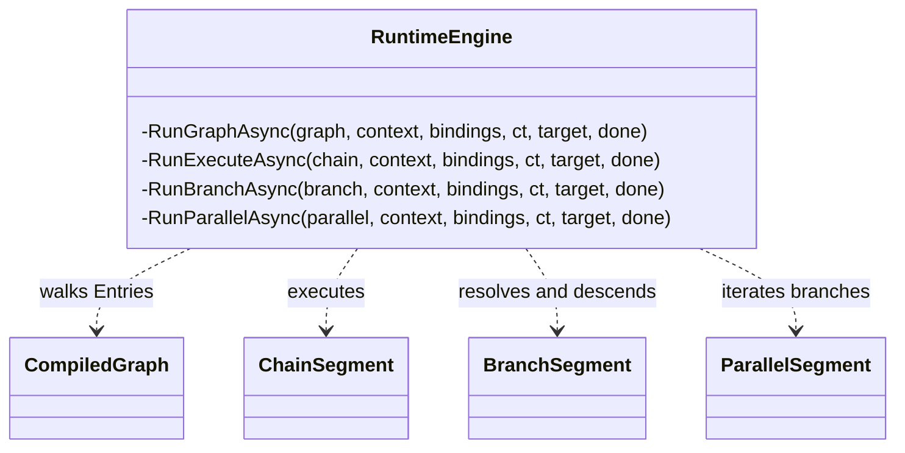
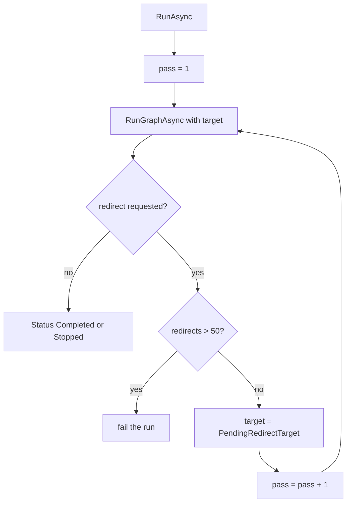

# Interpreter and execution pipeline

The engine is an Interpreter: the compiled model is inert data, and `RunGraphAsync` dispatches on each segment's runtime type to the routine that knows how to execute it. The outer `RunAsync` loop turns redirects into whole-graph re-runs and keeps the session state consistent across them.

## Segment dispatch

`RunGraphAsync` iterates the graph's entries and switches on the concrete segment. A chain runs its nodes in order, a branch resolves a route key and descends into one option's sub-graph, and a parallel group runs each child graph in sequence. The re-entrant shape mirrors the Composite model exactly.

```csharp
switch (entry)
{
    case ChainSegment exec:
        terminated = await RunExecuteAsync(exec, context, bindings, ct, redirectTarget, done);
        break;
    case BranchSegment branch:
        terminated = await RunBranchAsync(branch, context, bindings, ct, redirectTarget, done);
        break;
    case ParallelSegment parallel:
        terminated = await RunParallelAsync(parallel, context, bindings, ct, redirectTarget, done);
        break;
}
```

Source: `Src/Core/VeloxDev.Core/WorkflowSystem/CompilerEx/Runtime/RuntimeEngine.cs` lines 145-190.



`ParallelSegment` is executed sequentially by design. The class comment states the reason: the shared `IRuntimeContext` blackboard is not thread-safe, so true parallelism would corrupt join aggregation.

Source: `Src/Core/VeloxDev.Core/WorkflowSystem/CompilerEx/Compile/Model/ParallelSegment.cs` lines 70-79.

## Redirects are re-runs, not gotos

A failed or explicitly redirected drive does not continue from an arbitrary point. The pass ends at the requesting node and sets `PendingRedirectTarget` to a compile order. `RunAsync` then advances the pass counter and calls `RunGraphAsync` again; nodes with an order below the target are skipped, and the graph is driven from the target onward.

```csharp
var terminated = await RunGraphAsync(graph, context, bindings, ct, redirectTarget, redirects == 0 ? done : null);
if (!terminated && context.PendingRedirectTarget is { } next)
{
    redirects++;
    if (redirects > MaxRedirects) { /* stop the run */ }
    redirectTarget = next;
    continue;
}
```

Source: `Src/Core/VeloxDev.Core/WorkflowSystem/CompilerEx/Runtime/RuntimeEngine.cs` lines 56-90; the cap is `MaxRedirects = 50` at line 59.



The output registry is cleared once per `RunAsync`, not per pass. Stale outputs from an earlier pass are filtered by their pass stamp when a join collects inputs, which is why a redirect cannot silently feed old data into a merged node.

Source: `Src/Core/VeloxDev.Core/WorkflowSystem/CompilerEx/Runtime/RuntimeEngine.cs` lines 75-85; `.../Contracts/IRuntimeContext.cs` lines 132-146.

## Mediator: one session carries runtime state

`IRuntimeContext` is the mediator between the engine and the nodes. It inherits `ITaskContext`, so the engine can pass the session itself into `INodeHelper.ReceiveAsync` as the task context. It carries the run identifier, sequence, logs, current segment and node index, branch key, attempt, status, target tracking, redirect targets, and a shared variable store.

Source: `Src/Core/VeloxDev.Core/WorkflowSystem/CompilerEx/Runtime/Contracts/IRuntimeContext.cs` lines 12-146.

The node writes through the same object: `Log`, `Error`, `Warn`, `ErrorAsync`, `WarnAsync`, `Set` and `TryGet` are all members of the session. This is the mediator pattern's point — the node never holds a reference to the engine or to a sink; it reports to the context, and the engine decides what that report means.

```csharp
context.Error("...");      // log, stop the flow, no sink record
await context.ErrorAsync("...");  // log and await the host's error sink
context.Set("key", value); // shared variable for later nodes
```

Source: `Src/Core/VeloxDev.Core/WorkflowSystem/CompilerEx/Runtime/Contracts/IRuntimeContext.cs` lines 88-130.

## Join aggregation

A node with multiple compiled inputs does not receive a bare payload. The engine registers each upstream output in the context, and the join collects them with `CollectGroupedInputs`, which keeps only outputs from the current pass or from the contract-preserved prefix before a redirect target. The filtered dictionary is then injected as `GroupData`.

Source: `Src/Core/VeloxDev.Core/WorkflowSystem/CompilerEx/Runtime/Contracts/IRuntimeContext.cs` lines 132-146; group model at `.../Model/GroupData.cs`.

## Pattern summary

| Pattern | Participants | Design consequence |
| --- | --- | --- |
| Interpreter | `RuntimeEngine` over `ChainSegment` / `BranchSegment` / `ParallelSegment` | Model stays inert; execution decisions live in one place |
| Mediator | `IRuntimeContext` / `RuntimeContext` | Nodes report without knowing the engine |
| Re-run control flow | `RunAsync` redirect loop | Redirects reuse one validated execution path |

The strategy contracts that surround this pipeline are covered in [Strategy and checkpoint](../01_strategy-and-checkpoint/index.md).
