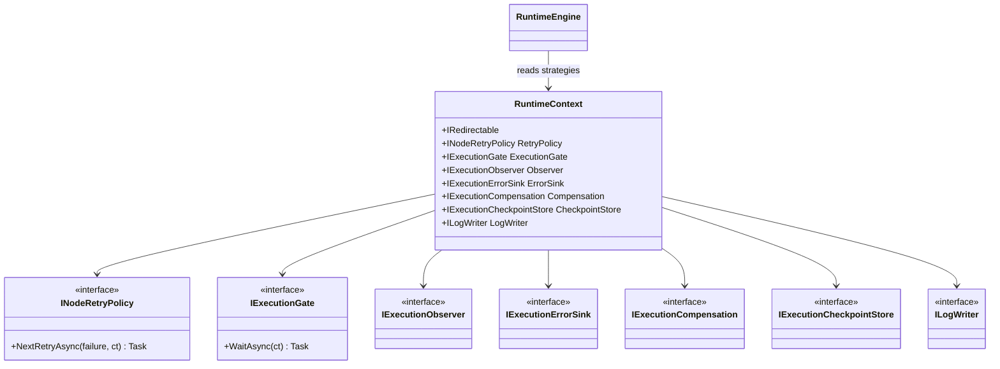
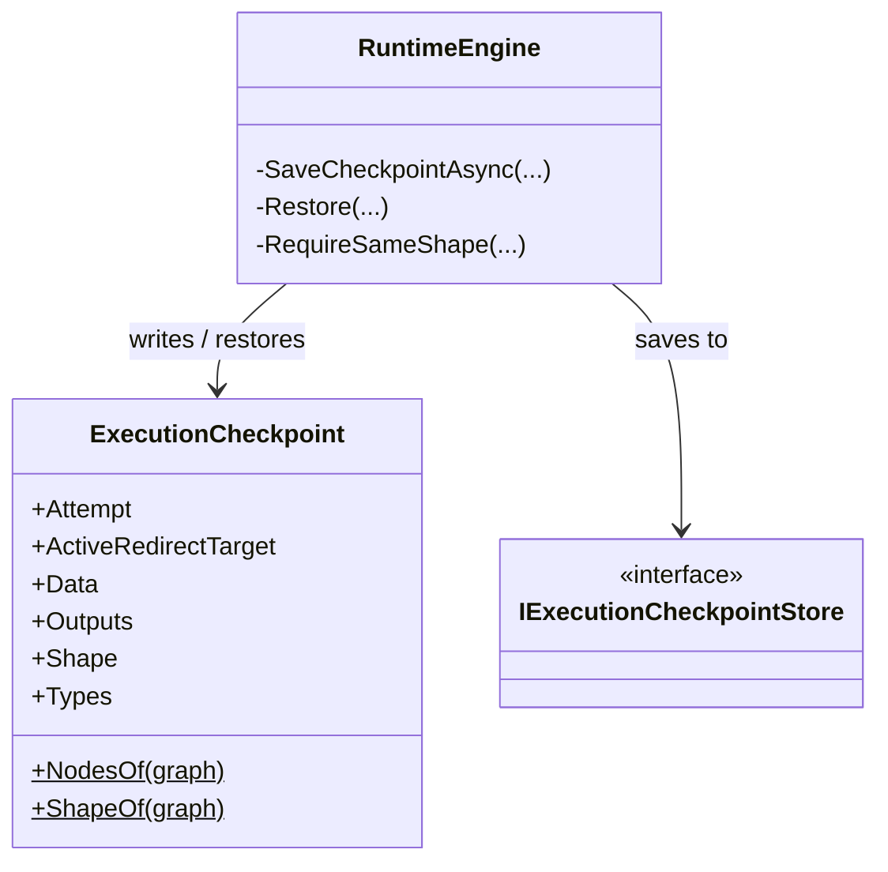

# Strategy and checkpoint

The runtime defines a narrow contract for each concern a host might want to replace. The engine reads the instance from `RuntimeContext` and calls it at a fixed point in the pipeline. Alongside these strategies, `ExecutionCheckpoint` is a memento that lets a later run resume without re-driving completed nodes.

## The strategy contracts

| Concern | Contract | Default implementation | Called when |
| --- | --- | --- | --- |
| Retry | `INodeRetryPolicy` | `ExponentialBackoffRetry` | A node threw |
| Redirect | `IRedirectable` | none — node-owned | A drive reported an error |
| Pause | `IExecutionGate` | `ManualExecutionGate` | Before each node |
| Observe | `IExecutionObserver` | `DelegateExecutionObserver` | Run start/end and node transitions |
| Report errors | `IExecutionErrorSink` | `DelegateExecutionErrorSink` | `ErrorAsync` / `WarnAsync` |
| Compensate | `IExecutionCompensation` | `DelegateExecutionCompensation` | The run ends |
| Checkpoint | `IExecutionCheckpointStore` | `InMemoryCheckpointStore` | After a node succeeds |
| Log | `ILogWriter` | `TextWriterLogWriter` | A log line is produced |

Sources: `Src/Core/VeloxDev.Core/WorkflowSystem/CompilerEx/Runtime/Contracts/` (`INodeRetryPolicy.cs` line 40, `IRedirectable.cs` line 22, `IExecutionGate.cs` line 28, `IExecutionObserver.cs` line 68, `IExecutionErrorSink.cs` line 78, `IExecutionCompensation.cs` line 40, `IExecutionCheckpointStore.cs` line 29, `ILogWriter.cs` line 29); defaults in `.../Model/`.

The contracts are small on purpose. `INodeRetryPolicy` has one method returning a delay or `null`; `IExecutionGate` has one awaitable point; `IRedirectable` has one method that returns an upstream node or declines.

```csharp
public interface INodeRetryPolicy
{
    Task<TimeSpan?> NextRetryAsync(NodeFailure failure, CancellationToken cancellationToken);
}

public interface IExecutionGate
{
    Task WaitAsync(CancellationToken cancellationToken);
}
```

Source: `Src/Core/VeloxDev.Core/WorkflowSystem/CompilerEx/Runtime/Contracts/INodeRetryPolicy.cs` lines 40-45; `.../IExecutionGate.cs` lines 28-37.



A delegate adapter exists for each observation-style contract, so a host can supply a lambda instead of a class. That is the Strategy pattern at its cheapest: the engine depends on the interface, and the default is a single captured delegate.

Source: `Src/Core/VeloxDev.Core/WorkflowSystem/CompilerEx/Runtime/Model/ExecutionObservers.cs` lines 9-12; `.../ErrorSinks.cs` lines 9-12; `.../Compensations.cs` lines 11-14; `.../ExecutionGates.cs` lines 9-12.

## Retry is not redirect

The two recovery strategies are intentionally distinct. A retry is chosen only for a thrown exception; a node that calls `Error` is making a deliberate control-flow request and is never retried. The policy's `RetryNumber` is its own counter, separate from `IRuntimeContext.Attempt`, which counts passes over the graph and stamps the output registry.

Source: `Src/Core/VeloxDev.Core/WorkflowSystem/CompilerEx/Runtime/Contracts/INodeRetryPolicy.cs` lines 1-49.

## Memento: `ExecutionCheckpoint`

`ExecutionCheckpoint` stores the pass number, the active redirect target, the chained payload, the outputs of completed nodes keyed by a stable node key, and the graph's shape. The shape is the fingerprint a resume checks against; a checkpoint taken over a different graph is refused before the session is touched.

```csharp
public sealed class ExecutionCheckpoint
{
    public int Attempt { get; set; }
    public int? ActiveRedirectTarget { get; set; }
    public object? Data { get; set; }
    public Dictionary<string, object?> Outputs { get; set; } = [];
    public List<string> Shape { get; set; } = [];
    public List<string> Types { get; set; } = [];
}
```

Source: `Src/Core/VeloxDev.Core/WorkflowSystem/CompilerEx/Runtime/Model/ExecutionCheckpoints.cs` lines 27-53.



The engine restores a checkpoint after clearing the output registry, then runs the pass with the checkpoint's own attempt number rather than incrementing it, so the restored outputs still carry the stamp the join filter expects.

Source: `Src/Core/VeloxDev.Core/WorkflowSystem/CompilerEx/Runtime/RuntimeEngine.cs` lines 44-47 and 60-69.

## Pattern summary

| Pattern | Participants | Design consequence |
| --- | --- | --- |
| Strategy | Eight runtime contracts on `RuntimeContext` | Every failure/observation policy is replaceable |
| Memento | `ExecutionCheckpoint` | Resume without re-driving completed nodes |
| Guard / shape check | `RequireSameShape` | A foreign checkpoint is refused, not guessed at |

Back to the runtime overview: [Workflow runtime](../index.md).
