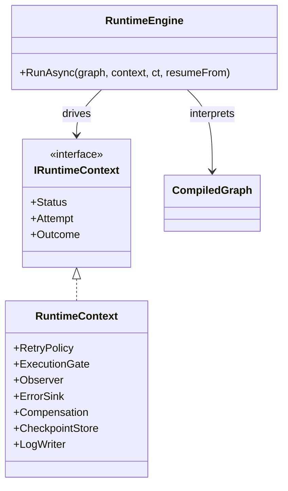

# Design patterns in the workflow runtime

The runtime drives a `CompiledGraph` to completion. Its structure is an Interpreter over the three segment types, surrounded by replaceable strategies for everything that can go wrong or needs observing: retry, redirect, pause, error reporting, compensation, checkpointing and logging.

The feature is large enough to split by the two responsibilities involved:

- [Interpreter and execution pipeline](00_interpreter-execution-pipeline/index.md) — the `RunAsync` loop, the segment switch, redirects as re-runs, and the shared session context.
- [Strategy and checkpoint](01_strategy-and-checkpoint/index.md) — the resilience contracts, their default implementations, and the `ExecutionCheckpoint` memento.

## Shape of the composition

`RuntimeEngine` is a sealed class with one public entry, `RunAsync`. Everything else in the feature is either a contract the host can supply or a default implementation of one. `RuntimeContext` is the mutable session that carries state and holds the strategy instances.

Source: `Src/Core/VeloxDev.Core/WorkflowSystem/CompilerEx/Runtime/RuntimeEngine.cs` lines 37-56; `.../Contracts/IRuntimeContext.cs` line 12; `.../Model/RuntimeContext.cs` lines 16-205.

The split keeps the engine's control flow readable: the interpreter half decides where execution goes, and the strategy half decides how a failure, a pause or a log is handled when it gets there.
