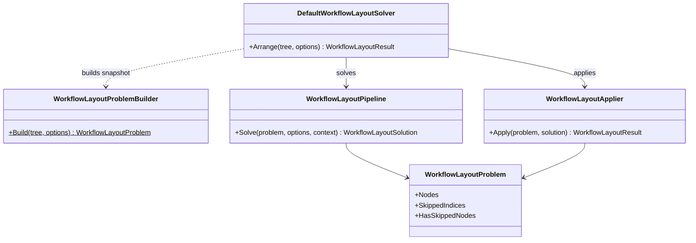
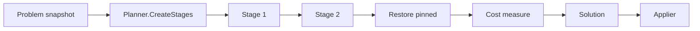
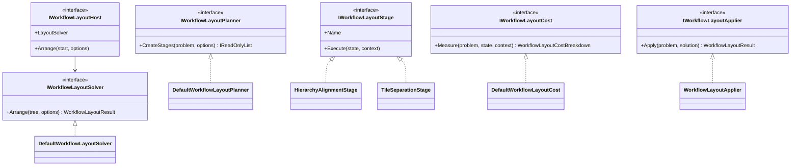

# Design patterns in workflow auto-layout

Auto-layout separates three questions: what the graph looks like right now, how positions are computed, and how the result is written back. The implementation answers them with a snapshot Builder, a Strategy-selected composition of stages, a Pipeline that runs the stages, and a single undoable Command that applies the outcome.

## Builder: the problem is an immutable snapshot

`solve` never dereferences a live node. `WorkflowLayoutProblemBuilder` copies the current geometry, links, pinning flags and traversal scope into a `WorkflowLayoutProblem`; the pipeline and the cost measure work only from that snapshot and the solved arrays.

```csharp
var problem = WorkflowLayoutProblemBuilder.Build(tree, options);
var pipeline = new WorkflowLayoutPipeline(_planner, _cost);
var solution = pipeline.Solve(problem, options);
return new WorkflowLayoutApplier(tree).Apply(problem, solution);
```

Source: `Src/Core/VeloxDev.Core/WorkflowSystem/Layout/DefaultWorkflowLayoutSolver.cs` lines 127-135.



The solve guard is explicit: `WorkflowLayoutPipeline.Solve` throws on a null problem, resets diagnostics, and never mutates model state.

Source: `Src/Core/VeloxDev.Core/WorkflowSystem/Layout/WorkflowLayoutPipeline.cs` lines 32-43.

## Pipeline: stages run in order, pinned nodes are restored

A stage reads the problem and writes only its own coordinate arrays in `WorkflowLayoutState`. The pipeline asks the planner for the ordered stages, checks cancellation before each one, then restores pinned positions so a misbehaving stage cannot move them.

```csharp
var state = new WorkflowLayoutState(problem, options);
var stages = _planner.CreateStages(problem, options);

foreach (var stage in stages)
{
    context.CancellationToken.ThrowIfCancellationRequested();
    stage.Execute(state, context);
}

RestorePinnedPositions(state);
```

Source: `Src/Core/VeloxDev.Core/WorkflowSystem/Layout/WorkflowLayoutPipeline.cs` lines 43-52.



The default planner composes two stages: hierarchy alignment, which places every node on its parent's centre line, and tile separation, which repairs remaining conflicts. The separation stage receives a position policy by constructor, so a stricter strategy can replace tolerance behaviour without editing the stage.

Source: `Src/Core/VeloxDev.Core/WorkflowSystem/Layout/DefaultWorkflowLayoutPlanner.cs` lines 146-167; `.../HierarchyAlignmentStage.cs`; `.../TileSeparationStage.cs`.

## Strategy: five replaceable seams

`IWorkflowLayoutSolver` is the whole-solution seam. Inside it, four smaller seams are injected: planner (stage composition), stage (one phase), cost (quality measure), and applier (write-back). A fifth strategy, `IWorkflowLayoutPositionPolicy`, is consumed by the separation stage.



Source: contracts in `Src/Core/VeloxDev.Core/Interfaces/WorkflowSystem/Layout/IWorkflowLayoutSolver.cs` lines 12-44, `.../IWorkflowLayoutStage.cs` lines 56-64, `.../IWorkflowLayoutPlanner.cs` lines 74-80, `.../IWorkflowLayoutCost.cs` lines 93-101, `.../IWorkflowLayoutApplier.cs` lines 114-120.

The host is the tree's helper, and the one-call entry points resolve it through the node's parent. A tree that does not implement `IWorkflowLayoutHost` falls back to the default solver, so registration is optional rather than mandatory.

Source: `Src/Core/VeloxDev.Core/WorkflowSystem/Layout/WorkflowLayoutEx.cs` lines 180-232.

## Command: one apply, one undo

The applier is the only part that touches the model, and it runs on the calling thread after the solve. Every changed anchor is submitted as one `IActionPair`, so a single undo restores the whole arrangement. The application also re-checks each node against the snapshot and skips nodes that moved in the meantime instead of overwriting them.

Source: `Src/Core/VeloxDev.Core/WorkflowSystem/Layout/WorkflowLayoutApplier.cs` lines 1-112; the contract's rationale is in `.../IWorkflowLayoutApplier.cs` lines 105-113.

## Pattern summary

| Pattern | Participants | Design consequence |
| --- | --- | --- |
| Builder | `WorkflowLayoutProblemBuilder`, `WorkflowLayoutProblem` | Solving cannot mutate the live graph |
| Pipeline | `WorkflowLayoutPipeline`, `IWorkflowLayoutStage` | Phases are isolated and reorderable |
| Strategy | solver, planner, stage, cost, applier, policy | Any layer replaceable without touching callers |
| Command | `WorkflowLayoutApplier` + `IActionPair` | One undo for a whole layout |

The snapshot preserves the connection structure that the next feature routes input against; see [Canvas input and navigation](../07_canvas-input-navigation/index.md).
