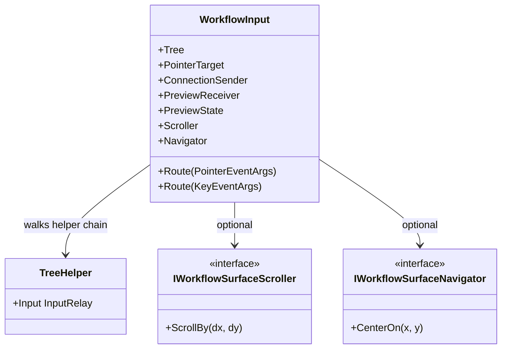
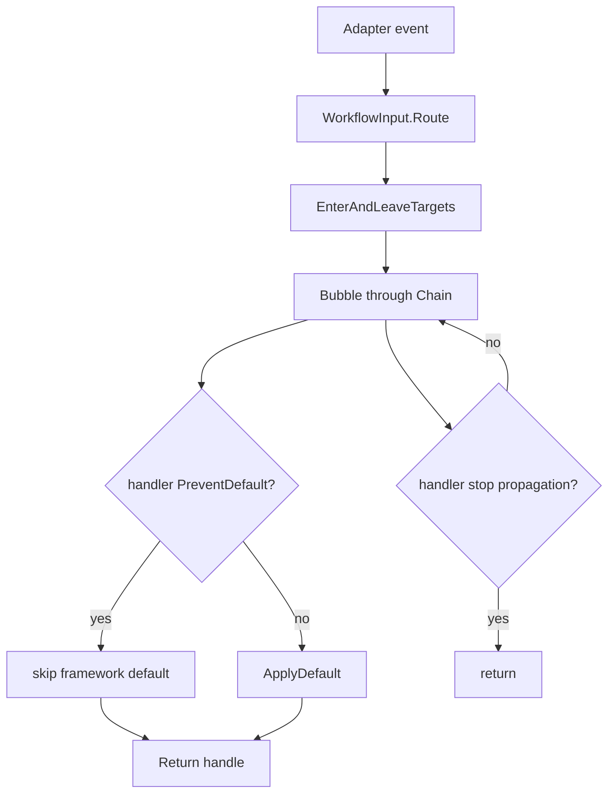

# Design patterns in canvas input and navigation

Pointer and keyboard input enters through one component, `WorkflowInput`, which routes it through the graph's helper chain and then applies the framework's own default reaction. Navigation is split into two narrow contracts — a relative scroller and an absolute navigator — that an adapter implements. The feature therefore combines a Mediator, a bubbling Chain of Responsibility, an Observer surface, and a Strategy seam for platform scrolling.

## Mediator: `WorkflowInput` is the single routing point

One `WorkflowInput` instance exists per tree, created lazily through a `ConditionalWeakTable`. It owns the current pointer target, the connection sender, the preview receiver and the preview state, and it exposes `Route` overloads for pointer and key events. Adapters translate their platform event into the framework's event type and call `Route`; they do not decide who hears it.

```csharp
var layer = (e.Source as Visual)?.ZIndex ?? 0;
var anchor = WorkflowSurfaceMath.ToCanvasLocalAnchor(point.X, point.Y, layer, viewModel.Layout);
var input = WorkflowInput.For(viewModel);
var target = ResolveTarget(e.Source, viewModel, anchor.Horizontal, anchor.Vertical, input.HitRadius);

var handle = new WorkflowEventHandle();
input.Route(args(anchor, target, handle));
```

Source: `Src/Adapters/VeloxDev.Avalonia/WorkflowSystem/AttachedBehaviors/WorkflowSurfaceBehavior.cs` lines 316-322.

Source: `Src/Core/VeloxDev.Core/WorkflowSystem/GUI/Events/WorkflowInput.cs` lines 31-56, 257-297.



The component adds no input members to its own contract. It exposes the relay through its helper, which is why a tree, node, slot or link can all take part without `IWorkflowComponent` growing.

Source: `Src/Core/VeloxDev.Core/WorkflowSystem/Templates/Helpers/TreeHelper.cs` line 40; `.../NodeHelper.cs` line 19.

## Chain of Responsibility: the event bubbles through helpers

`Chain` turns a component into the ordered list of helpers that should hear an event: the node's helper, then the slot's, then the link's, then the tree's. `Bubble` walks that list, hands the event to each relay, and stops when a handler asks to suppress further propagation.

```csharp
private IEnumerable<IWorkflowHelper> Chain(IWorkflowComponent? target)
{
    switch (target)
    {
        // resolve node / slot / link / tree and yield their helpers in route order
    }
}
```

Source: `Src/Core/VeloxDev.Core/WorkflowSystem/GUI/Events/WorkflowInput.cs` lines 358-380; bubbling at lines 320-356.

`WorkflowEventHandle` is the control token: `PreventDefault` suppresses the framework's own reaction, and a second flag stops the event from going further up. The handle is returned by the raising method, so a handler can communicate both decisions through one object.

Source: `Src/Core/VeloxDev.Core/WorkflowSystem/GUI/Events/WorkflowEventHandle.cs`; usage at `.../WorkflowInput.cs` lines 320-356.



## Observer: one relay per helper, typed events

Every helper owns an `InputRelay`. The relay declares the eight input events and dispatches a single argument object to exactly one of them by runtime type, so the raising logic exists once instead of in every helper implementation. Subscribers see the relay as the sender, which tells them which element of the route they are hearing from.

```csharp
internal void Raise(PointerEventArgs e)
{
    switch (e)
    {
        case PointerEnteredEventArgs entered: PointerEntered?.Invoke(this, entered); break;
        case PointerExitedEventArgs exited: PointerExited?.Invoke(this, exited); break;
        // ... moved, pressed, released, wheel
    }
}
```

Source: `Src/Core/VeloxDev.Core/WorkflowSystem/GUI/Events/Input/InputRelay.cs` lines 15-62.

The lifecycle events on nodes, slots and trees follow the same shape but are relayed by static helpers. `WorkflowEventRelay.Attach` connects a host's sink to the helper's events and returns an `IDisposable` that unsubscribes, so a host that detaches a view also detaches its handlers.

Source: `Src/Core/VeloxDev.Core/WorkflowSystem/GUI/Events/WorkflowEventRelay.cs` lines 18-52.

## Strategy and Adapter: navigation without platform branching

`IWorkflowSurfaceScroller.ScrollBy` takes wheel deltas, not scroll offsets, and `IWorkflowSurfaceNavigator.CenterOn` takes a canvas-local point. `SurfaceScrollerCore` implements both over a narrow `ISurfaceScrollHost` supplied by the adapter. The arithmetic — per-axis sign, zero-delta rule, overscroll growth — is written once; the adapter only reads and writes its platform's scroll container.

```csharp
public sealed class SurfaceScrollerCore : IWorkflowSurfaceScroller, IWorkflowSurfaceNavigator
{
    private readonly ISurfaceScrollHost host;
    public void ScrollBy(double wheelDeltaX, double wheelDeltaY) { /* ... */ }
    public void CenterOn(double localX, double localY) { /* ... */ }
}
```

Source: `Src/Core/VeloxDev.Core/WorkflowSystem/GUI/Surface/SurfaceScrollerCore.cs` lines 108-180; contracts at `Src/Core/VeloxDev.Core/WorkflowSystem/GUI/Events/IWorkflowSurfaceScroller.cs` lines 38-51 and `.../IWorkflowSurfaceNavigator.cs` lines 74-82.

Each adapter registers the behaviour through an attached property. The WPF surface behavior, for example, is a `DependencyObject` with attached registration properties for the scroll viewer, canvas and grid decorator; the Avalonia behavior is the same role over `AvaloniaProperty`. That is the Adapter half: the platform object is adapted to the Core contracts, and the seven implementations do not leak into Core.

Source: `Src/Adapters/VeloxDev.WPF/WorkflowSystem/AttachedBehaviors/WorkflowSurfaceBehavior.cs` lines 16-77; `Src/Adapters/VeloxDev.Avalonia/WorkflowSystem/AttachedBehaviors/WorkflowSurfaceBehavior.cs` lines 22-74.

## Geometry as a shared facade

`WorkflowSurfaceMath` is a static facade over coordinate conversion and clamping. Its methods take a `CanvasLayout` explicitly rather than reading model state, which keeps the arithmetic testable and lets the scroller and the grid decorator share one definition of scroll/content offset.

Source: `Src/Core/VeloxDev.Core/WorkflowSystem/GUI/Math/WorkflowSurfaceMath.cs` lines 14-44.

## Pattern summary

| Pattern | Participants | Design consequence |
| --- | --- | --- |
| Mediator | `WorkflowInput` | One owner of input state and routing |
| Chain of Responsibility | `Chain` / `Bubble` over helpers | Bubbling without a widget hierarchy in Core |
| Observer | `InputRelay`, `WorkflowEventRelay` | Typed events, one raising implementation |
| Strategy / Adapter | `IWorkflowSurfaceScroller`, `IWorkflowSurfaceNavigator`, `ISurfaceScrollHost`, attached behaviors | Seven platforms, one arithmetic |

The visible set those gestures move is managed by the next feature; see [View hosting and virtualization](../08_view-hosting-virtualization/index.md).
