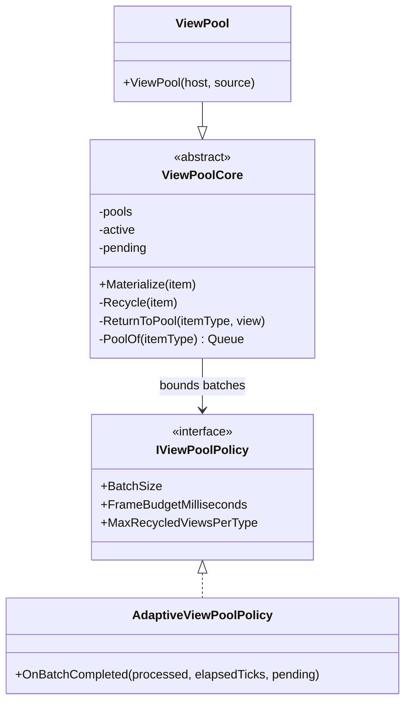
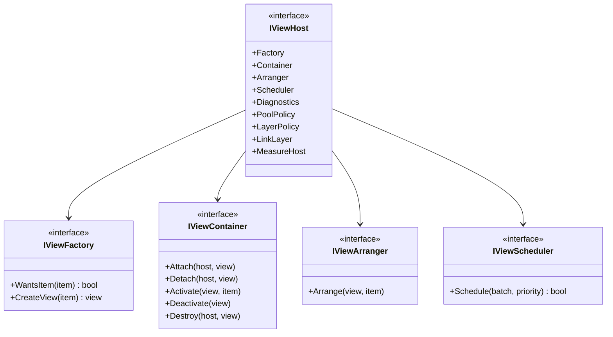
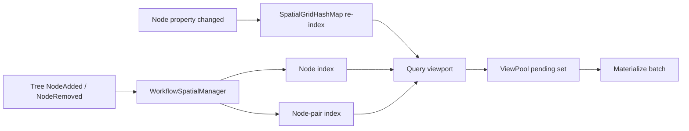

# Design patterns in view hosting and virtualization

Only the visible part of a workflow needs a platform view. `ViewPool` materializes a view for each visible item, recycles views by runtime type when an item leaves, and schedules materialization in batches so a large viewport does not monopolize the UI thread. Three patterns carry this: an Object Pool, an Abstract-Factory-style composition of platform layers, and an Observer-backed spatial index.

## Object Pool: views are keyed by item type and recycled

`ViewPoolCore` keeps three collections: a dictionary of per-type queues of free views, a dictionary of active item-to-view bindings, and a pending set of items waiting to materialize. A view returned by `Recycle` does not disappear; it goes back into the queue for its runtime type and is handed out again on the next `Materialize`.

```csharp
private readonly Dictionary<Type, Queue<TView>> pools = [];
private readonly Dictionary<object, TView> active = new(ViewReferenceComparer<object>.Instance);
private readonly Queue<object> pending = new();
```

Source: `Src/Core/VeloxDev.Core/WorkflowSystem/ViewHosting/ViewPool.cs` lines 29-47; materialize at line 319, recycle at line 380, return-to-pool at line 396.



The policy decides how many views one batch may create and how many recycled views one type may keep. `AdaptiveViewPoolPolicy` adjusts the batch size from a smoothed throughput estimate, using a larger time budget while many items are pending and a smaller one during ordinary scrolling.

Source: `Src/Core/VeloxDev.Core/WorkflowSystem/ViewHosting/ViewPool.cs` lines 274-318; `.../AdaptiveViewPoolPolicy.cs` lines 25-110; `.../ViewPoolOptions.cs` lines 21-112.

## Abstract Factory by composition: `IViewHost` groups the platform layers

A pool never calls a platform API directly. It asks one `IViewHost` for the factory, container, arranger, scheduler, diagnostics, pool policy, layer policy, link layer and measure host. Each layer is its own contract, so a platform can supply them independently; grouping them makes the pool's dependency one object.



Source: `Src/Core/VeloxDev.Core/Interfaces/WorkflowSystem/ViewHosting/IViewHost.cs` lines 22-53; the individual contracts are in the same directory.

This is Abstract Factory in composition form: `IViewHost` is the factory family, and each getter is one product. The pool depends on the family rather than on seven ad-hoc platform objects.

Source: `Src/Core/VeloxDev.Core/Interfaces/WorkflowSystem/ViewHosting/IViewHost.cs` lines 11-21.

## Observer and spatial index: the visible set is derived, not pushed

`SpatialGridHashMap<T>` indexes items into a fixed-size grid (`Dictionary<CellKey, HashSet<T>>`) and answers viewport queries. It subscribes to each item's `INotifyPropertyChanged`, so a node that moves re-indexes itself without the caller re-inserting it. A re-entrancy guard and a pending re-run flag keep a property change that fires mid-operation from corrupting the dictionary.

```csharp
public class SpatialGridHashMap<T>(double cellSize) : ISpatialMap<T>
{
    private readonly Dictionary<CellKey, HashSet<T>> _grid = [];
    private readonly Dictionary<T, Viewport> _trackedItems = [];
    private void OnItemPropertyChanged(object? sender, PropertyChangedEventArgs e) { /* re-index */ }
}
```

Source: `Src/Core/VeloxDev.Core/WorkflowSystem/GUI/Virtualization/SpatialGridHashMap.cs` lines 11-25 and 158-218; the query is at lines 98-131.

`WorkflowSpatialManager` composes two indexes — one for nodes, one for node pairs that represent links — and subscribes to the tree's add/remove events. Links whose endpoints are not yet indexed wait in a pending set and are retried when the endpoint arrives.

Source: `Src/Core/VeloxDev.Core/WorkflowSystem/GUI/Virtualization/WorkflowSpatialManager.cs` lines 8-27, 245-281.



The pool consumes the visible set produced by this index; it does not decide visibility itself. That separation is why the pool can be reused for a surface with no spatial index, as long as the source collection is supplied.

Source: `Src/Core/VeloxDev.Core/Interfaces/WorkflowSystem/Spatial/ISpatialMap.cs` lines 12-43; `Src/Core/VeloxDev.Core/WorkflowSystem/ViewHosting/ViewPool.cs` lines 125-230.

## Pattern summary

| Pattern | Participants | Design consequence |
| --- | --- | --- |
| Object Pool | `ViewPoolCore`, per-type queues | Recycling by runtime type; bounded per type |
| Abstract Factory (composition) | `IViewHost` and its eight layers | Platform differences behind one object |
| Strategy | `IViewPoolPolicy`, `AdaptiveViewPoolPolicy` | Batch sizing tuned at runtime |
| Observer + spatial index | `SpatialGridHashMap`, `WorkflowSpatialManager` | Visible set derived from model changes |

The minimap renders the same graph through a different pipeline; see [Minimap](../09_minimap/index.md).
