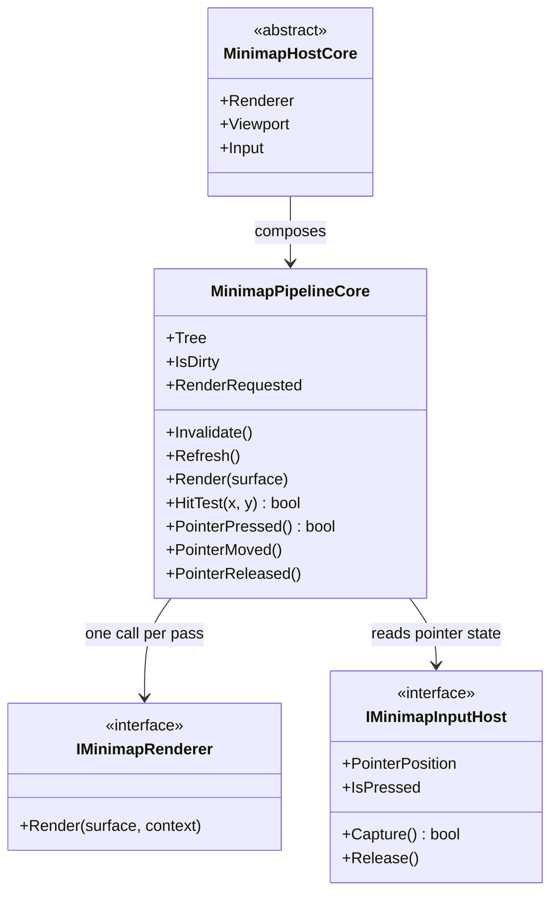
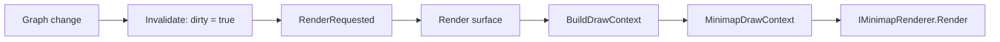

# Design patterns in the minimap

The minimap is a render pipeline fed by an observer. `MinimapPipelineCore` subscribes to the tree's nodes and links, keeps a dirty flag, computes a draw context in mapped coordinates, and asks a platform renderer to paint it. Pointer interaction follows the same split: the core owns drag logic, and a platform input host supplies pointer state and capture.

## Observer: the core listens to the graph

The pipeline subscribes to tree add/remove events and to each node's and link's property notifications. A change marks the pipeline dirty and raises `RenderRequested`; the host redraws on that signal rather than polling. Unsubscription mirrors subscription exactly, which is why the core keeps explicit `SubscribedNodeCount` and `SubscribedLinkCount` diagnostics.

```csharp
public event EventHandler? RenderRequested;
public bool IsDirty => dirty;
private void SubscribeToTree() { /* node/link add, remove, change */ }
private void UnsubscribeFromTree() { /* mirror */ }
```

Source: `Src/Core/VeloxDev.Core/WorkflowSystem/Minimap/MinimapPipelineCore.cs` lines 61-93, 133-163, 413-439.



Source: `Src/Core/VeloxDev.Core/WorkflowSystem/Minimap/MinimapPipelineCore.cs` lines 14-61.

## Pipeline: geometry first, painting second

`BuildDrawContext` does all coordinate mapping: content bounds, the placed minimap rectangle, each node thumbnail's mapped rectangle, and the viewport indicator. `Render` then calls `IMinimapRenderer.Render` once with that context. The renderer knows nothing about workflows; it translates rectangles and colours into platform primitives.

```csharp
public void Render(TSurface surface) { /* build context, call renderer */ }
private MinimapDrawContext? BuildDrawContext() { /* map nodes/links/viewport */ }
```

Source: `Src/Core/VeloxDev.Core/WorkflowSystem/Minimap/MinimapPipelineCore.cs` lines 188-207, 294-377; context model at `Src/Core/VeloxDev.Core/Interfaces/WorkflowSystem/Surface/MinimapDrawContext.cs` lines 1-99.



## Strategy: renderer and input host are platform seams

`IMinimapRenderer<TSurface>` has one method. `IMinimapInputHost` has pointer position, pressed/captured state, a clamp rectangle, and capture/release. Swapping either changes the platform without touching the drag state machine in the pipeline.

Source: `Src/Core/VeloxDev.Core/Interfaces/WorkflowSystem/Surface/IMinimapRenderer.cs` lines 55-64; `.../IMinimapInputHost.cs` lines 72-95.

Drag navigation is a state machine inside the core: press hit-tests the interaction rectangle and captures, move navigates the surface, release ends the drag, and capture loss resets it. The same mapped-coordinate helpers that place the minimap also convert a drag back into scroll offsets, so the thumbnail and the gesture cannot disagree.

Source: `Src/Core/VeloxDev.Core/WorkflowSystem/Minimap/MinimapPipelineCore.cs` lines 208-271, 378-412.

## Data contract: the adapter pushes, the decorator reads

The overlay interface derives from `IWorkflowGridDecorator` because the minimap also needs scroll and content offsets. The surface behavior pushes those members before each pass; the minimap does not reach into the platform's scroll viewer.

Source: `Src/Core/VeloxDev.Core/Interfaces/WorkflowSystem/Surface/IWorkflowMinimapOverlay.cs` lines 15-46; `.../IWorkflowGridDecorator.cs` lines 12-33.

`MinimapMetrics` carries the available area, width, height and minimum size, so placement is a value computation rather than a series of adapter-specific branches.

Source: `Src/Core/VeloxDev.Core/Interfaces/WorkflowSystem/Surface/MinimapMetrics.cs` lines 1-58.

## Pattern summary

| Pattern | Participants | Design consequence |
| --- | --- | --- |
| Observer | `MinimapPipelineCore`, `RenderRequested`, dirty flag | Redraw on graph change, no polling |
| Pipeline | `BuildDrawContext` → `IMinimapRenderer.Render` | Geometry and painting separated |
| Strategy | `IMinimapRenderer`, `IMinimapInputHost` | Platform pieces replaceable |
| Data contract | `IWorkflowMinimapOverlay`, `IWorkflowGridDecorator` | Adapter pushes offsets instead of Core reading them |

The grid and rulers use the same push contract; see [Grid decorators and rulers](../10_grid-decorators-rulers/index.md).
