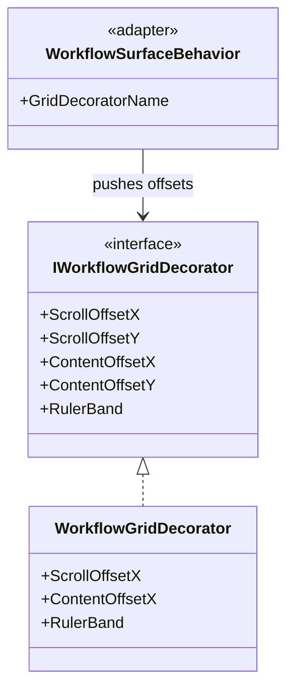
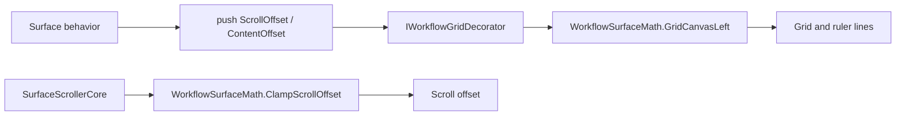

# Design patterns in grid decorators and rulers

The grid and its floating rulers are drawn by a platform decorator, not by Core. What Core owns is the data contract that keeps the decorator aligned with a panned, zoomed and overscrolled canvas, plus the coordinate arithmetic that both the grid and the scroller use. The design is a push-style Adapter contract with a shared Facade.

## Adapter: the decorator receives offsets, it does not fetch them

`IWorkflowGridDecorator` is a data-exchange contract. The surface behavior pushes the scroll offsets and the canvas content offsets into the decorator before each render pass. The decorator never reaches into the platform's `ScrollViewer`, so the same contract works for a WPF `DrawingVisual`, an Avalonia control, a Razor component or a WinForms painter.

```csharp
public interface IWorkflowGridDecorator
{
    double ScrollOffsetX { get; set; }
    double ScrollOffsetY { get; set; }
    double ContentOffsetX { get; set; }
    double ContentOffsetY { get; set; }
    double RulerBand { get; }
}
```

Source: `Src/Core/VeloxDev.Core/Interfaces/WorkflowSystem/Surface/IWorkflowGridDecorator.cs` lines 12-33.



The WPF adapter declares the attachment point as an attached property (`GridDecoratorName`) and resolves the named element; the Razor adapter ships a component that implements the contract directly. Both are adapters to the same Core interface.

Source: `Src/Adapters/VeloxDev.WPF/WorkflowSystem/AttachedBehaviors/WorkflowSurfaceBehavior.cs` lines 77-78 and 444; `Src/Adapters/VeloxDev.Razor/WorkflowSystem/AttachedBehaviors/WorkflowGridDecorator.razor.cs` line 14.

## Facade: one arithmetic module for grid, scroll and minimap

`WorkflowSurfaceMath` is the shared facade. The grid uses `GridCanvasLeft`/`GridCanvasTop` to place the first line, `GridX`/`GridY` to step lines, and `GridFirstLine` to align the first major line. The scroller uses `ClampScrollOffset` and `ClampValue`, and the minimap uses the `Minimap*` family. Every method takes its geometry explicitly; none reads model state.

```csharp
public static double GridCanvasLeft(double scrollOffset, double contentOffset);
public static double GridX(double localValue, double localLeft, double contentRectX);
public static double ClampScrollOffset(
    double desired, double max, CanvasLayout layout, bool horizontal, double extendRatio);
```

Source: `Src/Core/VeloxDev.Core/WorkflowSystem/GUI/Math/WorkflowSurfaceMath.cs` lines 112-224.



## The ruler band is part of the virtualization contract

`RulerBand` is not decoration metadata. The adapter surfaces read it each pass and forward it to `WorkflowSpatialEx.SetVirtualizeInset`, so spatial virtualization does not cull nodes that are still visible beneath the floating ruler band. The contract comment names that consumer explicitly, which is what keeps the band's thickness from drifting out of sync with culling.

Source: `Src/Core/VeloxDev.Core/Interfaces/WorkflowSystem/Surface/IWorkflowGridDecorator.cs` lines 26-32.

## Pattern summary

| Pattern | Participants | Design consequence |
| --- | --- | --- |
| Adapter (push contract) | `IWorkflowGridDecorator`, `WorkflowSurfaceBehavior`, `WorkflowGridDecorator` | Platform-agnostic grid; no scroll-viewer lookup in Core |
| Facade | `WorkflowSurfaceMath` | One definition of grid, scroll and minimap arithmetic |
| Shared invariant | `RulerBand` → `SetVirtualizeInset` | Culling respects the ruler overlay |

The next features turn from the canvas to the generated code that drives view models; see [MVVM view model generation](../11_mvvm-viewmodel-generation/index.md).
