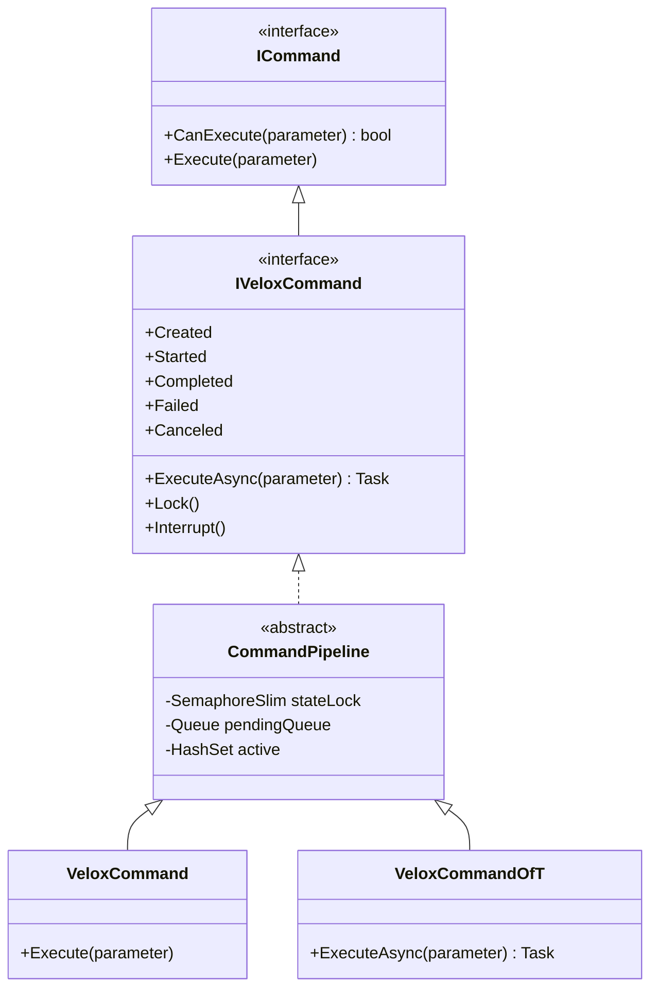
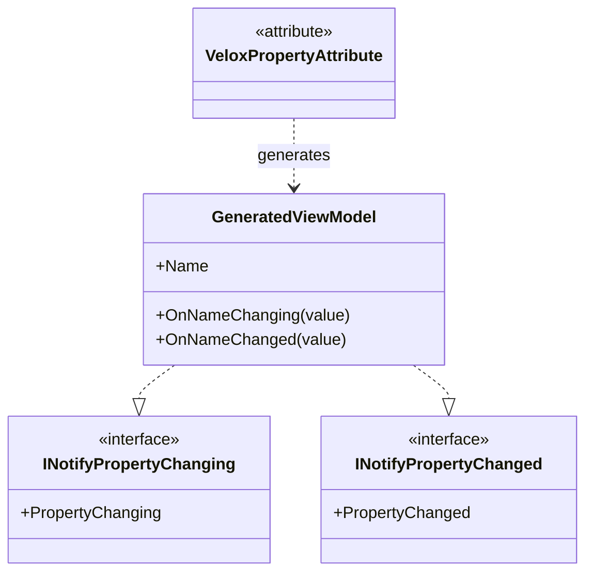

# Design patterns in MVVM view model generation

Two attributes drive the whole feature: `[VeloxProperty]` on a field produces an observable property, and `[VeloxCommand]` on a method produces an `IVeloxCommand`. The generator writes partial members; the runtime command pipeline supplies execution, concurrency and event behaviour. The patterns involved are Command, Observer and Template Method, with generation as the glue.

## Command: `IVeloxCommand` is a pipeline, not a delegate

`IVeloxCommand` extends `ICommand` with lifecycle events, lock/unlock, interrupt/continue, semaphore control and asynchronous forms. `CommandPipeline<TParam, TResult>` is the shared implementation: it holds a semaphore, a pending queue and an active set, and raises `Created`, `Enqueued`, `Started`, `Completed`, `Failed`, `Canceled` and `Exited` around each execution.

```csharp
public abstract class CommandPipeline<TParam, TResult> :
    IVeloxCommand, IVeloxCommandCompletion, IVeloxCommandStatus, IVeloxCommandResult,
    IVeloxCommandEvents<TParam, TResult>, IDisposable
{
    private readonly SemaphoreSlim _stateLock = new(1, 1);
    private readonly Queue<CommandEventArgs<TParam, TResult>> _pendingQueue = new();
    private readonly HashSet<CommandEventArgs<TParam, TResult>> _active = [];
}
```

Source: `Src/Core/VeloxDev.Core/MVVM/CommandPipeline{TParam,TResult}.cs` lines 30-83; the event surface is declared at `Src/Core/VeloxDev.Core/Interfaces/MVVM/IVeloxCommand.cs` lines 6-75.



Source: `Src/Core/VeloxDev.Core/MVVM/VeloxCommand.cs`; `Src/Core/VeloxDev.Core/MVVM/VeloxCommand{TParam,TResult}.cs`.

The attributes are the declaration surface: `VeloxCommandAttribute(name, canValidate, semaphore)` lets a command derive its name from the method, opt into a generated `CanExecute` partial, and set its concurrency limit.

Source: `Src/Core/VeloxDev.Core/MVVM/VeloxCommandAttribute.cs` lines 47-60.

## Observer: generated properties raise both notifications

A `[VeloxProperty]` field becomes a partial property whose setter raises `OnPropertyChanging` before the write and `OnPropertyChanged` after it. The generated partial hooks — `On{Name}Changing` and `On{Name}Changed` — let the host add behaviour without editing the generated setter.



Source: `Src/Core/VeloxDev.Core/MVVM/VeloxPropertyAttribute.cs` lines 26-30; generation at `Src/Generators/VeloxDev.Core.Generator/Writers/MVVMWriter.cs` lines 112-150.

Collection properties get a second observer layer. `ObservableCollectionTracker` subscribes to a collection once per handler and dispatches add/remove/move/reset notifications to generated `OnItemAddedTo...`-style partials, using a method-target comparer so the same handler is not subscribed twice.

Source: `Src/Core/VeloxDev.Core/MVVM/ObservableCollectionTracker.cs` lines 15-60, 100-115.

## Template Method: the generator writes the skeleton

`MVVMWriter` reads the fields that carry `[VeloxProperty]`, decides the setter mode (framework `SetProperty` when a compatible base class exists, otherwise explicit `OnPropertyChanging`/`OnPropertyChanged` calls), and emits a partial property for each. `CommandWriter` reads `[VeloxCommand]` methods and emits a lazily created command property with the configured shape and construction.

Source: `Src/Generators/VeloxDev.Core.Generator/Writers/MVVMWriter.cs` lines 40-78; `Src/Generators/VeloxDev.Core.Generator/Writers/CommandWriter.cs` lines 12-110.

The generated command's body forwards to the attribute's method, so the developer writes the work and the generator writes the plumbing. The optional `CanExecute` partial and the semaphore are template hooks: the generated pipeline calls them, but the developer fills them.

```csharp
[VeloxCommand(canValidate: true)]
private Task Minus(object? sender, CancellationToken ct)
{
    Index--;
    Greeting = $"current index: {Index}";
    return Task.CompletedTask;
}

private partial bool CanExecuteMinusCommand(object? sender)
{
    return _index > 0;
}
```

Source: `Examples/MVVM/Avalonia/Demo/ViewModels/MainWindowViewModel.cs` lines 77-89. The attribute generates `MinusCommand`; the hand-written `CanExecuteMinusCommand` partial is the hook the generated command calls.

## Strategy: validators and dispatch

The command pipeline treats the user's predicate as a strategy (`_canExecute`), and optional validators participate in the same execution path. That keeps one command type able to serve synchronous methods, `Task` methods, `ValueTask` methods and parameterised methods without subclassing per shape.

Source: `Src/Core/VeloxDev.Core/MVVM/CommandPipeline{TParam,TResult}.cs` lines 64-80, 403-440.

## Pattern summary

| Pattern | Participants | Design consequence |
| --- | --- | --- |
| Command | `IVeloxCommand`, `CommandPipeline`, generated `{Name}Command` | One runtime pipeline for every command shape |
| Observer | Generated setters, `ObservableCollectionTracker` | Change notification and collection hooks |
| Template Method | `[VeloxProperty]` / `[VeloxCommand]` partials | Generator writes skeleton, developer fills hooks |
| Strategy | `CanExecute` predicate, validators | Validation swappable per command |

Commands here are declarative; the next feature applies the same generator technique to animation declarations; see [Transition animation](../12_transition-animation/index.md).
