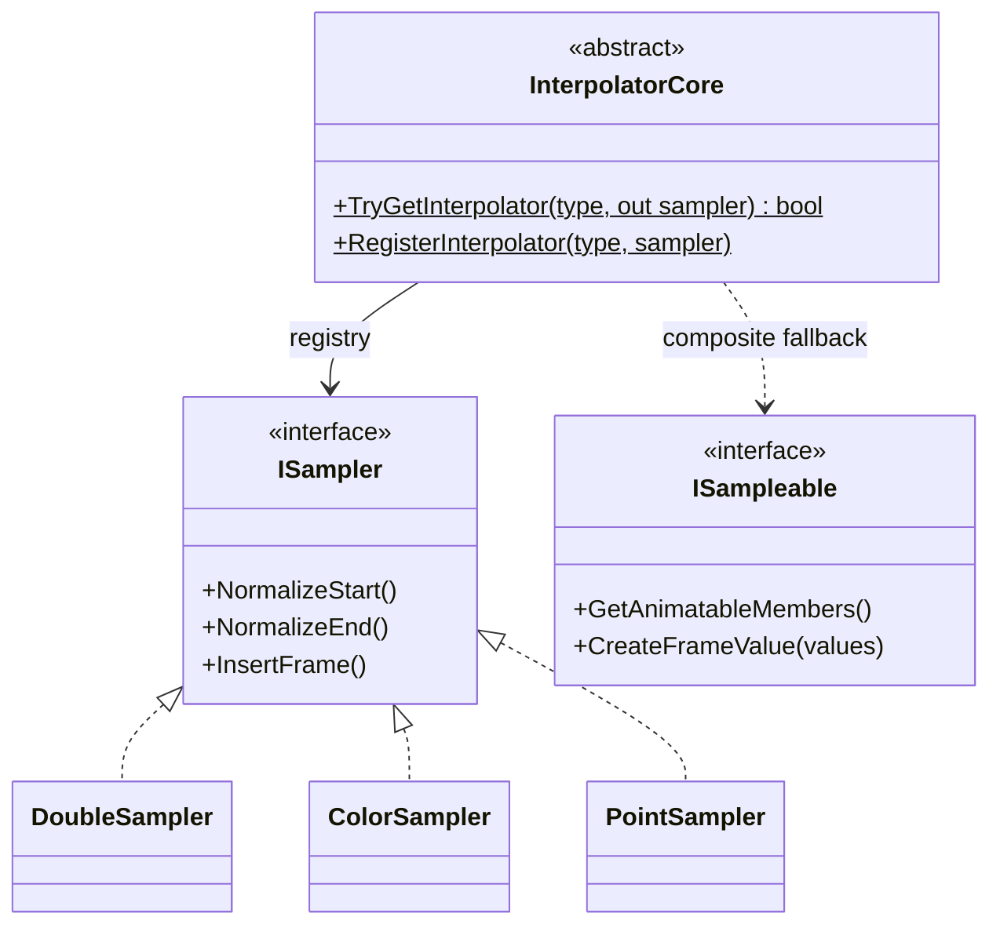
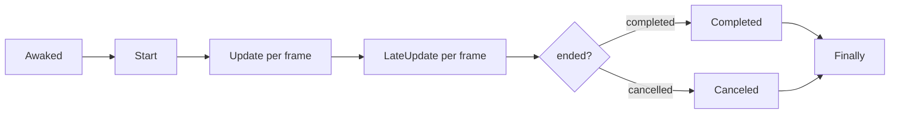

# Strategy and sampling

Two strategy families make an animation generic: a sampler turns a normalized progress value into a property write, and an easing function reshapes that progress before the write. A process-wide registry selects the sampler by property type, and the effect base class supplies the lifecycle template that hosts hook into.

## Strategy: `ISampler` per property type

`ISampler` has three operations: normalize the start value, normalize the end value, and insert the middle frame. The sampler receives the property, the target, the start and end values, an options object and the eased progress `t`. It may keep a reusable scratch object, so a per-frame allocation is avoidable but not required.

```csharp
public interface ISampler
{
    object? NormalizeStart(object? start, object? end, object? options);
    object? NormalizeEnd(object? start, object? end, object? options);
    void InsertFrame(object target, ITransitionProperty property, ref object? working,
        object? start, object? end, object? options, double t);
}
```

Source: `Src/Core/VeloxDev.Core/Interfaces/TransitionSystem/ISampler.cs` lines 11-38.

The shipped samplers cover the primitive and geometry types the adapters animate: `double`, `float`, `int`, `long`, `Point`, `PointF`, `Size`, `SizeF`, `Color`, `Rectangle`, `RectangleF`, `Vector2/3/4` and `Quaternion`.

Source: `Src/Core/VeloxDev.Core/TransitionSystem/NativeSamplers/`; registration at `.../Sampling/Interpolator.cs` lines 13-28.

A struct with no registered sampler takes the `ISampleable` path: its declared members are interpolated individually and the struct is rebuilt each frame. That interface is the composite-value strategy, and it keeps a reference type from being decomposed implicitly.

Source: `Src/Core/VeloxDev.Core/Interfaces/TransitionSystem/ISampleable.cs` lines 41-66.

## Registry: `InterpolatorCore` maps a type to its sampler

`InterpolatorCore` is both the process-wide registry and the base class an adapter derives from. Its static constructor registers the native samplers; `TryGetInterpolator` resolves a type, including a framework property declared as a subclass of the registered type.

```csharp
public static bool TryGetInterpolator(Type type, out ISampler? sampler)
```

Source: `Src/Core/VeloxDev.Core/TransitionSystem/Sampling/Interpolator.cs` lines 9-51, 94.



Source: `Src/Core/VeloxDev.Core/TransitionSystem/NativeSamplers/DoubleSampler.cs`, `.../ColorSampler.cs`, `.../PointSampler.cs`.

## Strategy: easing is a function object

`IEaseCalculator` has one method, `Ease(t)`. `Eases` exposes the built-in families as static properties — ten families (Sine, Quad, Cubic, Quart, Quint, Expo, Circ, Back, Elastic, Bounce), each with `In`, `Out` and `InOut` members — and each access returns a fresh calculator instance.

```csharp
public interface IEaseCalculator
{
    double Ease(double t);
}

public static class Eases
{
    public static IEaseCalculator Default => new EaseDefault();
    public static class Sine
    {
        public static IEaseCalculator In => new EaseInSine();
        public static IEaseCalculator Out => new EaseOutSine();
        public static IEaseCalculator InOut => new EaseInOutSine();
    }
}
```

Source: `Src/Core/VeloxDev.Core/Interfaces/TransitionSystem/IEaseCalculator.cs` lines 4-9; `Src/Core/VeloxDev.Core/TransitionSystem/Effects/Eases.cs` lines 4-28.

The curve is the information, so the sine family is plotted rather than tabulated. The `In` curve starts slow, `Out` starts fast, and `InOut` is symmetric; the linear baseline shows what the easing changes.

```plot
{
  "title": "Eases.Sine",
  "grid": true,
  "xAxis": { "domain": [0, 1] },
  "yAxis": { "domain": [0, 1] },
  "data": [
    { "fn": "x", "color": "#888888", "skipTip": true },
    { "fn": "1 - cos(x*PI/2)", "color": "#4a9eff", "title": "In" },
    { "fn": "sin(x*PI/2)", "color": "#a78bfa", "title": "Out" },
    { "fn": "-(cos(PI*x)-1)/2", "color": "#f472b6", "title": "InOut" }
  ]
}
```

## Template Method: the effect base class drives callbacks

`TransitionEffectCore` is the effect's template. It exposes the tunables (`Duration`, `FPS`, `IsAutoReverse`, `LoopTime`, `Ease`) as virtual properties and a fixed lifecycle: `Awaked`, `Start`, `Update`, `LateUpdate`, `Canceled`, `Completed`, `Finally`, `Warn`, `Error`. The interpreter calls the `Invoke...` methods at the matching points, so a host overrides a property or subscribes to an event without reimplementing the loop.

Source: `Src/Core/VeloxDev.Core/TransitionSystem/Effects/TransitionEffect.cs` lines 39-186.



## Pattern summary

| Pattern | Participants | Design consequence |
| --- | --- | --- |
| Strategy | `ISampler`, `ISampleable`, `IEaseCalculator` | Animation is generic over property type and curve |
| Registry | `InterpolatorCore` | Type-to-sampler lookup, adapter-extensible |
| Function object | `Eases` families | Curve chosen by composition, not a switch |
| Template Method | `TransitionEffectCore` | Fixed lifecycle, overridable tunables |

How the declared timeline chains segments is covered in [Fluent timeline](../01_fluent-timeline/index.md).
