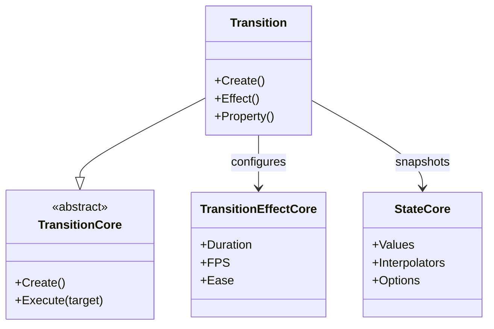
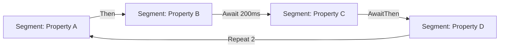

# Fluent timeline

A transition is declared as a chain: create a snapshot for a target, attach an effect, add one or more properties, then separate segments with `Await`/`Then`/`AwaitThen` and repeat them. The chain is a Builder, the segment list is a Composite, and the scheduler interprets it as a sampling loop with a shared timeline.

## Builder: `Transition<T>` accumulates a declaration

Each adapter defines `Transition<T>` over its own effect type. `Create()` returns a new builder; `Effect(...)` sets the effect; `Property(...)` adds one property and its target value. The `Property` overloads exist per value type because the expression tree selects the sampler and the write strategy at compile time.

```csharp
public class Transition<T> : TransitionCore<
    T,
    State,
    TransitionEffect,
    Interpolator,
    UIThreadInspector,
    TransitionInterpreter,
    DispatcherPriority>
    where T : class
{
    public static Transition<T> Create() => TransitionCore.Create<Transition<T>>();
}
```

Source: `Src/Adapters/VeloxDev.WPF/TransitionSystem/Transition.cs` lines 15-45.



The builder holds no platform state of its own; the target, the effect and the declared properties are passed into `TransitionCore.Execute`, which resolves a scheduler for the target.

Source: `Src/Core/VeloxDev.Core/TransitionSystem/Effects/Transition.cs` lines 259-305.

## Composite and Chain: segments are nodes, `Then` appends

`TransitionCoreEx` exposes four extension methods on a declared segment. `Await(time)` inserts a pause, `Then()` starts the next segment immediately after the current one, `AwaitThen(time)` combines both, and `Repeat(count)` marks how many more times the segment's cycle runs. Because each call returns the same builder, a caller writes a chain.

```csharp
public static T Await<T>(this T snapshot, TimeSpan timeSpan)
    where T : StateSnapshotCore, new()
{
    snapshot.CoreAwait<T>(timeSpan);
    return snapshot;
}

public static T Then<T>(this T snapshot)
    where T : StateSnapshotCore, new()
{
    return snapshot.CoreThen<T>();
}
```

Source: `Src/Core/VeloxDev.Core/TransitionSystem/Effects/TransitionEx.cs` lines 10-21; `AwaitThen` and `Repeat` follow in the same class.



`Repeat` is written after the node it configures, and the core records it as `RepeatTime` on that node. The documented example is cumulative across segments: three segments each carrying `Repeat(1)` run `1, 1, 2, 1, 1, 2, 3, ...` because each segment's loop nests inside the previous one.

Source: `Src/Core/VeloxDev.Core/TransitionSystem/Effects/Transition.cs` lines 280-290, 422-465.

## Interpreter: one sampling loop per segment

`TransitionInterpreterCore` is the template for the frame loop. Its `Execute` overloads build a frame application delegate — one for a dispatcher-priority host and one for the priority-free path — and pass it into `ExecuteSamplingLoopAsync`. The loop advances the timeline, computes eased progress, applies the sampler set, raises the effect callbacks and repeats for the declared segment cycles.

Source: `Src/Core/VeloxDev.Core/TransitionSystem/Runtime/TransitionInterpreter.cs` lines 6-53 and the sampling loop below it.

The scheduler queues runs per target. `TransitionSchedulerCore<T, ...>` creates or finds the scheduler for a target, executes the producer against the state and effect, and supports replay of a segment against the frame set it was prepared with. `Exit` cancels the runs it owns.

Source: `Src/Core/VeloxDev.Core/TransitionSystem/Runtime/TransitionScheduler.cs` lines 9-63, 100-197.

## State: one snapshot per target, one scheduler per target

`StateCore` is the per-target frame state. It stores the target values, the sampler chosen for each property and the per-property options, keyed by an expression or by an `ITransitionProperty`. The scheduler registry is a `ConditionalWeakTable<object, ITransitionSchedulerCore>`, so a scheduler lives exactly as long as its target and no cleanup list is needed.

Source: `Src/Core/VeloxDev.Core/TransitionSystem/State/State.cs` lines 8-30; `Src/Core/VeloxDev.Core/TransitionSystem/Runtime/TransitionScheduler.cs` lines 229-248.

## Timeline transport

`TransitionCore` exposes the transport operations as static methods: `Pause`, `Resume`, `SetRate`, `Seek`, `Cycle`, `Position`, `IsPaused`, `Rate` and `Exit`. Each collects the schedulers for the target (optionally including mutual and non-mutual runs) and applies the operation to the first run or to all runs as appropriate.

Source: `Src/Core/VeloxDev.Core/TransitionSystem/Effects/Transition.cs` lines 30-239.

That is why a theme switch can pause or seek a whole group of animated targets through one transport: the switch anchors every target's run to the same timeline.

Source: `Src/Core/VeloxDev.Core/DynamicTheme/ThemeManager.cs` lines 100-112.

## Pattern summary

| Pattern | Participants | Design consequence |
| --- | --- | --- |
| Builder / Fluent | `Transition<T>`, `TransitionCore.Create` | Declarative, type-checked animation |
| Composite / Chain | Segment list, `Await`/`Then`/`Repeat` | Segments compose without a separate DSL |
| Interpreter | `TransitionInterpreterCore` | One loop for every property/sampler |
| State + registry | `StateCore`, scheduler `ConditionalWeakTable` | Per-target state with automatic lifetime |

The theme system reuses this machinery for animated switches; see [Runtime themes](../../13_runtime-themes/index.md).
