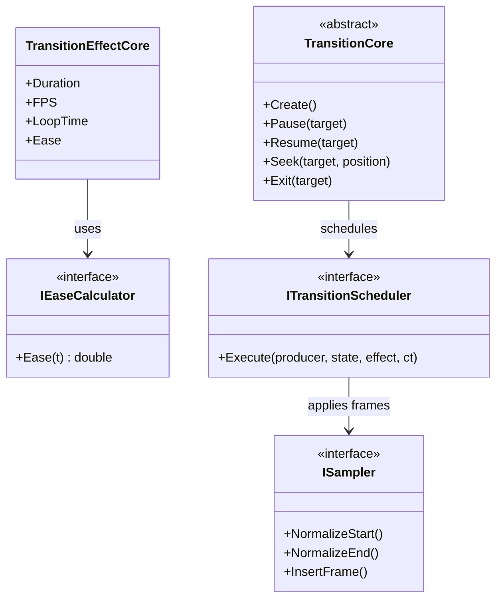

# Design patterns in transition animation

A transition declares properties, an effect, easing and timing; a scheduler then drives a sampling loop that writes interpolated values to the target on its own dispatcher. The declaring side is a fluent builder with a chainable timeline; the running side is a Strategy-driven interpreter over pluggable samplers and easing functions.

The feature is analyzed in two parts:

- [Strategy and sampling](00_strategy-sampling/index.md) — `ISampler`, `IEaseCalculator`, the process-wide sampler registry, and the effect hook template.
- [Fluent timeline](01_fluent-timeline/index.md) — `Transition<T>`, `Await`/`Then`/`Repeat`, the interpreter loop, and the timeline state shared by a chain.

## The two halves

The fluent surface is generated per adapter — each platform defines its own `Transition<T>` over its own effect type — while the pipeline and contracts live in Core. That keeps Core free of platform property types without duplicating the sampling engine.

Source: `Src/Adapters/VeloxDev.WPF/TransitionSystem/Transition.cs` lines 10-45; Core contracts in `Src/Core/VeloxDev.Core/Interfaces/TransitionSystem/`.
