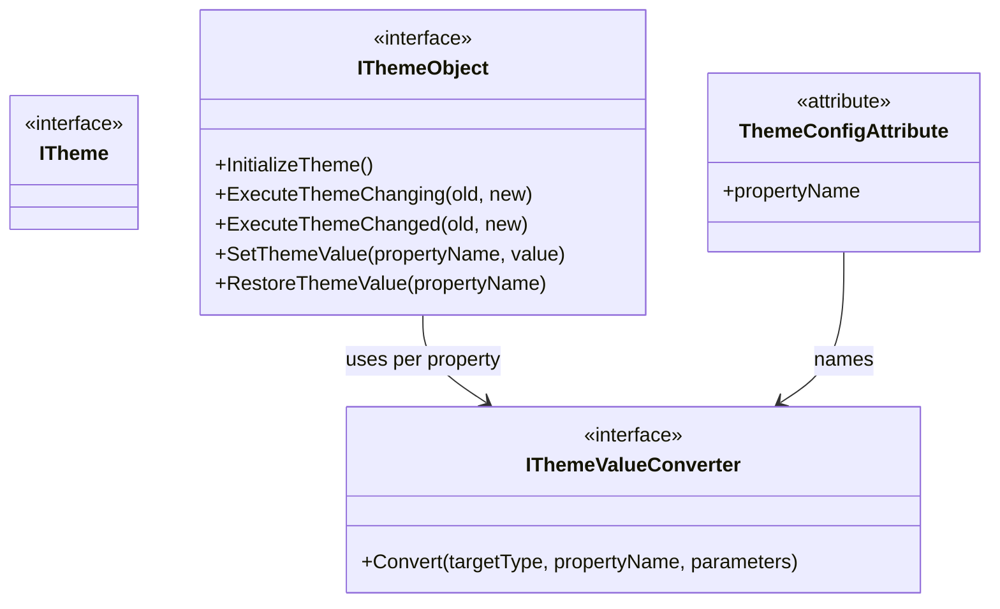
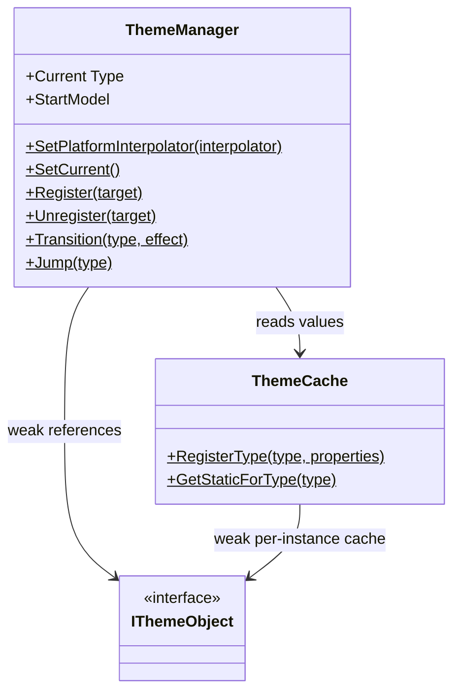

# Design patterns in runtime themes

A theme object declares, per property, which value belongs to each theme type and which converter turns the stored value into the property's type. `ThemeManager` switches the current theme either immediately or through a shared transition, and a weak registry keeps the active objects reachable without pinning them. The feature is a Strategy for conversion, a Registry with weak keys for lifetime, and a Template Method for the generated hooks.

## Strategy: one converter per declared property

`ThemeConfigAttribute<TConverter, TTheme1, TTheme2, ...>` names the converter and the theme types. At compile time the generator writes a registration that maps each property name to a value per theme; at run time `IThemeValueConverter.Convert` turns the stored value into the property's target type.

```csharp
public interface IThemeValueConverter
{
    object? Convert(Type targetType, string propertyName, object?[] parameters);
}
```

Source: `Src/Core/VeloxDev.Core/Interfaces/DynamicTheme/IThemeValueConverter.cs` lines 4-10.

The converter is the strategy seam: a brush converter, an object converter or a platform-specific converter all satisfy the same contract, so Core never references a UI type.

Source: `Src/Core/VeloxDev.Core/DynamicTheme/ThemeConfigAttribute.cs` lines 7-18 (the two-theme form; the family extends to seven themes).



Source: `Src/Core/VeloxDev.Core/Interfaces/DynamicTheme/IThemeObject.cs` lines 6-35; `.../ITheme.cs` lines 4-7.

## Registry: a static cache, a weak active list

`ThemeCache` keeps two tables. The static table is keyed by declaring type and merged up the inheritance chain, so a derived type inherits its base type's theme values unless it overrides them. The active table is keyed per instance through a `ConditionalWeakTable` and holds runtime overrides; `ThemeManager` also keeps a `List<WeakReference<IThemeObject>>` of active objects for switching.

```csharp
private static readonly Dictionary<Type, Dictionary<string, PropertyEntry>> _staticCache = [];
private static readonly object _lock = new();
private static readonly ConditionalWeakTable<IThemeObject, InstanceCache> _activeCache = new();
```

Source: `Src/Core/VeloxDev.Core/DynamicTheme/ThemeCache.cs` lines 10-33; inheritance merge at lines 67-95.



Source: `Src/Core/VeloxDev.Core/DynamicTheme/ThemeManager.cs` lines 23-93.

The weak references are the lifetime rule: registering an object does not keep it alive, and `Unregister` removes it from both the cache and the active list. A host that forgets to unregister still does not leak the object.

Source: `Src/Core/VeloxDev.Core/DynamicTheme/ThemeManager.cs` lines 75-93.

## Template Method: the generator writes `InitializeTheme` and the hooks

The generator reads every class carrying a `ThemeConfigAttribute`, verifies that the class is partial, and emits `InitializeTheme`, the two `ExecuteThemeChanging`/`ExecuteThemeChanged` hooks and the per-property `SetThemeValue`/`RestoreThemeValue` bodies. The developer supplies the partial class and the attributes; the generated code supplies the reflection-free registration and dispatch.

Source: `Src/Generators/VeloxDev.Core.Generator/Theme.cs` lines 15-114 and 152-244.

```csharp
[ThemeConfig<ObjectConverter, Dark, Light>(nameof(Background), ["#1e1e1e"], ["#ffffff"])]
[ThemeConfig<ObjectConverter, Dark, Light>(nameof(BorderBrush), ["#ffffff"], ["#1e1e1e"])]
public partial class ThemeTile : Border
{
    public ThemeTile()
    {
        Width = 26;
        Height = 26;
        Margin = new Thickness(2);
        BorderThickness = new Thickness(3);
        InitializeTheme();
    }
}
```

Source: `Examples/Theme/Avalonia/Demo/ThemeTile.cs` lines 17-28.

The generated body registers the property table once per type into `ThemeCache`; `InitializeTheme` is idempotent because duplicate registration is ignored. That is what lets each instance start with the current theme without a global initialization order.

Source: `Src/Generators/VeloxDev.Core.Generator/Theme.cs` lines 152-244; `Src/Core/VeloxDev.Core/DynamicTheme/ThemeCache.cs` lines 46-65.

## Observer: switching is a broadcast, not a poll

`ThemeManager.Transition` collects the registered objects, captures the old values, applies the new theme to each, and runs the changing/changed hooks around the animation. `Jump` applies the new values without animation. `Current` is the single readable state; there is no per-object subscription protocol, because the manager already holds the active list.

Source: `Src/Core/VeloxDev.Core/DynamicTheme/ThemeManager.cs` lines 112-205.

An animated switch is anchored to one shared `ITimeSourceControl`, so `Pause`, `Resume` and `SetRate` move the whole switch; `Seek` and `Exit` act on one target's runs. That reuses the transition timeline analyzed in [Fluent timeline](../12_transition-animation/01_fluent-timeline/index.md).

Source: `Src/Core/VeloxDev.Core/DynamicTheme/ThemeManager.cs` lines 100-111.

## Pattern summary

| Pattern | Participants | Design consequence |
| --- | --- | --- |
| Strategy | `IThemeValueConverter` | Core theme system is UI-framework agnostic |
| Registry + weak cache | `ThemeCache`, `ThemeManager.activeThemes` | Per-type defaults, per-instance overrides, no leaks |
| Template Method | generated `InitializeTheme`, theme hooks | Reflection-free registration and dispatch |
| Observer / broadcast | `ThemeManager.Transition`, `Jump` | One switch updates every active object |

The generated proxy machinery in the next feature uses a different interception strategy; see [Aspect-oriented programming](../14_aspect-oriented-programming/index.md).
