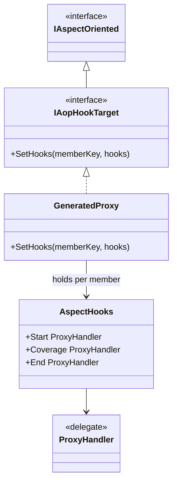
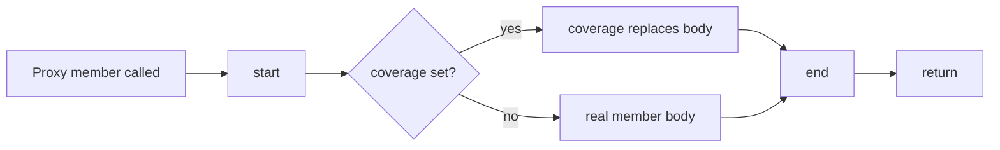
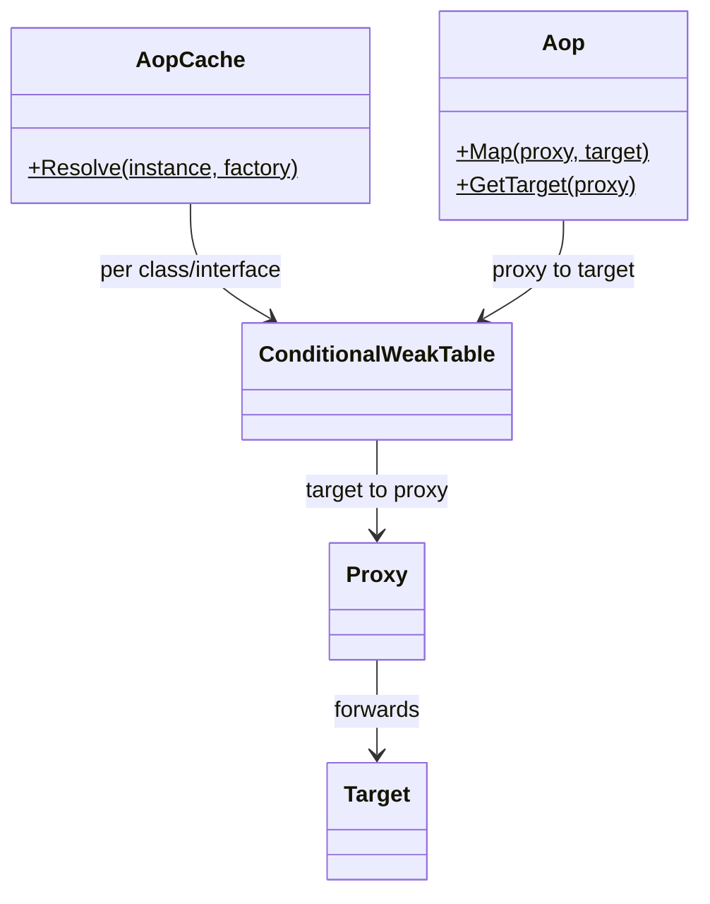

# Design patterns in aspect-oriented programming

A class marked `[AspectOriented]` gets a generated interface that mirrors its members and a generated proxy that implements it. Aspects are installed on the proxy, not on the object, and each intercepted member runs up to three stages: `start`, `coverage` and `end`. The design is a Proxy built by a generator, a Chain for the stages, and a weak cache for per-instance proxy identity.

## Proxy: the generated interface is the interception surface

`IAspectOriented` is a marker. The generator emits a mirror interface and a proxy class for every member the caller can intercept; the proxy's members run the installed hooks around the real member. Because the proxy is ordinary generated code, there is no runtime `DispatchProxy` and no reflection invocation.

```csharp
[VeloxProperty][AspectOriented] private string _name = string.Empty;
[VeloxProperty][AspectOriented] private ObservableCollection<MemberViewModel> _members = [];

[AspectOriented]
public void Reset()
{
    Name = string.Empty;
    Members.Clear();
}
```

Source: `Examples/AOP/Avalonia/Demo/ViewModels/TeamViewModel.cs` lines 16-24. The generator emits the mirror interface and the proxy from these members; `AopSurface` builds both halves, and `AopProxy` emits the `Aop()` extension.

Source: `Src/Core/VeloxDev.Core/AspectOriented/AspectOrientedAttribute.cs` lines 1-14; `Src/Generators/VeloxDev.Core.Generator/AopSurface.cs` lines 31-114; `Src/Generators/VeloxDev.Core.Generator/AopProxy.cs` lines 13-32.



Source: `Src/Core/VeloxDev.Core/AspectOriented/AspectHooks.cs` lines 40-77; `Src/Core/VeloxDev.Core/Interfaces/AspectOriented/IAspectOriented.cs` lines 1-12.

## Chain of Responsibility: start, coverage, end

`AspectHooks` groups three delegates. `start` runs before the member and its return value becomes the next stage's `previous`; `coverage`, when non-null, replaces the member entirely and its return value is the member's result; `end` runs after the member and its return value is discarded. The three stages always install together, so there is no way to keep one stage and swap another.

```csharp
public delegate object? ProxyHandler(object?[]? parameters, object? previous);

public sealed class AspectHooks(ProxyHandler? start, ProxyHandler? coverage, ProxyHandler? end)
{
    public ProxyHandler? Start { get; } = start;
    public ProxyHandler? Coverage { get; } = coverage;
    public ProxyHandler? End { get; } = end;
}
```

Source: `Src/Core/VeloxDev.Core/AspectOriented/AspectHooks.cs` lines 17-50.



`ProxyEx.SetProxy` is the installation helper. It converts the accessor kind and member name into the proxy's interception key (`get_Name`, `set_Name`, or the method name) and throws when the target is not a proxy, because an aspect installed on the real object would never run.

Source: `Src/Core/VeloxDev.Core/AspectOriented/ProxyEx.cs` lines 27-75.

## Cache: one proxy per target, weakly held

`AopCache.Resolve<TClass, TInterface>` uses CLR generic specialization to give each `(class, interface)` pair its own `ConditionalWeakTable`. The table maps a target instance to its proxy, so `Aop()` returns the same proxy for the same object and the proxy does not keep the object alive.

```csharp
private static class Entry<TClass, TInterface>
{
    public static readonly ConditionalWeakTable<TClass, TInterface> Instances = [];
}

public static TInterface Resolve<TClass, TInterface>(TClass instance, Func<TClass, TInterface> factory)
    => Entry<TClass, TInterface>.Instances.GetValue(instance, k => factory(k));
```

Source: `Src/Core/VeloxDev.Core/AspectOriented/AopCache.cs` lines 13-52.



## Reverse lookup

`Aop.Map` records the proxy-to-target direction in a second `ConditionalWeakTable`, and `Aop.GetTarget<TTarget>` reads it back. That is what lets code holding only the proxy recover the original instance, for example to pass the real object to a serialization path that does not know about proxies.

Source: `Src/Core/VeloxDev.Core/AspectOriented/Aop.cs` lines 11-27.

## Pattern summary

| Pattern | Participants | Design consequence |
| --- | --- | --- |
| Proxy | generated mirror interface + proxy, `IAspectOriented` | Interception without a runtime proxy generator |
| Chain of Responsibility | `AspectHooks` start/coverage/end | Predictable stage order and replace semantics |
| Cache | `AopCache`, `ConditionalWeakTable` | One proxy per target, no lifetime pinning |
| Reverse map | `Aop.Map`, `Aop.GetTarget` | Proxy-to-target recovery |

The next feature is a loop rather than an interceptor; see [Tick loop](../15_tick-loop/index.md).
