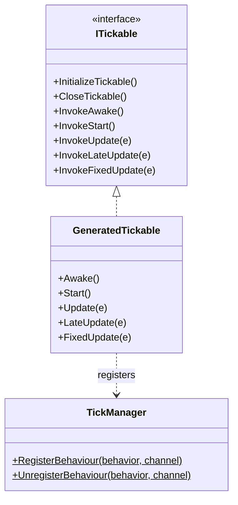
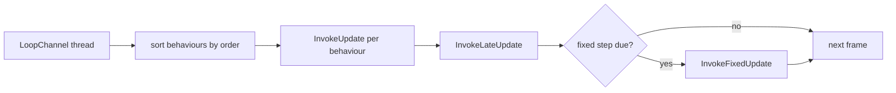

# Design patterns in the tick loop

A `[Tickable]` class declares five lifecycle methods; the generator makes it an `ITickable` whose `Invoke...` methods call those partials. `TickManager` runs one loop per channel, drives every registered behaviour in order, and exposes pause, rate and fixed-step controls. The design is a Template Method for the lifecycle, an Observer surface for frames and channel state, and a per-channel Manager with a small object pool.

## Template Method: five partial hooks

`ITickable` fixes the lifecycle: `Awake`, `Start`, `Update`, `LateUpdate`, `FixedUpdate`, plus register/unregister. The generator emits the interface implementation, and each `Invoke...` method calls the matching `partial` method the developer may declare.

```csharp
public interface ITickable
{
    void InitializeTickable();
    void CloseTickable();
    void InvokeAwake();
    void InvokeStart();
    void InvokeUpdate(FrameEventArgs e);
    void InvokeLateUpdate(FrameEventArgs e);
    void InvokeFixedUpdate(FrameEventArgs e);
}
```

Source: `Src/Core/VeloxDev.Core/Interfaces/Tickable/ITickable.cs` lines 25-46.

The declaration surface is the attribute: `TickableAttribute(channel, fps)` names the channel and the target frame rate. The generator translates it into the `ITickable` implementation and a registration call in `InitializeTickable`.

```csharp
[Tickable(DemoChannel.Name)]
public partial class MainWindow
{
    private readonly DemoState _state = new();
}
```

Source: `Examples/Tickable/WPF/Demo/MainWindow.Hooks.cs` lines 23-26. The class declares its lifecycle methods as `partial void` further down the same file; the attribute is what makes the generator emit the `ITickable` shell around them.

Source: `Src/Core/VeloxDev.Core/TimeLine/TickableAttribute.cs` lines 7-17; generated registration and hooks at `Src/Generators/VeloxDev.Core.Generator/Writers/TickWriter.cs` lines 88-125.



## Observer: frames and channel state are events

Each `LoopChannel` raises `Started`, `Paused`, `Resumed` and `Stopped`, and the static facade raises `OnChannelStarted`, `OnChannelPaused`, `OnChannelResumed` and `OnChannelStopped`. Per-frame values arrive through `FrameEventArgs`: it inherits `DeltaTime`, `TotalTime` and the `Handled` kill flag from `TimeLineEventArgs`, and adds `CurrentFPS` and `TargetFPS`.

```csharp
public static event EventHandler<TickChannelEventArgs>? OnChannelStarted;
public static event EventHandler<TickChannelEventArgs>? OnChannelPaused;
public static event EventHandler<TickChannelEventArgs>? OnChannelResumed;
public static event EventHandler<TickChannelEventArgs>? OnChannelStopped;
```

Source: `Src/Core/VeloxDev.Core/TimeLine/TickManager.cs` lines 1041-1044; frame arguments at `Src/Core/VeloxDev.Core/TimeLine/FrameEventArgs.cs`.



## Manager: one channel, one thread, one configuration queue

The public `TickManager` is a static facade over named `LoopChannel` instances. Each channel owns its behaviours in a `ConcurrentDictionary<int, BehaviorWrapper>`, its add/remove queues, and a configuration queue; the loop drains those queues at safe points instead of mutating the behaviour set mid-iteration.

```csharp
public static void Start(string channel = DEFAULT_CHANNEL);
public static Task StopAsync(string channel = DEFAULT_CHANNEL);
public static void Pause(string channel = DEFAULT_CHANNEL);
public static void Resume(string channel = DEFAULT_CHANNEL);
public static Task RestartAsync(string channel = DEFAULT_CHANNEL);
public static void RegisterBehaviour(ITickable behavior, string channel = DEFAULT_CHANNEL);
public static void SetTargetFPS(int fps, string channel = DEFAULT_CHANNEL);
public static void SetFixedUpdateInterval(int intervalMs, string channel = DEFAULT_CHANNEL);
```

Source: `Src/Core/VeloxDev.Core/TimeLine/TickManager.cs` lines 1063-1097; the channel internals are at lines 101-186.

`Bus(channel)` returns the channel's `ITimeSourceControl`, so a host can drive its own sampling from the same clock the tick loop uses.

Source: `Src/Core/VeloxDev.Core/TimeLine/TickManager.cs` line 1159.

## Object Pool: per-frame arguments are recycled

The channel pools three allocation-heavy objects — `FrameEventArgs`, configuration requests and behaviour wrappers — in a small `ObjectPool<T>` backed by a `ConcurrentStack`. Because the loop runs every frame, reusing these objects removes a steady allocation load that would otherwise become garbage-collection pressure.

Source: `Src/Core/VeloxDev.Core/TimeLine/TickManager.cs` lines 71-99 and 154-156.

## Pattern summary

| Pattern | Participants | Design consequence |
| --- | --- | --- |
| Template Method | `ITickable`, generated `Invoke...`, partial hooks | Five fixed lifecycle points |
| Observer | channel events, `FrameEventArgs` | Hosts react without polling |
| Manager / channels | `TickManager`, `LoopChannel` | Isolated frame rates and behaviour sets |
| Object Pool | internal `ObjectPool<T>` | Per-frame allocations reused |

Generated lifecycle declarations also drive themes and serialization; the next feature is the latter; see [Closed-world serialization](../16_closed-world-serialization/index.md).
