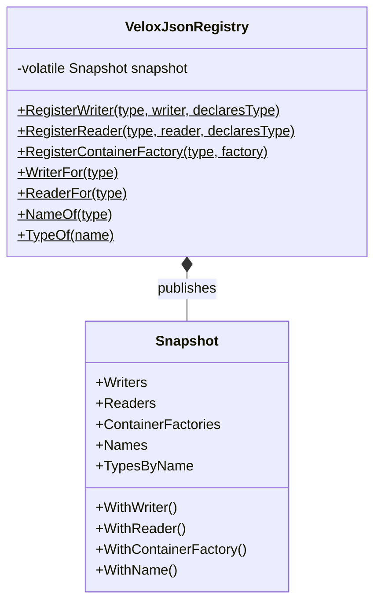
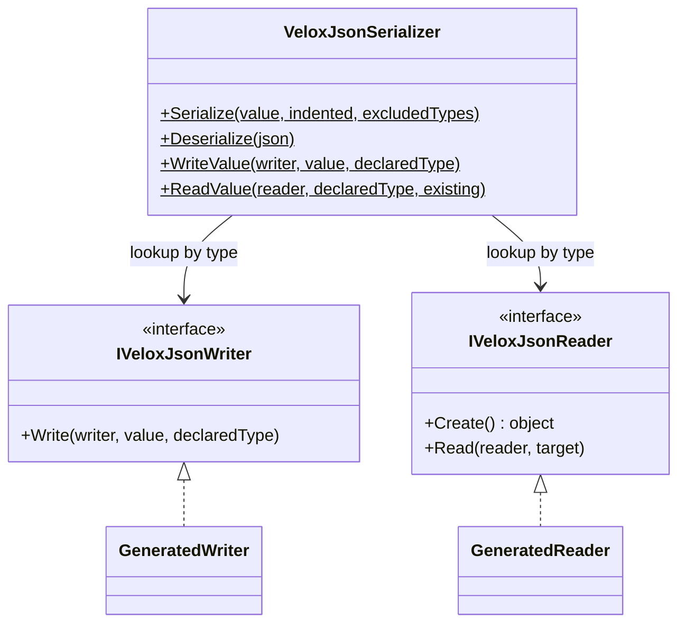
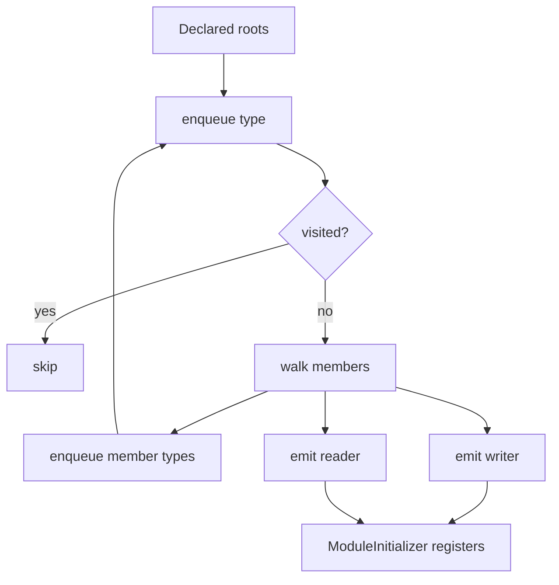

# Design patterns in closed-world serialization

The serializer can only write a type that was known when the declaring assembly was compiled. The generator walks the reachable type graph from declared roots, emits one reader and one writer per type, and registers them from module initializers. At run time a registry maps a type to those generated pieces, and `VeloxJsonSerializer` dispatches through it. The design is a Registry over an immutable snapshot, a Strategy per type, and a compile-time closure walk instead of runtime reflection.

## Registry: an immutable snapshot published by replacement

`VeloxJsonRegistry` holds five tables — writers, readers, container factories, type names, and the reverse name-to-type map. A registration builds a new `Snapshot` with one table copied and the others carried over, then publishes it with a volatile write. Readers never take a lock: they see either a whole old snapshot or a whole new one.

```csharp
private static volatile Snapshot _snapshot = Snapshot.Empty;

private sealed class Snapshot
{
    internal readonly Dictionary<Type, IVeloxJsonWriter> Writers;
    internal readonly Dictionary<Type, IVeloxJsonReader> Readers;
    internal readonly Dictionary<Type, Func<object>> ContainerFactories;
    internal readonly Dictionary<Type, string> Names;
    internal readonly Dictionary<string, Type> TypesByName;
}
```

Source: `Src/Core/VeloxDev.Core/Serialization/VeloxJsonRegistry.cs` lines 98-150.



Source: `Src/Core/VeloxDev.Core/Serialization/VeloxJsonRegistry.cs` lines 130-278.

## Strategy: one writer and one reader per type

`IVeloxJsonWriter` writes one type's members; `IVeloxJsonReader` creates an instance and reads those members into it. Both are generated, one implementation per serializable type, as straight-line code with literal member names. The serializer looks up the implementation by declared type and delegates.

```csharp
public interface IVeloxJsonWriter
{
    void Write(VeloxJsonWriter writer, object value, Type? declaredType);
    Task WriteAsync(VeloxJsonWriter writer, object value, Type? declaredType);
}

public interface IVeloxJsonReader
{
    object Create();
    void Read(VeloxJsonReader reader, object target);
    Task ReadAsync(VeloxJsonReader reader, object target);
}
```

Source: `Src/Core/VeloxDev.Core/Serialization/VeloxJsonRegistry.cs` lines 14-67.



A type with no registered writer or reader fails with a message that names the type. That is the closed world expressed as an error rather than a silent fallback to reflection.

Source: `Src/Core/VeloxDev.Core/Serialization/VeloxJsonSerializer.cs` lines 608-675.

## Factory: container construction is generated too

A container at the top of a member is filled in place by that member's reader. A nested container — the tree's `LinksMap` is a map of maps — has nowhere to be filled, and constructing a generic container from a `Type` alone would need `Activator`. The generator therefore registers a `Func<object>` for each closed container combination it meets.

```csharp
public static void RegisterContainerFactory(Type type, Func<object> factory);
public static Func<object>? ContainerFactoryFor(Type type);
```

Source: `Src/Core/VeloxDev.Core/Serialization/VeloxJsonRegistry.cs` lines 53-79.

## Closure walk: roots, reachability, emitted registrations

The generator starts from declared roots, walks members to discover reachable types, and emits a reader and writer for each. A type joins the format when it is a component, carries `[VeloxProperty]`, or is named by `[Archivable]`; `[Archive]` then changes how one member participates.

```csharp
[Archivable]
public sealed class ExecutionCheckpoint
{
    public int Attempt { get; set; }
    public Dictionary<string, object?> Outputs { get; set; } = [];
    public List<string> Shape { get; set; } = [];
}
```

Source: `Src/Core/VeloxDev.Core/Serialization/Annotations/ArchivableAttribute.cs` lines 33-42; `Src/Core/VeloxDev.Core/Serialization/Annotations/ArchiveAttribute.cs` lines 65-84; options at `.../ArchiveOptions.cs` lines 14-58.

The model builder enqueues roots and follows their member types; `TypeParameterWalk` supplies the type arguments of generic members. Generated registrations run from a `[ModuleInitializer]`, so the registry is complete before any caller can reach it.

Source: `Src/Generators/VeloxDev.Core.Generator/Base/VeloxJsonModel.cs` lines 283-368; `Src/Generators/VeloxDev.Core.Generator/Writers/VeloxJsonCodeWriter.cs` line 499.



## Read dispatch: declared type first, shape as fallback

`ReadValue` uses the declared type to find a reader. When the declared type is abstract or an interface, it reads by the written type name; when no name is available, it falls back to the serialized shape. The fallback is bounded by the same registry, so it still cannot construct a type outside the closed world.

Source: `Src/Core/VeloxDev.Core/Serialization/VeloxJsonSerializer.cs` lines 387-510.

## Pattern summary

| Pattern | Participants | Design consequence |
| --- | --- | --- |
| Registry (immutable snapshot) | `VeloxJsonRegistry`, `Snapshot` | Lock-free lookups on the per-node path |
| Strategy | `IVeloxJsonWriter`, `IVeloxJsonReader` | One generated implementation per type |
| Factory | container factories in the registry | Nested containers construct without reflection |
| Closure walk (generator) | `VeloxJsonModelBuilder`, `[Archivable]` roots | The set of writable types is known at compile time |

This closes the Core feature set covered by this page group. The archivable model analyzed here is also what the runtime's checkpoint store writes through.
