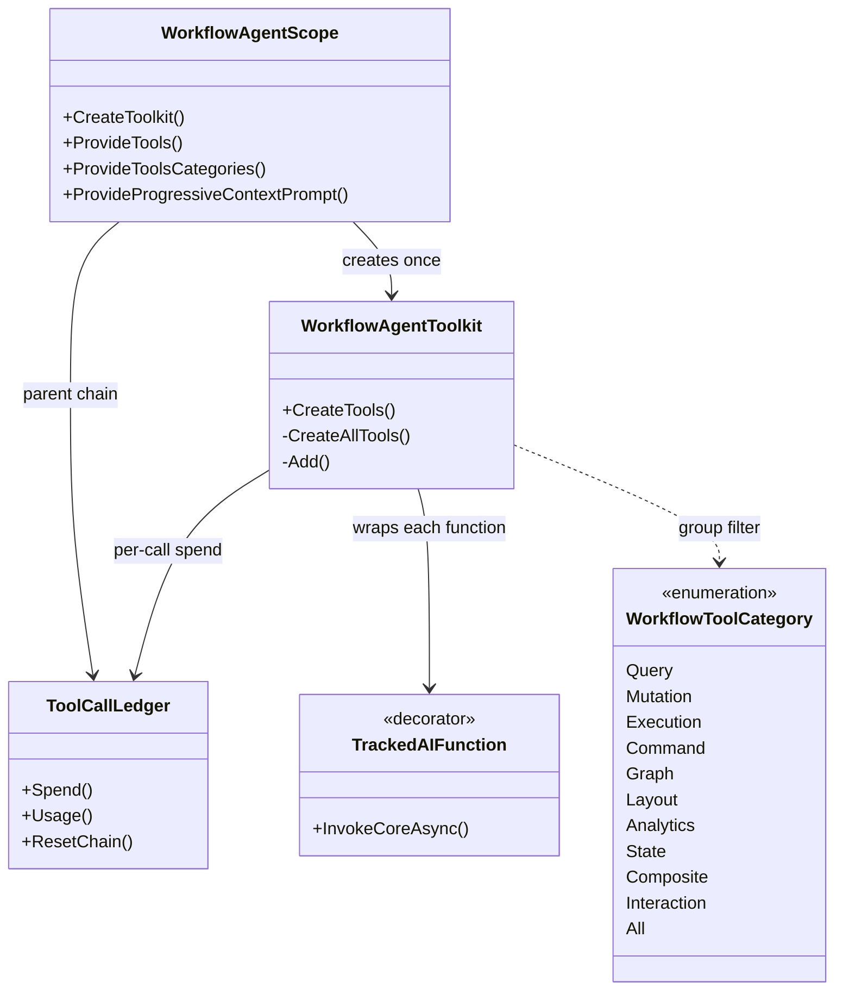

# Workflow Agent Tools

`VeloxDev.AI.Workflow.WorkflowAgentScope` is the per-tree façade an agent host talks to; it hides tool construction, context rendering and call accounting behind one object. `WorkflowAgentToolkit` assembles the callable `AITool` list, and every tool passes through `TrackedAIFunction` before it reaches the tree.

## Type topology



> Sources: `Src/Core/VeloxDev.Core.Extension/Agent/Workflow/WorkflowAgentScope.cs:23`, `Src/Core/VeloxDev.Core.Extension/Agent/Workflow/Functions/WorkflowAgentToolkit.cs:28`, `Src/Core/VeloxDev.Core.Extension/Agent/Workflow/Functions/WorkflowToolCategory.cs:12`.

## Patterns at work

| Pattern | Where | Evidence |
|---|---|---|
| Facade | `WorkflowAgentScope` | `CreateToolkit` lazily owns the one toolkit (`WorkflowAgentScope.cs:1555`); `ProvideTools` delegates (`:1586`) |
| Factory | `WorkflowAgentToolkit` | `CreateTools`/`CreateAllTools` produce the tool list (`WorkflowAgentToolkit.cs:78`, `:88`) |
| Composite | category groups | `Add(category, params AITool[])` appends a group when its flag is set (`WorkflowAgentToolkit.cs:95`) |
| Decorator / Proxy | `TrackedAIFunction` | `DelegatingAIFunction` wrapper intercepts invoke, then delegates (`TrackedAIFunction.cs:31`, `:110`) |
| Strategy | permission judge and interaction handlers | injectable delegates consumed by the toolkit (`WorkflowAgentToolkit.cs:301`, `:312`) |
| Observer | `ToolCalled` | scope raises `IAgentToolCallNotifier.ToolCalled` (`WorkflowAgentScope.cs:1006`) |

### Group composition, not a builder registry

Category grouping is an explicit sequence of `Add` calls, and the flag test is the only filter:

```csharp
// Src/Core/VeloxDev.Core.Extension/Agent/Workflow/Functions/WorkflowAgentToolkit.cs:95-99
void Add(WorkflowToolCategory category, params AITool[] items)
{
    if ((categories & category) == category)
        tools.AddRange(items);
}
```

`Query`, `State`, `Mutation`, `Execution`, `Command`, `Graph`, `Layout` and `Analytics` each contribute a group; `Composite` is reserved with no tools; `Interaction` is added only when the host installed selection or confirmation handlers (`WorkflowAgentToolkit.cs:102-235`). Custom tools merge last (`:237-240`).

### Call accounting is a chain

`ToolCallLedger` keeps `total`, `read` and `write` counters, and `Spend` walks to its `Outer` so a sub-agent's calls count against the whole tree (`ToolCallLedger.cs:57-68`). A bypass-mode caller is not charged (`WorkflowAgentToolkit.cs:478`), while the token ceiling is still checked after the count ceilings (`:389-411`).

## Design notes

- The toolkit is created once and reused: `_toolkit ??= new WorkflowAgentToolkit(this, ParentLedger)` (`WorkflowAgentScope.cs:1555`). Hosts never assemble the list themselves.
- `ProvideTools(categories)` is the filtering seam (`WorkflowAgentScope.cs:1594`); `CreateTools` drops disabled names but always keeps `ResetToolCallLimit` (`WorkflowAgentToolkit.cs:78-81`).
- The scope is the notification hub: refused and failed calls surface as pipeline events, while successful ones also raise `ToolCalled` (`WorkflowAgentScope.cs:1006-1011`). This keeps the host's UI and the agent's event stream consistent without coupling them.
