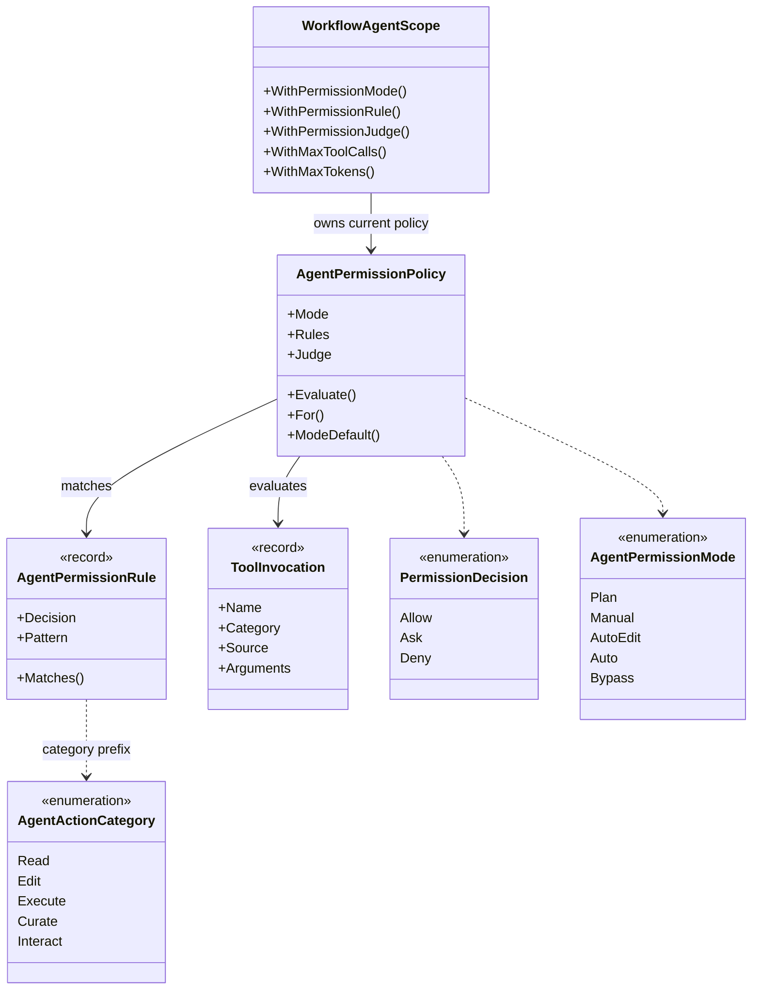

# Agent Safety and Budgets

`VeloxDev.AI.Safety` decides whether a tool call may run, and `WorkflowAgentScope`'s pre-flight gates bound how much it may run. The decision is a value (`PermissionDecision`), the policy is swappable, and the budgets are enforced before the tool body executes.

## Type topology



> Sources: `Src/Core/VeloxDev.Core.Extension/Agent/Safety/AgentPermissionPolicy.cs:31`, `AgentPermissionRule.cs:39`, `ToolInvocation.cs:23`, `PermissionDecision.cs:4`, `AgentPermissionMode.cs:32`, `AgentActionCategory.cs:20`, `Agent/Workflow/WorkflowAgentScope.cs:23`.

## Patterns at work

| Pattern | Where | Evidence |
|---|---|---|
| Policy object | `AgentPermissionPolicy` | one immutable object bundles mode, rules and judge behind `Evaluate` (`AgentPermissionPolicy.cs:31`, `:100`) |
| Strategy | injectable judge | `Func<ToolInvocation, PermissionDecision>` consulted only in `Auto` (`AgentPermissionPolicy.cs:110-121`) |
| State | permission mode | mode is read live at call time; `EnterPlan`/`ExitPlan` save and restore it (`WorkflowAgentScope.cs:787-806`) |
| Fluent builder | `With*` gates | each gate mutates the scope and returns `this` (`WorkflowAgentScope.cs:176`, `:838`, `:866`) |
| Value object | rules and invocations | both are sealed records (`AgentPermissionRule.cs:39`, `ToolInvocation.cs:23`) |

### Precedence, not a rule chain

The evaluation is a fixed precedence pipeline. Deny wins first, Plan refusal is unconditional, then Ask, then Allow, then the judge, then the mode default:

```csharp
// Src/Core/VeloxDev.Core.Extension/Agent/Safety/AgentPermissionPolicy.cs:100-124
public PermissionDecision Evaluate(ToolInvocation invocation)
{
    if (Has(PermissionDecision.Deny, invocation)) return PermissionDecision.Deny;
    if (Mode == AgentPermissionMode.Plan && ModeDefault(Mode, invocation.Category) == PermissionDecision.Deny)
        return PermissionDecision.Deny;
    if (Has(PermissionDecision.Ask, invocation)) return PermissionDecision.Ask;
    if (Has(PermissionDecision.Allow, invocation)) return PermissionDecision.Allow;

    if (Mode == AgentPermissionMode.Auto && Judge is { } judge)
    {
        try { return judge(invocation); }
        catch (Exception) { return PermissionDecision.Deny; }
    }

    return ModeDefault(Mode, invocation.Category);
}
```

Because a rule carries a `Decision`, rules are bucketed by outcome rather than walked in declaration order. A judge that throws is fail-closed.

### Budgets ride the decorator

`TrackedAIFunction` builds a `ToolInvocation`, asks `ToolPipeline` to refuse it, and only then calls the inner function (`TrackedAIFunction.cs:74-83`). The pipeline's `Refuse` delegate is wired to `CheckInvocation`, whose order is: reset-tool exemption, per-tool switch, permission Deny, session ceiling, own total, read/write caps, then token cap (`WorkflowAgentToolkit.cs:352-414`). Results are capped separately by `CapResult` (`TrackedAIFunction.cs:135-158`).

## Design notes

- The mode matrix is the whole policy: `Plan` allows only read/interact; `Manual` asks for edits; `AutoEdit` allows edits; `Auto` asks only for `Curate`; `Bypass` allows everything (`AgentPermissionPolicy.cs:130-143`).
- Bypass skips the three call-count budgets and their accounting, but Deny rules (`:104`) and the token cap (`WorkflowAgentToolkit.cs:410-411`) still apply.
- `ResetToolCallLimit` is the controlled escape hatch: it asks the user, then zeroes the ledger chain and token usage only on approval (`WorkflowAgentToolkit.cs:500-531`).
