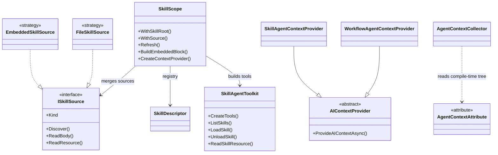

# Agent Context and Skills

Context reaches the model through `AIContextProvider` implementations, and skills reach it through a pluggable source abstraction. `SkillScope` merges sources; `WorkflowAgentScope` renders the progressive prompt and owns the provider set.

## Type topology



> Sources: `Src/Core/VeloxDev.Core.Extension/Agent/Skills/ISkillSource.cs:17`, `EmbeddedSkillSource.cs:24`, `FileSkillSource.cs:23`, `SkillScope.cs:31`, `SkillAgentToolkit.cs:32`, `SkillAgentContextProvider.cs:24`, `Agent/Workflow/WorkflowAgentContextProvider.cs:27`, `Src/Core/VeloxDev.Core/AI/AgentContextAttribute.cs:5`, `Agent/Workflow/AgentContextCollector.cs:25`.

## Patterns at work

| Pattern | Where | Evidence |
|---|---|---|
| Strategy | `ISkillSource` | embedded and file sources are interchangeable; `Refresh` calls `Discover` polymorphically (`SkillScope.cs:168-197`) |
| Provider + Template Method | `AIContextProvider` subclasses | framework fixes `ProvideAIContextAsync`, subclass supplies `BuildContext` (`SkillAgentContextProvider.cs:69`, `:78`) |
| Composite | multi-source merge | `Refresh` merges all sources with first-source-owns-name (`SkillScope.cs:191-195`) |
| Registry / cache | skill owners and renders | `_owningSource` map plus `Version` gating (`SkillScope.cs:459-468`) |
| Factory | provider and tool construction | `CreateContextProvider` (`SkillScope.cs:107`), `CreateTools` (`SkillAgentToolkit.cs:68`) |

### Source isolation

A failing source becomes a descriptor with an error instead of aborting discovery, and duplicate names are deduplicated by owner:

```csharp
// Src/Core/VeloxDev.Core.Extension/Agent/Skills/SkillScope.cs:168-196
try
{
    discovered = source.Discover();
}
catch (Exception ex)
{
    found.Add(new SkillDescriptor { Name = source.Kind + "-source", Source = source.Kind,
        Error = $"Skill source '{source.GetType().Name}' failed to discover: {ex.Message}" });
    continue;
}

foreach (var descriptor in discovered)
{
    if (owners.TryGetValue(descriptor.Name, out var owner) && !ReferenceEquals(owner, source))
        continue;
    owners[descriptor.Name] = source;
    found.Add(descriptor);
}
```

### Embedded versus file discovery

`EmbeddedSkillSource` enumerates assembly manifest resources under `Resources.{system}.{language}.Skills.` and parses optional frontmatter (`EmbeddedSkillSource.cs:50-111`; `AgentEmbeddedResources.cs:167-195`). `FileSkillSource` scans `<root>/SKILL.md` plus one folder deep and checks path containment before reading a resource (`FileSkillSource.cs:52-124`, `:149-164`). `WithSkillRoot` resolves a relative path against `AppContext.BaseDirectory` (`SkillScope.cs:129-138`).

## Design notes

- Context annotations are not reflected at runtime. `AgentContextCollector` forwards to `AgentContextReader`, which looks up a precompiled `AIContextDirectory` tree by `FullName`; the source comments state that nothing reflects over metadata (`AgentContextCollector.cs:12-18`; `Src/Core/VeloxDev.Core/AI/AgentContextReader.cs:60-100`).
- `ProvideProgressiveContextPrompt` emits a skeleton — behavioral rules, references, registered type names, a `GetComponentContext` mandate and embedded skills — while per-turn deltas come from `BuildDynamicInstructions` (`WorkflowAgentScope.cs:1309-1431`, `:2151`).
- When embedded skills are frozen into the prompt, `SkillAgentContextProvider` contributes a withdrawn block instead of the corpus, preventing double injection (`SkillAgentContextProvider.cs:111-113`; `WorkflowAgentScope.cs:2448-2451`).
