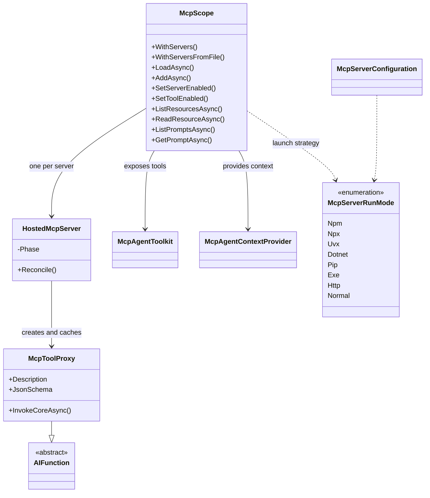

# MCP Integration

`VeloxDev.AI.MCP` hosts Model Context Protocol servers and exposes their tools, resources and prompts to an agent. `McpScope` is the façade and registry; each launched server is a `HostedMcpServer`; each remote tool is a stable `McpToolProxy` that implements the local `AIFunction` contract.

## Type topology



> Sources: `Src/Core/VeloxDev.Core.Extension/Agent/MCP/McpScope.cs:38`, `HostedMcpServer.cs:35`, `McpToolProxy.cs:24`, `McpAgentToolkit.cs:29`, `McpAgentContextProvider.cs:27`, `McpServerRunMode.cs:8`.

## Patterns at work

| Pattern | Where | Evidence |
|---|---|---|
| Facade | `McpScope` | load/add/status/resource/prompt all funnel through one object over a private host map (`McpScope.cs:144`, `:778-838`) |
| Proxy / Adapter | `McpToolProxy` | adapts a dynamic MCP tool to `AIFunction` by forwarding description, schema and invoke (`McpToolProxy.cs:30-49`) |
| Registry | server and tool maps | `_hosts` dictionary plus registered-server list (`McpScope.cs:144`, `:328`) |
| Builder | fluent `With*` | `WithServers`, `WithServersFromFile`, `WithConnectionTimeout` return the scope (`McpScope.cs:61`, `:341`, `:816`) |
| Mediator | connector delegate | scope binds a `Connector` into each host instead of calling it directly (`HostedMcpServer.cs:39`; `McpScope.cs:993`) |
| Strategy | launch mode | one switch selects the process builder for each run mode (`McpScope.cs:1303-1312`) |
| Template Method | provider override | `AIContextProvider.ProvideAIContextAsync` delegates to `BuildContext` (`McpAgentContextProvider.cs:69-78`) |

### Run modes are launch strategies

```csharp
// Src/Core/VeloxDev.Core.Extension/Agent/MCP/McpScope.cs:1303-1312
var (cmd, args) = config.RunMode switch
{
    McpServerRunMode.Normal => BuildNormalArgs(config),
    McpServerRunMode.Npx    => BuildNpxArgs(config),
    McpServerRunMode.Uvx    => BuildUvxArgs(config),
    McpServerRunMode.Dotnet => BuildDotnetArgs(config, mcpRoot),
    McpServerRunMode.Pip    => BuildPipArgs(config, mcpRoot),
    McpServerRunMode.Exe    => BuildExeArgs(config, mcpRoot),
    _                       => BuildNpmArgs(config, mcpRoot),
};
```

`Npm` and `Pip` install a package into a runtime directory before launch; `Npx`, `Uvx`, `Dotnet` and `Exe` execute a resolved command; `Http` takes the transport path instead of a process (`McpScope.cs:1153-1231`, `:1336`, `:1479-1578`).

### Proxies keep identity

`HostedMcpServer.Reconcile` reuses an existing `McpToolProxy` by name and only publishes the live set, so the agent sees a stable tool identity across reconnects (`HostedMcpServer.cs:363-370`).

## Design notes

- `WithServers` does not reconnect live hosts; it updates configuration and bumps a version counter so the next call rebuilds the affected server (`McpScope.cs:341-359`).
- `McpAgentContextProvider` rebuilds its toolkit only when the scope version changes, and wraps every loaded tool so call accounting and permission checks apply (`McpAgentContextProvider.cs:78-121`). Its instructions carry an explicit untrusted-provenance line (`:142`).
- Resource and prompt access are delegated methods, not separate sub-systems: each resolves the host through `RequireHost` (`McpScope.cs:966-982`).
