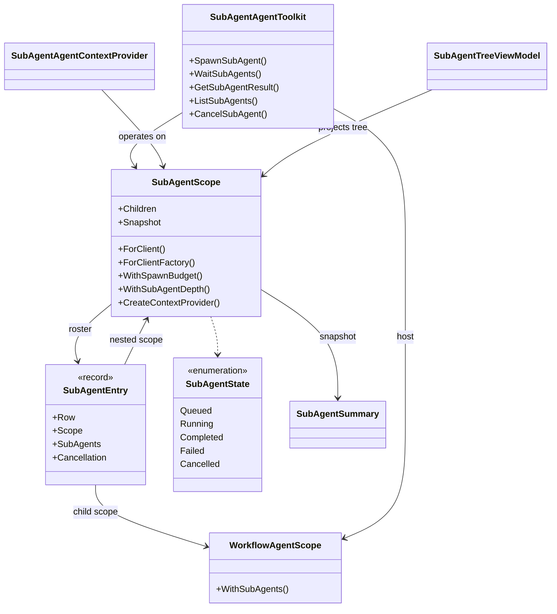

# Sub-Agents

`VeloxDev.AI.SubAgents.SubAgentScope` lets an agent delegate work to child agents that share the parent tree but hold strictly smaller budgets. The scope owns a roster of `SubAgentEntry` records; `SubAgentAgentToolkit` is the tool surface over that roster.

## Type topology



> Sources: `Src/Core/VeloxDev.Core.Extension/Agent/SubAgents/SubAgentScope.cs:130`, `:1060`, `SubAgentAgentToolkit.cs:30`, `SubAgentAgentContextProvider.cs:24`, `SubAgentStatus.cs:14`, `:40`, `SubAgentTreeViewModel.cs:278`.

## Patterns at work

| Pattern | Where | Evidence |
|---|---|---|
| Facade | `SubAgentScope` | factories, budgets, roster and operations behind one object (`SubAgentScope.cs:130-246`) |
| Composite | roster tree | `SubAgentEntry` holds child entries; `SubAgentTreeViewModel` recursively projects them (`SubAgentScope.cs:1060`; `SubAgentTreeViewModel.cs:405-447`) |
| Mediator | toolkit | translates model tool calls into `TrySpawn`, `List`, `Cancel` on the scope (`SubAgentAgentToolkit.cs:84-231`) |
| Strategy | client factory | injectable agent factory so a child can use a different model or client (`SubAgentScope.cs:132`, `:185`, `:204`) |
| Builder | fluent budgets | `WithSpawnBudget`, `WithSubAgentDepth`, `WithSynchronizationContext` (`SubAgentScope.cs:276-340`) |
| Observer | `Changed` | roster changes notify the tree view model (`SubAgentScope.cs:261`; `SubAgentTreeViewModel.cs:485`) |

### The grant is strictly descending

A child never receives the parent's full remaining allowance:

```csharp
// Src/Core/VeloxDev.Core.Extension/Agent/SubAgents/SubAgentScope.cs:459-470
var parentLedger = parent.CreateToolkit().Ledger;
var remaining = RemainingAllowance(parent, parentLedger);
var granted = Math.Min(request.MaxToolCalls ?? remaining, remaining - 1);
if (granted < 1)
{
    refusal = "No tool-call allowance remains for a sub-agent...";
    return null;
}
if (request.MaxToolCalls is { } askedBudget && askedBudget > granted)
    dropped.Add($"maxToolCalls: asked for {askedBudget}, granted {granted}...");
```

The granted value is applied with `child.WithMaxToolCalls(granted)`, and the child's `ParentLedger` points at the parent so spend counts against the whole tree (`SubAgentScope.cs:544-548`, `:601`).

### Capabilities are intersected, not copied

The parent computes its available surface — toolkit tools, skill names, sub-agent names and MCP tools — filters it by its own switches, then intersects the request with it (`SubAgentScope.cs:479-522`). Omitted lists inherit everything; explicit lists that exceed the parent are reported as dropped (`:511-522`).

## Design notes

- Depth is a hard gate: `CanSpawn => Depth < MaxDepth`, and the child is constructed at `Depth + 1` (`SubAgentScope.cs:331`, `:544`).
- Skills, MCP servers, node execution, generic commands and auto-dirty are each resolved against the parent's grantable names before being forwarded (`SubAgentScope.cs:684-851`).
- The context provider rebuilds instructions and tools only when `SubAgentScope.Version` changes, then caches them (`SubAgentAgentContextProvider.cs:77-99`).
