# Agent Dashboard and Transcript

`VeloxDev.AI.Pipelines` converts raw agent updates into a typed `AgentEvent` stream that stages consume, while `VeloxDev.AI.Dashboard` projects the live scope into member rows and `VeloxDev.AI.Media` carries attachments through the same stream. `AgentPipelineAgent` is the decorator that attaches the whole pipeline to any `AIAgent`.

## Type topology

```mermaid
classDiagram
    class AgentEvent {
        <<abstract>>
    }
    class AgentTurnStarted
    class AgentTurnCompleted
    class AgentTextDelta
    class AgentReasoningDelta
    class AgentToolCallStarted
    class AgentToolCallCompleted
    class AgentUsageReported
    class AgentTurnFaulted
    class AgentMediaReceived
    class IAgentPipelineStage {
        <<interface>>
        +OnEventAsync()
    }
    class AgentPipeline {
        +Use()
        +PublishAsync()
    }
    class TextPipeline
    class ToolPipeline
    class AgentPipelineAgent {
        +RunCoreAsync()
        +RunCoreStreamingAsync()
    }
    class DelegatingAIAgent {
        <<abstract>>
    }
    class AgentMemberViewModel {
        <<abstract>>
    }
    class ToolMemberViewModel
    class SkillMemberViewModel
    class McpToolMemberViewModel
    class McpServerMemberViewModel
    class AgentTranscript {
        +ToMarkdown()
    }
    class AgentMedia
    class IAgentMediaTranscoder {
        <<interface>>
        +TranscodeAsync()
    }
    AgentTurnStarted --|> AgentEvent
    AgentTurnCompleted --|> AgentEvent
    AgentTextDelta --|> AgentEvent
    AgentReasoningDelta --|> AgentEvent
    AgentToolCallStarted --|> AgentEvent
    AgentToolCallCompleted --|> AgentEvent
    AgentUsageReported --|> AgentEvent
    AgentTurnFaulted --|> AgentEvent
    AgentMediaReceived --|> AgentEvent
    TextPipeline ..|> IAgentPipelineStage
    ToolPipeline ..|> IAgentPipelineStage
    AgentPipeline --> IAgentPipelineStage : ordered chain
    AgentPipelineAgent --|> DelegatingAIAgent
    AgentPipelineAgent --> AgentPipeline : publishes into
    ToolMemberViewModel --|> AgentMemberViewModel
    SkillMemberViewModel --|> AgentMemberViewModel
    McpToolMemberViewModel --|> AgentMemberViewModel
    McpServerMemberViewModel --|> AgentMemberViewModel
    AgentMedia ..|> IAgentMediaContent
```



> Sources: `Src/Core/VeloxDev.Core.Extension/Agent/Pipelines/AgentEvent.cs:21-177`, `AgentPipeline.cs:16-46`, `TextPipeline.cs:42`, `ToolPipeline.cs:23`, `AgentPipelineAgent.cs:33`, `Dashboard/AgentMemberViewModel.cs:18`, `Dashboard/ToolMemberViewModel.cs:11`, `Dashboard/SkillMemberViewModel.cs:11`, `Dashboard/McpMemberViewModel.cs:14`, `:54`, `AgentTranscript.cs:230`, `Media/AgentMedia.cs:31`, `Media/IAgentMediaTranscoder.cs:87`.

## Patterns at work

| Pattern | Where | Evidence |
|---|---|---|
| Observer | event stream | `AgentEvent` subclasses are published by `AgentPipeline.PublishAsync` (`AgentPipeline.cs:84`); dashboard subscribes to scope changes (`AgentDashboardViewModel.cs:62-63`) |
| Pipeline / Chain of Responsibility | `IAgentPipelineStage` | each stage receives a `next` delegate and forwards (`AgentPipeline.cs:22`, `:98-101`) |
| Decorator | `AgentPipelineAgent` | wraps an inner `AIAgent`, yields its updates untouched (`AgentPipelineAgent.cs:33`, `:119-120`) |
| Composite | member rows | `AgentMemberViewModel` base with concrete rows; MCP server row holds tool rows (`McpMemberViewModel.cs:65`; `AgentDashboardViewModel.cs:131-141`) |
| Template Method | pipeline overrides | `RunCoreAsync`/`RunCoreStreamingAsync` fix the event boundaries (`AgentPipelineAgent.cs:38`, `:77`) |
| Adapter | media transcoder | `DelegateAgentMediaTranscoder` adapts a lambda to `IAgentMediaTranscoder` (`IAgentMediaTranscoder.cs:101-120`) |

### Raw content becomes typed events

```csharp
// Src/Core/VeloxDev.Core.Extension/Agent/Pipelines/AgentPipelineAgent.cs:143-162
switch (content)
{
    case TextReasoningContent reasoning when !string.IsNullOrEmpty(reasoning.Text):
        await PublishAsync(new AgentReasoningDelta(reasoning.Text), cancellationToken).ConfigureAwait(false);
        break;
    case TextContent text when !string.IsNullOrEmpty(text.Text):
        await PublishAsync(new AgentTextDelta(text.Text), cancellationToken).ConfigureAwait(false);
        break;
    case UsageContent usage when usage.Details is { } details:
        await PublishAsync(new AgentUsageReported(details), cancellationToken).ConfigureAwait(false);
        break;
    case DataContent:
    case UriContent:
        if (AgentAttachment.TryFromContent(content, out var attachment))
            await PublishAsync(new AgentMediaReceived(attachment, content), cancellationToken).ConfigureAwait(false);
        break;
}
```

### Stages interpret, transcript records

`TextPipeline` coalesces text and reasoning deltas and flushes them on turn boundaries, using `PipelineDispatch` so writes stay ordered (`TextPipeline.cs:79-132`; `PipelineDispatch.cs:20-43`). `ToolPipeline` records completed tool calls (`ToolPipeline.cs:84-96`). `AgentTranscript` appends a new entry only when the role differs from the open one, which is what makes a streaming turn read as a single transcript entry (`AgentTranscript.cs:402-415`).

## Design notes

- Failures are isolated per stage: `AgentPipeline.InvokeAsync` catches a stage exception and raises `StageFailed` rather than breaking the chain (`AgentPipeline.cs:103-106`).
- The member hierarchy is uniform: `AllMembers()` walks server rows, tool rows and skill rows through one interface (`AgentDashboardViewModel.cs:131-141`).
- `AgentMedia` owns bytes and sniffs/validates its container; `AgentMediaReference` is the URL-only counterpart, and `AgentAttachment` is the display record. Only `AgentMedia` routes through `IAgentMediaTranscoder` (`AgentMedia.cs:31`, `:272-323`; `AgentMediaReference.cs:19`; `AgentAttachment.cs:15`).
