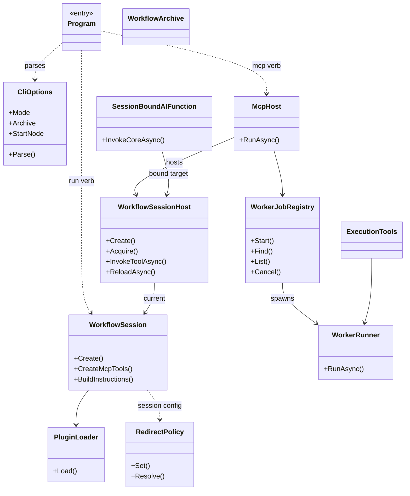

# Headless CLI

`VeloxDev.Cli` is a two-verb executable: `run` executes one workflow archive and exits, `mcp` hosts a workflow session as an MCP stdio server. Around those verbs it composes session reload, archive parsing, plugin loading, worker isolation and run logging.

## Type topology



> Sources: `Src/Cli/VeloxDev.Cli/CliOptions.cs:4`, `Program.cs:12`, `WorkflowSession.cs:21`, `WorkflowSessionHost.cs:31`, `WorkflowArchive.cs:20`, `PluginLoader.cs:30`, `ExecutionTools.cs:13`, `WorkerRunner.cs:17`, `WorkerJobRegistry.cs:85`, `RedirectPolicy.cs:16`, `SessionBoundAIFunction.cs:10`, `McpHost.cs:12`.

## Patterns at work

| Pattern | Where | Evidence |
|---|---|---|
| Command | verb dispatch | closed-set validation of `mcp`/`run` (`CliOptions.cs:102-104`); distinct handlers (`Program.cs:22-25`) |
| Facade | `WorkflowSession` / `WorkflowSessionHost` | one object hides archive, scope, toolkit, plugins, redirect, checkpoint and log (`WorkflowSession.cs:91-144`); host hides lease/reload/audit (`WorkflowSessionHost.cs:107-254`) |
| Factory | static `Create` + loader | private constructors with static factories (`WorkflowSession.cs:147`, `WorkflowSessionHost.cs:68`); `PluginLoader.Load` returns an assembly (`PluginLoader.cs:122`) |
| Registry | jobs | `WorkerJobRegistry` owns a job dictionary and lifecycle (`WorkerJobRegistry.cs:88-140`) |
| Strategy | redirect policy | replaceable `Resolve` injected into session configuration (`RedirectPolicy.cs:48`; `WorkflowSession.cs:244`) |
| Adapter | session binding | `SessionBoundAIFunction` keeps one schema but forwards to the current session (`SessionBoundAIFunction.cs:21-23`) |

### Two verbs, one host

```csharp
// Src/Cli/VeloxDev.Cli/Program.cs:14-25
var options = CliOptions.Parse(args);
if (options.ShowHelp) { /* print usage */ }
if (options.Mode == "run")
    return await RunOnceAsync(options);

await McpHost.RunAsync(options);
```

`CliOptions` defaults to `mcp` and rejects any other token, so the fall-through branch is safe (`CliOptions.cs:69`, `:103-104`). `--archive` is required for both verbs; `--start` is required only for `run` (`CliOptions.cs:206-210`).

### Session swap without tool re-registration

Every MCP tool is a `SessionBoundAIFunction` whose schema is captured at startup but whose call resolves the host's current session through `InvokeToolAsync` (`McpHost.cs:39`; `WorkflowSessionHost.cs:138-145`). Reload retires a leased session instead of disposing it, then swaps `_current` when the lease is released (`WorkflowSessionHost.cs:284-296`).

## Design notes

- Plugin assemblies load into the default `AssemblyLoadContext` from a per-process staging copy, and the loader explicitly runs each module initializer so generated registrations take effect (`PluginLoader.cs:157-168`, `:240-262`).
- Worker isolation is file-handoff, not shared memory: the parent serializes the tree to a snapshot, launches `dotnet <cli> run --archive ... --output-tree ...`, and reads the state file plus stdout/stderr (`WorkerRunner.cs:32-80`, `:181-190`). The child deliberately does not inherit the MCP stdin stream (`:63-69`).
- `McpHost` keeps stdout clean for JSON-RPC by forcing logs to stderr and registering tools, resources and prompts on the MCP builder (`McpHost.cs:16-49`).
