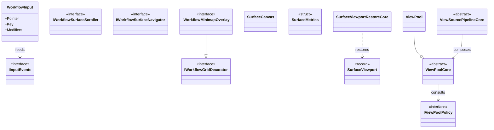

# Platform Adapter Contract

The seven GUI adapters do not reimplement workflow mechanics; they close a shared contract declared in `VeloxDev.Core`. This page describes that contract. `WorkflowInput` normalizes pointer/key state, the `Surface*` types carry viewport geometry, and `ViewPool`/`ViewSourcePipelineCore` fix the hosting pipeline that each platform specializes.

## Type topology

> Sources: `Src/Core/VeloxDev.Core/WorkflowSystem/GUI/Events/WorkflowInput.cs:31`, `GUI/Events/Input/IInputEvents.cs:19`, `GUI/Events/IWorkflowSurfaceScroller.cs:38`, `GUI/Events/IWorkflowSurfaceNavigator.cs:23`, `Interfaces/WorkflowSystem/Surface/IWorkflowGridDecorator.cs:12`, `Interfaces/WorkflowSystem/Surface/IWorkflowMinimapOverlay.cs:15`, `GUI/Surface/SurfaceViewport.cs:11`, `SurfaceMetrics.cs:24`, `SurfaceViewportRestoreCore.cs:24`, `ViewHosting/ViewPool.cs:29`, `:463`, `ViewSourcePipelineCore.cs:24`, `Interfaces/WorkflowSystem/ViewHosting/IViewPoolPolicy.cs:11`.

## Patterns at work

| Pattern | Where | Evidence |
|---|---|---|
| Port / Adapter boundary | Core interfaces | each adapter implements the same interfaces instead of forking behavior (`IInputEvents.cs:19`; `IWorkflowGridDecorator.cs:12`) |
| Template Method | `ViewPoolCore`, `ViewSourcePipelineCore` | abstract base fixes the batch/pipeline loop; sealed `ViewPool` closes it (`ViewPool.cs:29`, `:463`; `ViewSourcePipelineCore.cs:24`) |
| Strategy | `IViewPoolPolicy` | pool selection is an injected policy (`IViewPoolPolicy.cs:11`) |
| Composite | layer policy | view layers are composed by the pipeline (`Interfaces/WorkflowSystem/ViewHosting/IViewLayerPolicy.cs:12`) |
| Observer | `WorkflowEventRelay` | Core relay forwards component events to host sinks (`GUI/Events/WorkflowEventRelay.cs:18`) |
| Value objects | geometry | `SurfaceViewport` is a record and `SurfaceMetrics` a readonly struct (`SurfaceViewport.cs:11`; `SurfaceMetrics.cs:24`) |

### The seven roles

Every adapter supplies the same role set over the same contracts: surface host, canvas transform, event sinks, node drag, slot connection, slot layout, view pool, minimap overlay, grid decorator, transition system and dynamic theme. Six adapters derive their source pipeline through `ViewSourcePipelineCore` — all but Razor, which relies on Core plus a JS module (for example `Src/Adapters/VeloxDev.WPF/WorkflowSystem/ViewHosting/ViewSourcePipeline.cs:10` and `Src/Adapters/VeloxDev.WinForms/WorkflowSystem/ViewHosting/ViewSourcePipeline.cs:14`) — and all seven minimaps implement `IWorkflowMinimapOverlay` (`IWorkflowMinimapOverlay.cs:15`).

### Conformance evidence

The headless suites live in `Src/Test/Headless` for WPF, Avalonia, WinForms, Razor and Jalium. WinUI and MAUI have demos and benchmarks but no windowless suite. The contract is exercised through `VeloxDev.AdapterTestKit`, not by importing platform UI types into tests.

## Design notes

- `IWorkflowMinimapOverlay` extends `IWorkflowGridDecorator`, so the minimap can reuse grid drawing contracts without a second abstraction (`IWorkflowMinimapOverlay.cs:15`).
- Geometry flows as values: the viewport record is restored by `SurfaceViewportRestoreCore`, keeping camera state out of the adapter's control tree (`SurfaceViewport.cs:11`; `SurfaceViewportRestoreCore.cs:24`).
- The adapters add `ProjectReference` to Core in Debug and `PackageReference` in Release, so the contract page and the release binary describe the same surface (for example `Src/Adapters/VeloxDev.WPF/VeloxDev.WPF.csproj:28-29`).
