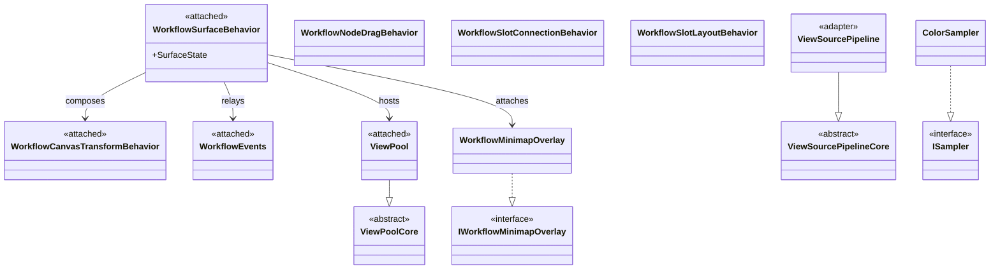

# WPF Adapter

`VeloxDev.WPF` closes the Core adapter contract with WPF attached properties. Each behavior is a static `DependencyObject` class that attaches to a named part of the host's visual tree; the heavy mechanics stay in `VeloxDev.Core`, and the WPF project supplies the visual host, samplers and theme converters.

## Type topology

> Sources: `Src/Adapters/VeloxDev.WPF/WorkflowSystem/AttachedBehaviors/WorkflowSurfaceBehavior.cs:16`, `WorkflowCanvasTransformBehavior.cs:10`, `WorkflowEvents.cs:33`, `WorkflowNodeDragBehavior.cs:11`, `WorkflowSlotConnectionBehavior.cs:8`, `WorkflowSlotLayoutBehavior.cs:30`, `ViewPool.cs:18`, `WorkflowMinimapOverlay.cs:22`; `ViewHosting/ViewSourcePipeline.cs:10`; `TransitionSystem/Samplers/ColorSampler.cs:5`; `Src/Core/VeloxDev.Core/Interfaces/TransitionSystem/ISampler.cs:11`.

## Patterns at work

| Pattern | Where | Evidence |
|---|---|---|
| Adapter | `ViewSourcePipeline` | derives the Core pipeline and supplies WPF layers (`ViewSourcePipeline.cs:10`) |
| Proxy | `WorkflowEvents` | attached sink forwards component events through `WorkflowEventRelay.Attach` (`WorkflowEvents.cs:111`) |
| Composite | view layers | `ViewLayerPolicy : IViewLayerPolicy<IWorkflowComponent>` composes with `ViewLinkLayer` (`ViewLayerPolicy.cs:6`; `ViewLinkLayer.cs:8`) |
| Strategy | samplers | `ColorSampler`, `PointSampler`, `RectSampler` implement `ISampler` (`Samplers/ColorSampler.cs:5`) |
| Facade | surface behavior | one attached class exposes scroll, canvas, grid, minimap, restore and pool (`WorkflowSurfaceBehavior.cs:16`, `:20`) |
| Template Method | pool core | `ViewPool` closes `ViewPoolCore` (`ViewPool.cs:18`) |

### Scroll and restore are separate ports

WPF is the adapter that visibly separates the two surface contracts into private host objects: `WpfSurfaceScrollHost : ISurfaceScrollHost` and `WpfViewportRestoreHost : ISurfaceViewportRestoreHost`, constructed by the surface behavior and backed by `SurfaceViewportRestoreCore` (`WorkflowSurfaceBehavior.cs:893`, `:943`, `:354`). This keeps scroll physics and camera restoration independently replaceable while a single attached property remains the public entry point.

### Attached properties as the composition root

`DependencyProperty.RegisterAttached` appears on `ViewPool`, `WorkflowEvents` and `WorkflowCanvasTransformBehavior` (`ViewPool.cs:21`; `WorkflowEvents.cs:36`; `WorkflowCanvasTransformBehavior.cs:12`). The host XAML attaches them to named elements; no adapter code constructs the visual tree.

## Design notes

- The surface state is aggregated in a `SurfaceState` object, so one property change does not fan out into many unrelated notifications (`WorkflowSurfaceBehavior.cs:20`).
- Transitions use the shared `TransitionInterpreter` with WPF-specific samplers; theme conversion lives in `DynamicTheme/ThemeValueConverters.cs:8`.
- The headless suite in `Src/Test/Headless` exercises this adapter without a visible window.
