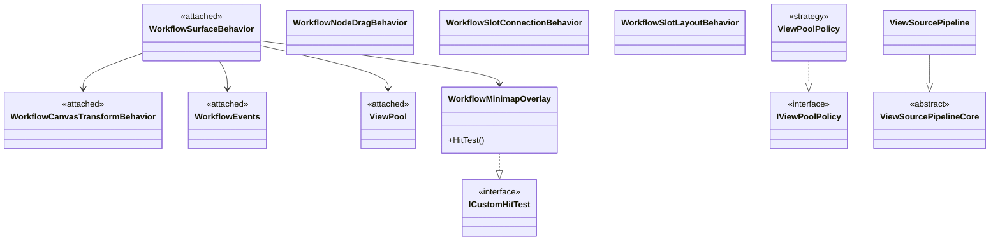

# Avalonia Adapter

`VeloxDev.Avalonia` mirrors the WPF role set over `AvaloniaProperty` rather than `DependencyProperty`, and replaces WPF's hit-test plumbing with Avalonia's `ICustomHitTest`. The Core contract is unchanged; only the property and input systems differ.

## Type topology



> Sources: `Src/Adapters/VeloxDev.Avalonia/WorkflowSystem/AttachedBehaviors/WorkflowSurfaceBehavior.cs:22`, `WorkflowCanvasTransformBehavior.cs:11`, `WorkflowEvents.cs:34`, `WorkflowNodeDragBehavior.cs:13`, `WorkflowSlotConnectionBehavior.cs:12`, `WorkflowSlotLayoutBehavior.cs:30`, `ViewPool.cs:19`, `WorkflowMinimapOverlay.cs:29`; `WorkflowSystem/ViewHosting/ViewPoolPolicy.cs:4`; `Src/Core/VeloxDev.Core/Interfaces/WorkflowSystem/ViewHosting/IViewPoolPolicy.cs:11`.

## Patterns at work

| Pattern | Where | Evidence |
|---|---|---|
| Adapter | attached behaviors | `AvaloniaProperty.RegisterAttached` binds Core behavior to Avalonia objects (`WorkflowEvents.cs:38`; `WorkflowSurfaceBehavior.cs:66`; `ViewPool.cs:29`) |
| Proxy | `WorkflowEvents` | event sinks forward through the Core relay (`WorkflowEvents.cs:34`) |
| Composite | view layers | the source pipeline composes layer policies |
| Strategy | pool policy | `ViewPoolPolicy : IViewPoolPolicy` (`ViewPoolPolicy.cs:4`) |
| Template Method | pipeline core | `ViewSourcePipeline` derives `ViewSourcePipelineCore` |
| Facade | surface | one attached surface exposes scroll, transform, grid, minimap and pool (`WorkflowSurfaceBehavior.cs:22`) |

### Minimap hit testing is a control concern

Unlike WPF, the Avalonia minimap implements `ICustomHitTest` and delegates its hit test to the shared minimap pipeline:

```csharp
// Src/Adapters/VeloxDev.Avalonia/WorkflowSystem/AttachedBehaviors/WorkflowMinimapOverlay.cs:245
bool ICustomHitTest.HitTest(Point point)
```

That keeps pointer routing in the platform control while the decision still comes from `MinimapPipelineCore`.

### Property system, not inheritance

All attached behavior classes are sealed and stateless; state lives in attached properties or per-control companion objects. The surface behavior derives `AvaloniaObject`, not a control, so it can attach to any host without changing the visual hierarchy (`WorkflowSurfaceBehavior.cs:22`).

## Design notes

- Transitions reuse the shared interpreter; Avalonia contributes samplers such as `BoxShadowsSampler`, `GridLengthSampler` and `RelativePointSampler`.
- Theme conversion is in `DynamicTheme/ThemeValueConverters.cs`; object conversion is the Avalonia-specific piece.
- The headless suite in `Src/Test/Headless` covers this adapter.
