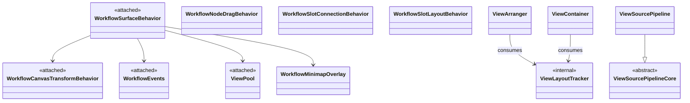

# WinUI Adapter

`VeloxDev.WinUI` closes the Core contract on `DependencyObject` attached properties and adds a layout tracker that keeps measured view bounds in step with the deferred WinUI layout cycle. It has a demo but no headless conformance suite.

## Type topology

> Sources: `Src/Adapters/VeloxDev.WinUI/WorkflowSystem/AttachedBehaviors/WorkflowSurfaceBehavior.cs:19`, `WorkflowCanvasTransformBehavior.cs:10`, `WorkflowEvents.cs:33`, `WorkflowNodeDragBehavior.cs:13`, `WorkflowSlotConnectionBehavior.cs:8`, `WorkflowSlotLayoutBehavior.cs:30`, `ViewPool.cs:18`, `WorkflowMinimapOverlay.cs:24`; `ViewHosting/ViewLayoutTracker.cs:13`; `ViewHosting/ViewArranger.cs:11`.

## Patterns at work

| Pattern | Where | Evidence |
|---|---|---|
| Adapter | attached behaviors | attached DPs bind Core mechanics to WinUI elements (`WorkflowSurfaceBehavior.cs:75`; `ViewPool.cs:21`; `WorkflowEvents.cs:36`) |
| Proxy | `WorkflowEvents` | event sinks forward through the Core relay (`WorkflowEvents.cs:33`) |
| Composite | view layers | the source pipeline composes layers over the Core pipeline |
| Strategy | pool policy | the adapter supplies its own `IViewPoolPolicy` |
| Template Method | pipeline core | `ViewSourcePipeline` derives `ViewSourcePipelineCore` |
| Facade | surface | one attached surface exposes transform, grid, minimap and pool (`WorkflowSurfaceBehavior.cs:19`) |

### Deferred layout needs a tracker

WinUI measures asynchronously, so the adapter maintains an internal `ViewLayoutTracker` (`ViewLayoutTracker.cs:13`) that `ViewArranger` and `ViewContainer` consult when they place views (`ViewArranger.cs:11-14`). Work that must wait for the layout pass is posted at `DispatcherQueuePriority.Low` (for example `WorkflowSurfaceBehavior.cs:916`), which keeps input handling responsive while the visual tree settles.

### Attached property surface

The same three core attachments as the other XAML adapters — surface, events and view pool — are registered as WinUI attached properties, so a host page wires the workflow by naming parts, not by constructing behavior objects (`ViewPool.cs:21`; `WorkflowEvents.cs:36`; `WorkflowSurfaceBehavior.cs:75`).

## Design notes

- Transitions use the shared interpreter with WinUI samplers, including `ProjectionSampler` and `GridLengthSampler`.
- Theme conversion lives in `DynamicTheme/ThemeValueConverters.cs`.
- There is no windowless suite for this adapter; the demo and the benchmark project are the available evidence.
