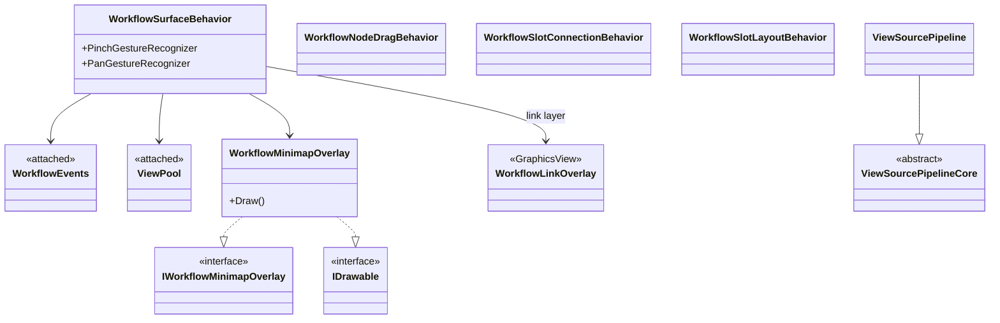

# MAUI Adapter

`VeloxDev.MAUI` adapts the Core contract to .NET MAUI by moving surface gestures into native recognizers and drawing links on a dedicated viewport-sized `GraphicsView`. It has a demo but no headless conformance suite.

## Type topology

> Sources: `Src/Adapters/VeloxDev.MAUI/WorkflowSystem/AttachedBehaviors/WorkflowSurfaceBehavior.cs:9`, `WorkflowEvents.cs:31`, `WorkflowNodeDragBehavior.cs:12`, `WorkflowSlotConnectionBehavior.cs:12`, `WorkflowSlotLayoutBehavior.cs:26`, `ViewPool.cs:16`, `WorkflowMinimapOverlay.cs:27`, `WorkflowLinkOverlay.cs:54`.

## Patterns at work

| Pattern | Where | Evidence |
|---|---|---|
| Adapter | bindable behaviors | `BindableProperty.CreateAttached` binds Core behavior to MAUI elements (`WorkflowEvents.cs:34`; `ViewPool.cs:19`) |
| Proxy | `WorkflowEvents` | event sinks forward through the Core relay (`WorkflowEvents.cs:31`) |
| Composite | link layer | links draw on a separate overlay above the surface (`WorkflowLinkOverlay.cs:54`) |
| Strategy | pool policy | the adapter supplies its own `IViewPoolPolicy` |
| Template Method | pipeline core | `ViewSourcePipeline` derives `ViewSourcePipelineCore` |
| Facade | surface | one behavior hosts pointer, transform, grid, minimap and pool (`WorkflowSurfaceBehavior.cs:9`) |

### Native recognizers drive the surface

The surface behavior creates platform gesture recognizers instead of interpreting raw pointer events itself: a `PanGestureRecognizer` and a `PinchGestureRecognizer` are attached to the host view (`WorkflowSurfaceBehavior.cs:783`, `:872`). Mapping those recognizer updates onto `WorkflowInput` keeps the Core state machine platform-agnostic.

### Links live on their own layer

`WorkflowLinkOverlay : GraphicsView` sizes itself to the viewport and draws link curves through `IDrawable` (`WorkflowLinkOverlay.cs:54`). Separating the link layer avoids putting every link into the node host and matches the Core's layer policy.

## Design notes

- The minimap is a `Grid` that implements both `IDrawable` and `IWorkflowMinimapOverlay`, so it renders through the same `MinimapPipelineCore` as the other adapters (`WorkflowMinimapOverlay.cs:27`).
- Transitions use the shared interpreter with MAUI samplers such as `PointFSampler`, `RectFSampler` and `ShadowSampler`.
- There is no windowless suite for this adapter; the demo and the benchmark project are the available evidence.
