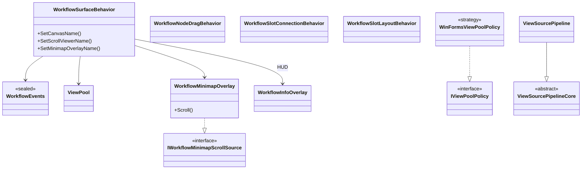

# WinForms Adapter

`VeloxDev.WinForms` is the adapter with the least declarative property system. Instead of attached properties alone, it exposes static named-part setters and keeps per-control state in a `ConditionalWeakTable`, so a WinForms form can be wired entirely from a designer or code-behind.

## Type topology

> Sources: `Src/Adapters/VeloxDev.WinForms/WorkflowSystem/AttachedBehaviors/WorkflowSurfaceBehavior.cs:32`, `WorkflowEvents.cs:31`, `WorkflowNodeDragBehavior.cs:19`, `WorkflowSlotConnectionBehavior.cs:16`, `WorkflowSlotLayoutBehavior.cs:22`, `ViewPool.cs:26`, `WorkflowMinimapOverlay.cs:28`, `WorkflowInfoOverlay.cs:22`; `Platform/IWorkflowMinimapScrollSource.cs:16`; `ViewHosting/ViewSourcePipeline.cs:14`, `:71`.

## Patterns at work

| Pattern | Where | Evidence |
|---|---|---|
| Adapter | static named-part setters | `SetCanvasName`, `SetScrollViewerName`, `SetMinimapOverlayName` bind a form to the shared engine (`WorkflowSurfaceBehavior.cs:151-173`) |
| Registry / state table | per-control state | `ConditionalWeakTable` holds companion state without extending controls (`WorkflowSurfaceBehavior.cs:34`) |
| Strategy | pool policy | `WinFormsViewPoolPolicy : IViewPoolPolicy` (`ViewSourcePipeline.cs:71`) |
| Composite | overlay layers | info overlay and minimap overlay stack above the surface |
| Template Method | pipeline core | `ViewSourcePipeline` derives `ViewSourcePipelineCore` (`ViewSourcePipeline.cs:14`) |
| Facade | surface | one static class owns pointer, transform, grid, minimap and pool wiring (`WorkflowSurfaceBehavior.cs:32`) |

### The minimap is also the scroll source

WinForms merges two contracts that the other adapters keep apart: the minimap implements `IWorkflowMinimapOverlay` and `IWorkflowMinimapScrollSource`, and the surface consumes it as the scroll input host (`WorkflowMinimapOverlay.cs:28`; `WorkflowSurfaceBehavior.cs:556`). Dragging the minimap therefore scrolls the workflow without a separate scrollbar contract.

### Named parts, not visual-tree traversal

The host passes control names to the setters, and the behavior resolves them later. That is why the WinForms adapter can be configured from a designer surface, and why its state is keyed per control rather than per behavior instance (`WorkflowSurfaceBehavior.cs:151-173`, `:34`).

## Design notes

- `EaselAnimationBootstrap` runs as a `[ModuleInitializer]`, so the Easel animation bridge is installed before any form uses transitions (`XamlAnimation/EaselVisualAnimator.cs:329-333`).
- Theme conversion uses System.Drawing converters in `DynamicTheme/ThemeValueConverters.cs`.
- The headless suite in `Src/Test/Headless` covers this adapter.
