# Razor Adapter

`VeloxDev.Razor` is the browser adapter. Where the XAML adapters use attached properties, Razor uses Blazor components: each role is a `ComponentBase` partial class that renders its layer and drives the shared Core engine through `IJSRuntime` and a JavaScript module.

## Type topology

```mermaid
classDiagram
    class ComponentBase {
        <<blazor>>
    }
    class WorkflowSurfaceBehavior {
        <<component>>
    }
    class ViewPool {
        <<component>>
    }
    class WorkflowNodeDragBehavior {
        <<component>>
    }
    class WorkflowSlotConnectionBehavior {
        <<component>>
    }
    class WorkflowSlotLayoutBehavior {
        <<component>>
    }
    class WorkflowMinimapOverlay {
        <<component>>
    }
    class WorkflowGridDecorator {
        <<component>>
    }
    class WorkflowCanvasTransformBehavior {
        <<static>>
    }
    class WorkflowEvents {
        <<static>>
    }
    class WorkflowGeometryScope {
        +AsyncLocal
    }
    class WorkflowPresentation
    class WorkflowRuntimeIds
    class IWorkflowMinimapOverlay {
        <<interface>>
    }
    WorkflowSurfaceBehavior --|> ComponentBase
    ViewPool --|> ComponentBase
    WorkflowNodeDragBehavior --|> ComponentBase
    WorkflowSlotConnectionBehavior --|> ComponentBase
    WorkflowSlotLayoutBehavior --|> ComponentBase
    WorkflowMinimapOverlay --|> ComponentBase
    WorkflowGridDecorator --|> ComponentBase
    WorkflowSurfaceBehavior --> WorkflowCanvasTransformBehavior
    WorkflowSurfaceBehavior --> WorkflowEvents
    WorkflowSurfaceBehavior --> WorkflowGeometryScope
    WorkflowSurfaceBehavior --> WorkflowPresentation
    WorkflowSurfaceBehavior --> WorkflowRuntimeIds
    WorkflowMinimapOverlay ..|> IWorkflowMinimapOverlay
```



> Sources: `Src/Adapters/VeloxDev.Razor/WorkflowSystem/AttachedBehaviors/WorkflowSurfaceBehavior.razor.cs:22`, `ViewPool.razor.cs:21`, `WorkflowNodeDragBehavior.razor.cs:17`, `WorkflowSlotConnectionBehavior.razor.cs:14`, `WorkflowSlotLayoutBehavior.razor.cs:25`, `WorkflowMinimapOverlay.razor.cs:31`, `WorkflowGridDecorator.razor.cs:14`, `WorkflowCanvasTransformBehavior.cs:11`, `WorkflowEvents.cs:22`, `WorkflowGeometryScope.cs:21`, `WorkflowPresentation.cs:15`, `WorkflowRuntimeIds.cs:15`.

## Patterns at work

| Pattern | Where | Evidence |
|---|---|---|
| Adapter | Blazor components | each role is a component over the shared Core engine rather than a reimplementation (`WorkflowSurfaceBehavior.razor.cs:22`) |
| Proxy | static sinks | `WorkflowEvents` forwards component events to host handlers (`WorkflowEvents.cs:22`) |
| Composite | component layers | surface, grid, link and minimap layers compose in the render tree |
| Strategy | JS module | interaction mechanics are delegated to `veloxdev.workflow.js` (`WorkflowSurfaceBehavior.razor.cs:749`) |
| Template Method | component lifecycle | `ComponentBase` fixes lifecycle; the partial class supplies workflow behavior |
| Facade | surface component | one component hosts transform, events, geometry, presentation and ids |

### JS interop carries the browser mechanics

The surface imports the package's JavaScript module during initialization:

```csharp
// Src/Adapters/VeloxDev.Razor/WorkflowSystem/AttachedBehaviors/WorkflowSurfaceBehavior.razor.cs:749
_module = await JS.InvokeAsync<IJSObjectReference>("import", "./_content/VeloxDev.Razor/veloxdev.workflow.js");
```

Pointer capture, wheel handling and canvas drawing live in that module; the C# side keeps the Core state machine and the component model.

### Per-circuit state without statics

`WorkflowGeometryScope` stores geometry in an `AsyncLocal`, so two Blazor circuits cannot see each other's zoom or pan state (`WorkflowGeometryScope.cs:21`). `WorkflowRuntimeIds` supplies stable DOM ids for interop lookups (`WorkflowRuntimeIds.cs:15`), and `WorkflowPresentation` centralizes palette and CSS values (`WorkflowPresentation.cs:15`).

## Design notes

- This adapter has no `ViewSourcePipeline` class; it relies on Core hosting plus the JS module for the browser pipeline.
- Transitions use the shared interpreter with a `StringSampler` for CSS-friendly values.
- The headless suite in `Src/Test/Headless` covers this adapter.
