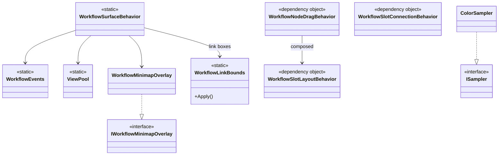

# Jalium Adapter

`VeloxDev.Jalium` mixes two behavior styles: static classes that attach configuration to a host, and instance `DependencyObject` behaviors for drag, connection and layout. Its most distinctive piece is a static link-geometry helper that moves each link view's layout box onto its curve.

## Type topology

> Sources: `Src/Adapters/VeloxDev.Jalium/WorkflowSystem/AttachedBehaviors/WorkflowSurfaceBehavior.cs:40`, `WorkflowEvents.cs:32`, `ViewPool.cs:19`, `WorkflowLinkBounds.cs:29`, `WorkflowNodeDragBehavior.cs:29`, `WorkflowSlotConnectionBehavior.cs:33`, `WorkflowSlotLayoutBehavior.cs:43`, `WorkflowMinimapOverlay.cs:22`; `TransitionSystem/Samplers/ColorSampler.cs:5`.

## Patterns at work

| Pattern | Where | Evidence |
|---|---|---|
| Adapter | static + instance behaviors | static classes attach configuration; instance `DependencyObject` behaviors handle interaction (`WorkflowSurfaceBehavior.cs:40`; `WorkflowNodeDragBehavior.cs:29`) |
| Proxy | `WorkflowEvents` | static event sinks forward to host handlers (`WorkflowEvents.cs:32`) |
| Composite | behavior layers | drag, connection and layout behaviors compose over the surface |
| Strategy | samplers | Jalium samplers implement `ISampler` (`ColorSampler.cs:5`) |
| Template Method | Core pool/pipeline | the adapter closes the shared core classes |
| Facade | surface | the static surface hosts events, pool, minimap and link bounds |

### Link geometry has one owner

Jalium does not ship a separate canvas-transform behavior. Link placement is centralized in the static `WorkflowLinkBounds.Apply`, which fits a view's layout box onto the curve and returns drawing origins (`WorkflowLinkBounds.cs:29`, `:47`). That single owner keeps hit testing and rendering consistent for every link.

### Static versus instance is deliberate

The surface, events and pool are static because they are configuration surfaces resolved by name. Drag, connection and layout are instance `DependencyObject` behaviors because they carry per-element state across pointer gestures (`WorkflowNodeDragBehavior.cs:29`; `WorkflowSlotConnectionBehavior.cs:33`; `WorkflowSlotLayoutBehavior.cs:43`).

## Design notes

- No `DynamicTheme` converter set is present in this adapter; theme value conversion is not part of its surface, while transitions are.
- Transitions use the shared interpreter and Jalium samplers such as `PointSampler`, `RectSampler` and `Transform3DSampler`.
- The headless suite in `Src/Test/Headless` covers this adapter.
