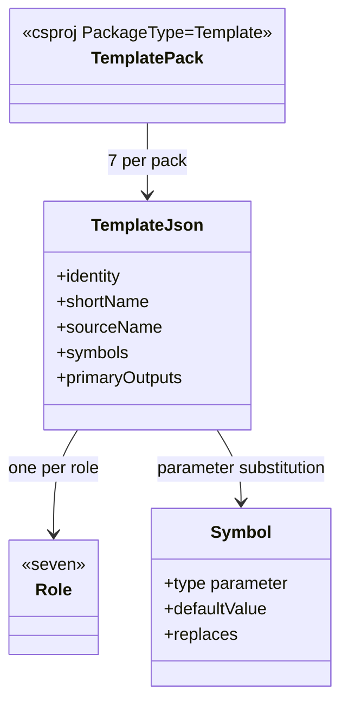

# Workflow Item Templates

`Src/Templates` ships seven `dotnet new` item packs, one per GUI adapter. Each pack exposes the same seven roles, so a consumer can generate a tree, node, slot, link, selector, decorator or minimap item and get code that already targets that platform's adapter.

## Type topology

> Sources: `Src/Templates/VeloxDev.Avalonia.Templates/working/content/workflow-grid-decorator/.template.config/template.json:2-6`, `:14`, `:24-30`, `:44-48`; pack project `Src/Templates/VeloxDev.WPF.Templates/working/VeloxDev.WPF.Templates.csproj`.

## Patterns at work

| Pattern | Where | Evidence |
|---|---|---|
| Template Method (packaging) | shared pack shape | all packs use `PackageType=Template` and `tags.type=item`; 49 manifests share one contract |
| Parameter substitution | `symbols` | each symbol is `"type": "parameter"` with a `replaces` token (`template.json:24-30`) |
| Naming generation | `sourceName` | every template sets `"sourceName": "TemplateClass"`, so `dotnet new` renames files and identifiers (`template.json:15`) |
| Strategy by platform | seven packs | identical role grid with platform-specific markup (`wpf`, `ava`, `winui`, `maui`, `winforms`, `razor`, `jalium`) |

### The 7x7 grid

The short-name grid is complete and exact: prefixes `wpf`, `ava`, `winui`, `maui`, `winforms`, `razor`, `jalium` combined with suffixes `-v-tree`, `-v-node`, `-v-slot`, `-v-link`, `-v-selector`, `-v-decorator`, `-v-minimap` (49 manifests, no missing or mismatched entry). Identities follow the real role names — `VeloxDev.<Platform>.WorkflowTreeView`, `WorkflowNodeView`, `WorkflowSlotView`, `WorkflowLinkView`, `WorkflowTemplateSelector`, `WorkflowGridDecorator`, `WorkflowMinimapOverlay` — not a single `Workflow`-plus-role token.

### What each role emits

| Role | WPF / WinUI / MAUI / WinForms | Avalonia | Jalium | Razor |
|---|---|---|---|---|
| tree, node, slot, link | `.xaml` + `.xaml.cs` | `.axaml` + `.axaml.cs` | `.jalxaml` + `.jalxaml.cs` | `.razor` + `.razor.cs` |
| selector, decorator, minimap | `.cs` | `.cs` | `.cs` | `.razor` + `.razor.cs` |

The role folders are `workflow-tree-view`, `workflow-node-view`, `workflow-slot-view`, `workflow-link-view`, `workflow-template-selector`, `workflow-grid-decorator` and `workflow-minimap-overlay`.

## Design notes

- The WinForms pack is XAML-first even though the adapter is WinForms: markup roles inherit `Easel.Visuals.Controls.UserControl` and reference the `VeloxDev.WinForms` assembly. Its selector default name is `CustomTemplateSelector`, unlike the plain `TemplateSelector` used by the other packs.
- Every manifest is a pure item template: `tags.type` is `item` for all 49, all symbols are `parameter`, and no pack defines `postActions` or a project template.
- There is no automated test for generated output. Evidence is the template manifests plus the `* Trimmed` demos that mirror the generated roles.
