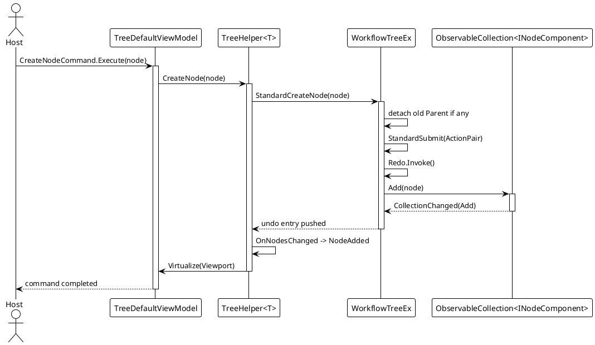

# Workflow graph model

A tree owns nodes, a node owns slots, and a link joins a sender slot to a receiver slot. Construction is not a special subsystem: every component holds a helper, and the helper turns model mutations into one undoable action on the tree.

## Entity construction

`TreeDefaultViewModel` binds its default helper in the constructor, and `InitializeWorkflow` is the single point where that helper attaches to the model.

```csharp
public TreeDefaultViewModel() { InitializeWorkflow(); }
// ...
public void InitializeWorkflow()
{
    Helper.Install(this);
}
```

> Source: `Src/Core/VeloxDev.Core/WorkflowSystem/Templates/ViewModels/TreeDefaultViewModel.cs` lines 28 and 98-101.

`TreeHelper<T>.Install` wires the collection observers, optionally starts the tick channel, and enables the spatial map used by virtualization.

```csharp
public virtual void Install(ITreeComponent tree)
{
    Component = tree as T;
    commands = tree.GetStandardCommands();
    VisibleItems = [];
    tree.Nodes.CollectionChanged += OnNodesChanged;
    tree.Links.CollectionChanged += OnLinksChanged;
```

> Source: `Src/Core/VeloxDev.Core/WorkflowSystem/Templates/Helpers/TreeHelper.cs` lines 172-178.

## Normal flow: create a node



`StandardCreateNode` detaches the node from a previous tree first, then submits the add as a redo/undo pair; the redo is what actually sets `Parent` and appends to `Nodes`.

```csharp
public static void StandardCreateNode(this ITreeComponent component, INodeComponent node)
{
    var oldParent = node.Parent;
    var newParent = component;
    if (node.Parent is not null)
    {
        node.GetHelper().Delete();
    }
    component.StandardSubmit(new ActionPair(
        () => CreateNodeRedo(component, node, newParent),
        () => CreateNodeUndo(component, node, oldParent)));
}
```

> Source: `Src/Core/VeloxDev.Core/WorkflowSystem/StandardEx/WorkflowTreeEx.cs` lines 28-41.

The redo body is the observable mutation that fires `Nodes.CollectionChanged` and therefore `NodeAdded`:

```csharp
private static void CreateNodeRedo(ITreeComponent component, INodeComponent node, ITreeComponent newParent)
{
    node.Parent = newParent;
    component.Nodes.Add(node);
}
```

> Source: `Src/Core/VeloxDev.Core/WorkflowSystem/StandardEx/WorkflowTreeEx.cs` lines 394-398.

## Geometry read and write

Node getters collapse world geometry by the canvas scale, so a caller that needs the stored world value must expand it back. Helpers use this rule when they snapshot or move a node.

```csharp
public static Anchor GetWorldAnchor(this INodeComponent component)
{
    if (component is null) throw new ArgumentNullException(nameof(component));
    return component.Anchor.Expand(component.Parent?.Layout?.Scale);
}
```

> Source: `Src/Core/VeloxDev.Core/WorkflowSystem/StandardEx/WorkflowNodeEx.cs` lines 66-70.

## Error and lifecycle paths

- `CreateNode` is a no-op when the helper has no installed component (`TreeHelper<T>.CreateNode` forwards to `Component?.StandardCreateNode`).
- `Install` without virtualization returns before the spatial map is created; with virtualization it calls `EnableMap` and `InitializeTickable`.
- `Component?.Virtualize(Viewport)` throws `ArgumentNullException` when a non-zero viewport reaches it while the spatial map was never enabled. A default zero viewport returns before that check, which is why a non-virtualizing helper can still forward node-add notifications.
- `SetHelper` uninstalls the old helper, swaps the field, and installs the new one, so a tree never carries two installed helpers.

> Sources: `Src/Core/VeloxDev.Core/WorkflowSystem/Templates/Helpers/TreeHelper.cs` lines 172-193 and 232-238; `Src/Core/VeloxDev.Core/WorkflowSystem/GUI/Virtualization/WorkflowSpatialEx.cs` lines 115-126; `Src/Core/VeloxDev.Core/WorkflowSystem/Templates/ViewModels/TreeDefaultViewModel.cs` lines 103-109.
