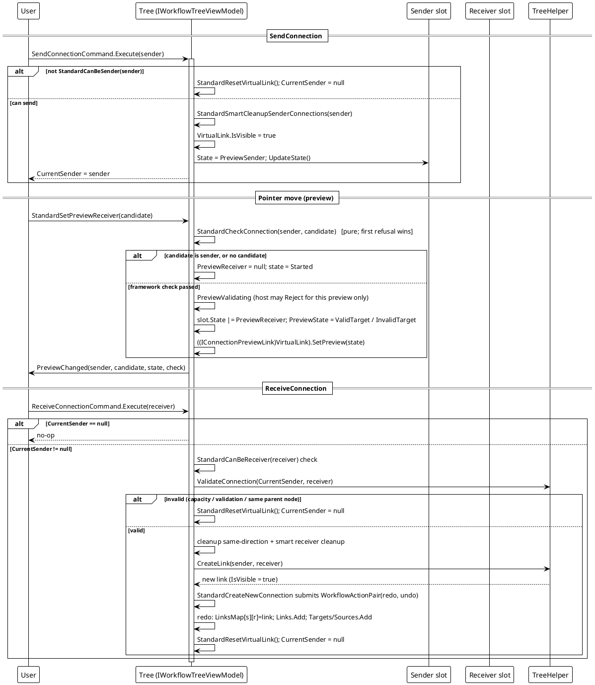

# Workflow System — Connect Flow

`SendConnection` → `SetPreviewReceiver` (zero or more) → `ReceiveConnection` → `CreateLink`.

A connection is built in two phases, with a preview stage in between. `SendConnection(sender)` validates sender capability, cleans up conflicting sender connections, shows the `VirtualLink` and sets `CurrentSender`. While the pointer moves, `SetPreviewReceiver(candidate)` computes the framework check, marks the candidate, and publishes the stage. `ReceiveConnection(receiver)` validates capability + custom `ValidateConnection` + the same-node rule, cleans up same-direction conflicts, then `StandardCreateNewConnection` asks the tree helper for a new link and submits the whole connection as one undoable `WorkflowActionPair`.

The preview and the completion share **one rule set** (`StandardCheckConnection`), so the red/green rubber band and the final acceptance cannot disagree about direction, same-node or the host's `ValidateConnection`. The release-time `IWorkflowTreeEvents.Connecting` veto is deliberately *not* part of the preview: it is a per-attempt decision raised only on release.

The submitted pair is executed immediately (`redo`) and pushed onto the undo stack; `StandardUndo`/`StandardRedo` later run `undo`/`redo` and swap stacks (see the Command-pattern page in the design-patterns dimension). Any failed validation resets the virtual link and leaves no connection.

*Source: `Src/Core/VeloxDev.Core/WorkflowSystem/StandardEx/WorkflowTreeEx.cs` — `StandardSendConnection` lines 105-137, `StandardSetPreviewReceiver` 150-152, `StandardRefreshConnectionPreview` 162-174, `StandardCheckConnection` 195-216, `StandardReceiveConnection` 253-307, `StandardCreateNewConnection` 517-570; `StandardEx/WorkflowSlotEx.cs` — `StandardUpdateState` 93-106. Preview behavior: `Src/Core/VeloxDev.Core.Test/WorkflowSystem/WorkflowConnectionPreviewTests.cs`.*
