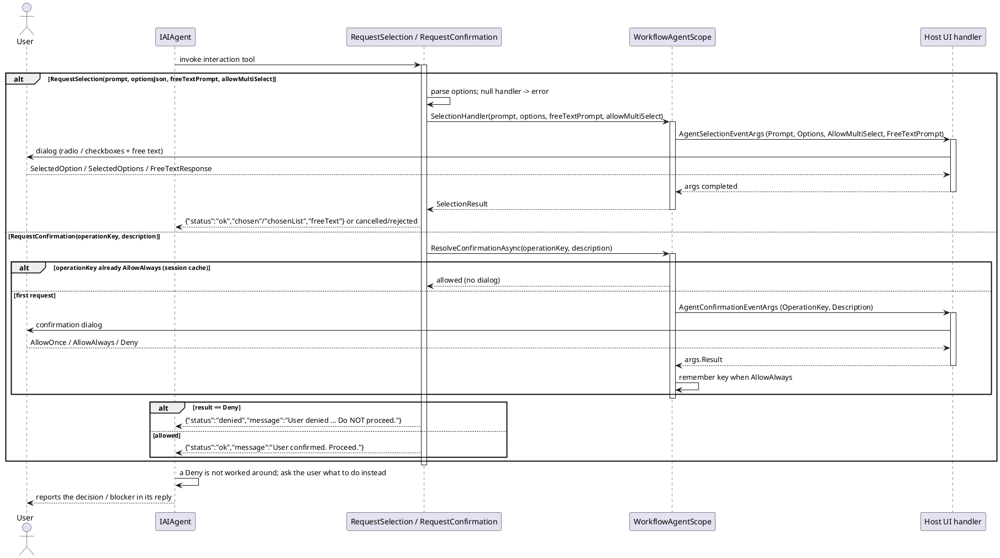

# Data Flow — Interaction & Confirmation

When the agent hits an ambiguous or destructive action it can pause and delegate the decision to the host UI. `RequestSelection` asks the user to pick from options (plus a free-text field); `RequestConfirmation` asks for an allow/deny decision, and `AllowAlways` approvals are remembered per `operationKey` for the rest of the session (`ResolveConfirmationAsync`).

Notes:

- The interaction tools are registered when the matching handler exists; there is no safety-level gate. `RequestSelection` / `RequestConfirmation` are `AgentActionCategory.Interact`, which no permission mode ever puts to the user.
- An `Ask` permission decision (from the mode or a rule) reaches the same confirmation handler, keyed by the **tool name**; a `Deny` decision never asks and returns `DescribePermissionRefusal`, which names the mode or rule.
- `EnterPlanMode` / `ExitPlanMode` ask through the confirmation handler under the keys `mode:plan` / `mode:build` before moving the mode.
- `SelectionResult` (single/multi/free-text) is returned from the host layer to the toolkit (`WorkflowAgentScope.SelectionResult`).

> Source: `WorkflowAgentScope.cs` (`WithSelectionHandler`, `WithConfirmationHandler`, `ResolveConfirmationAsync`, `PermissionPolicy`); `WorkflowAgentToolkit.cs` (`RequestSelection`, `RequestConfirmation`, `EnterPlanMode`, `ExitPlanMode`).
