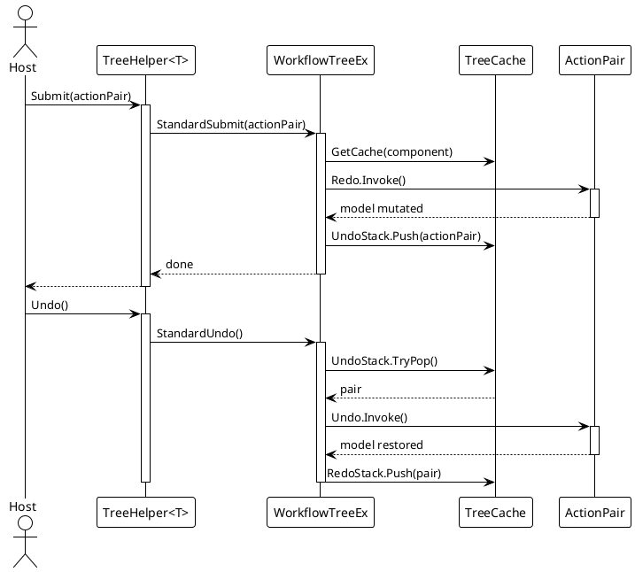

# Workflow editing and history

Every edit — create, delete, connect, lay out — is submitted as an `IActionPair`. The tree owns two stacks, and `Submit`, `Undo` and `Redo` are the only writers.

## The submitted operation

`ActionPair` is a readonly struct holding the two delegates. Nothing else records what changed; the pair is the record.

```csharp
public readonly struct ActionPair(Action redo, Action undo) : IActionPair
{
    public Action Redo { get; } = redo;
    public Action Undo { get; } = undo;
}
```

> Source: `Src/Core/VeloxDev.Core/WorkflowSystem/ActionPair.cs` lines 6-12.

## Normal flow: submit, undo, redo



`StandardSubmit` invokes the redo immediately and only pushes when it returns; an exception is logged and leaves the history untouched. `StandardUndo` and `StandardRedo` move the same pair between the two stacks.

```csharp
public static void StandardSubmit(this ITreeComponent component, IActionPair actionPair)
{
    var cache = GetCache(component);
    try
    {
        actionPair.Redo.Invoke();
        cache.UndoStack.Push(actionPair);
    }
    catch (Exception ex)
    {
        Debug.WriteLine(ex);
    }
}
```

> Source: `Src/Core/VeloxDev.Core/WorkflowSystem/StandardEx/WorkflowTreeEx.cs` lines 352-364.

```csharp
public static void StandardUndo(this ITreeComponent component)
{
    var cache = GetCache(component);
    if (cache.UndoStack.TryPop(out var pair))
    {
        try
        {
            pair.Undo.Invoke();
            cache.RedoStack.Push(pair);
        }
        catch (Exception ex)
        {
            Debug.WriteLine(ex);
        }
    }
}
```

> Source: `Src/Core/VeloxDev.Core/WorkflowSystem/StandardEx/WorkflowTreeEx.cs` lines 367-382.

## Composite edits

Higher-level operations build one pair around several model changes, so a single undo reverses all of them.

- **Create node**: detach old parent, then submit add/remove.
- **Delete node**: collect every link whose endpoint lives in the same tree, then submit one pair whose redo removes links, clears slot parents and removes the node; undo restores all of it (`WorkflowNodeEx.cs` lines 295-359).
- **Delete slot**: collect links on both sides, then submit remove/restore around the slot and its links (`WorkflowSlotEx.cs` lines 132-192).
- **Delete link**: only if the link is still the current mapping for its sender/receiver (`WorkflowLinkEx.cs` lines 17-34).
- **Create slot**: when the node is already attached, route the add through the tree's `Submit`; when detached, add directly without history (`WorkflowNodeEx.cs` lines 37-58).

```csharp
tree.GetHelper().Submit(new ActionPair(
    () => { ExecuteNodeDeletion(tree, component, distinctConnections); },
    () => { RestoreNode(tree, component, oldParent, distinctConnections); }));
```

> Source: `Src/Core/VeloxDev.Core/WorkflowSystem/StandardEx/WorkflowNodeEx.cs` lines 345-356.

## Error and edge paths

- `StandardSubmit`, `StandardUndo` and `StandardRedo` catch every exception from the delegate and write it to `Debug`; the history stacks still move, so a failing redo does not corrupt the stack.
- `StandardDelete` on a detached node or slot calls `WorkflowGuard.Fail` and returns without adding history.
- `StandardCreateSlot` is idempotent by reference: a slot already in `Slots` is ignored, preventing a phantom undo entry.
- `StandardClearHistory` clears both stacks through the per-component `ConditionalWeakTable` cache.

> Sources: `Src/Core/VeloxDev.Core/WorkflowSystem/StandardEx/WorkflowTreeEx.cs` lines 14-25, 334-390, 688-691; `Src/Core/VeloxDev.Core/WorkflowSystem/StandardEx/WorkflowNodeEx.cs` lines 24-58; `Src/Core/VeloxDev.Core/WorkflowSystem/StandardEx/WorkflowSlotEx.cs` lines 132-138.
